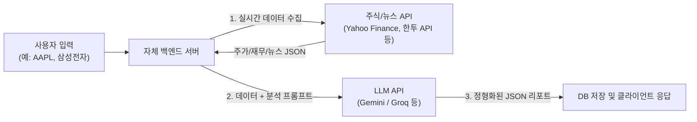
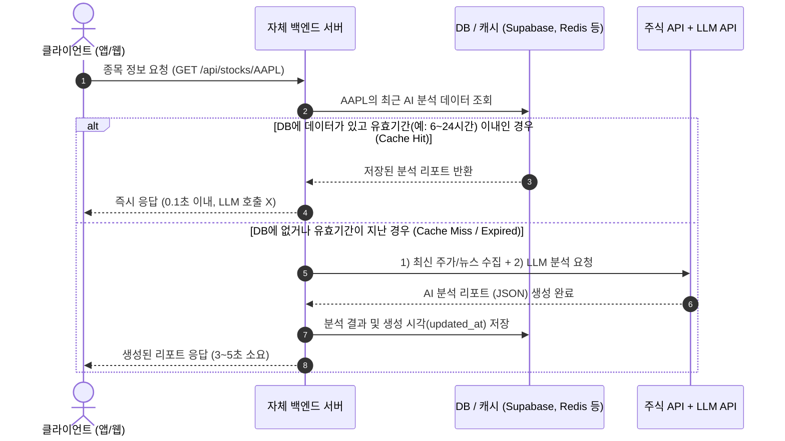
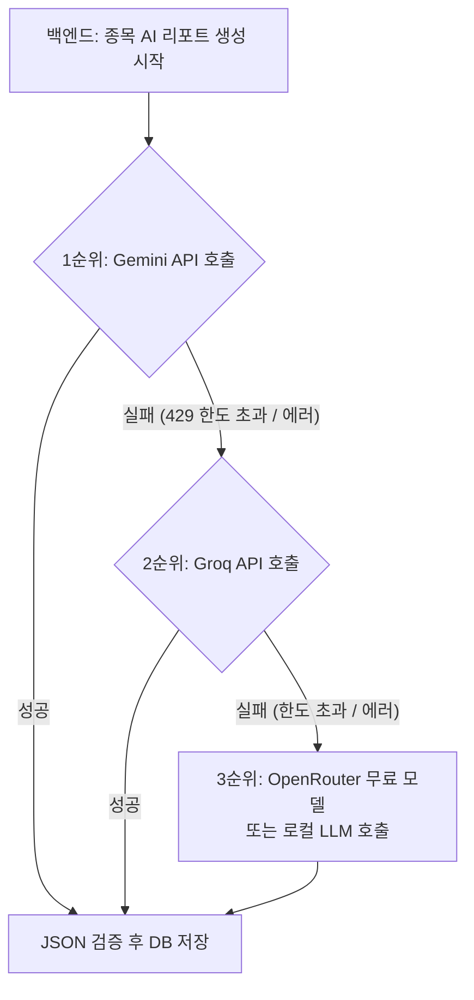

# 웹·모바일 개발자를 위한 AI 개발 입문 및 Stock AI 프로젝트 가이드

기존 웹·모바일 개발 경험을 살려 AI 엔지니어로 영역을 확장하는 방법과, **단일 주식 종목 AI 분석 서비스**를 무료/저비용으로 안정적이게 구축하는 실전 아키텍처를 정리한 문서입니다.

---

## 1. AI 개발자 직무 이해 및 접근 전략

### 1.1 주요 AI 개발자 직군
1. **AI 리서치 사이언티스트:** 새로운 AI 알고리즘·아키텍처 연구 및 논문 발표
2. **ML/DL 엔지니어:** 데이터 전처리, 모델 학습(Training) 및 파인튜닝(Fine-tuning)
3. **AI 서비스 / 애플리케이션 개발자 (AI Engineer):** 파운데이션 모델(LLM API, 오픈소스 모델)을 활용해 실제 사용자용 웹/앱 서비스, RAG, 에이전트를 구축 **(웹/앱 개발자에게 가장 유리한 진입점)**
4. **MLOps 엔지니어:** 모델 배포, 서빙 최적화, 인프라 자동화 구축

### 1.2 웹·모바일 개발자의 Top-Down 학습 로드맵
* **1단계 (LLM API 연동):** OpenAI, Gemini, Groq 등 API 연동, 스트리밍(SSE) UI 구현, **Structured Outputs(JSON 강제 출력)**, Function Calling 익히기
* **2단계 (RAG 및 컨텍스트 주입):** 실시간 외부 데이터나 DB 검색 결과를 프롬프트에 주입해 할루시네이션(거짓말)을 방지하는 파이프라인 구축
* **3단계 (온디바이스 AI - 선택):** 모바일(`CoreML`, `LiteRT`) 또는 웹 브라우저(`Transformers.js`, `WebLLM`)에서 직접 경량 모델 구동
* **4단계 (오픈소스 모델 & 파인튜닝 - 심화):** Python, `FastAPI`, `Hugging Face`, `LoRA` 파인튜닝 및 자체 모델 서빙

---

## 2. 로컬 LLM(Ollama) vs 무료 클라우드 LLM API

PC 사양이 높지 않을 때는 무리해서 로컬 LLM(`Ollama`)을 돌리는 것보다 **OpenAI API 규격과 호환되는 무료 클라우드 API**를 사용하는 것이 속도나 생산성 면에서 훨씬 유리합니다.

| 구분 | 서비스명 | 주요 특징 및 장점 |
| :--- | :--- | :--- |
| **클라우드 1순위** | **Google AI Studio (Gemini)** | 신용카드 없이 무료 API 키 발급, 넉넉한 무료 할당량(일 1,500회 수준), 뛰어난 한국어 성능 및 Google 검색 그라운딩 지원 |
| **클라우드 2순위** | **Groq (그록)** | `Llama 3.3`, `Qwen 2.5`, `Gemma 2` 등 오픈소스 모델을 초고속(초당 수백 토큰)으로 무료 티어 제공 |
| **클라우드 3순위** | **GitHub Models / OpenRouter** | GitHub 계정이나 `:free` 태그 모델을 통해 다양한 최신 모델을 무료로 호출 가능 |
| **로컬 (참고)** | **Ollama** | 비용 완전 무료 및 오프라인 구동 가능. 단, PC 사양(RAM/GPU)이 낮으면 속도가 매우 느림 |

> [!TIP]
> 위 모든 서비스(Gemini, Groq, OpenRouter, Ollama)는 **OpenAI SDK 호환 엔드포인트(`baseURL`)**를 제공합니다. 따라서 코드는 그대로 두고 설정값만 바꿔서 언제든 모델을 교체할 수 있습니다.

---

## 3. Stock 프로젝트: 단일 종목 AI 분석 기능 설계

### 3.1 핵심 원칙: 실시간 데이터 수집 + AI 요약 결합
LLM에게 종목명만 던져주면 과거 학습 데이터에 의존해 틀린 주가를 말합니다. 반드시 **서버가 먼저 실시간 주가·재무·뉴스 데이터를 가져온 뒤, 이를 프롬프트에 함께 넣어 분석을 요청**해야 합니다.



---

## 4. 서버 캐싱(Cache-Aside) 아키텍처

사용자가 종목을 조회할 때마다 LLM API를 호출하면 **속도 저하(3~10초), 무료 한도 초과, 비용 낭비**가 발생합니다. 따라서 서버에서 결과를 DB에 저장해 두고 재사용하는 구조가 필수입니다.



### 데이터 성격에 따른 분리 전략
* **실시간 데이터 (현재가, 등락률, 차트):** LLM을 거치지 않고 주식 API에서 바로 가져와 제공 (1~5분 단기 캐싱)
* **AI 분석 리포트 (기업 개요, 실적 요약, 뉴스 호재/악재, 투자 포인트):** DB에 저장 후 **6시간~24시간 주기(TTL)**로 갱신하여 제공
* **인기 종목 사전 갱신 (선택):** 시가총액 상위 종목이나 인기 종목 20~50개는 매일 장 시작 전 크론잡(Cron Job)으로 미리 분석해 DB에 넣어두면 첫 조회 사용자도 대기 시간 없이 즉시 확인 가능

---

## 5. 다중 LLM 라우팅 및 폴백(Fallback) 구현

Gemini, Groq, OpenRouter(또는 로컬 LLM)를 배열로 묶어 **1순위 모델이 무료 한도 초과(`429 에러`)나 장애로 실패할 경우 자동으로 다음 모델이 처리**하도록 구성합니다.

### 5.1 폴백(Fallback) 흐름도


### 5.2 통합 호출 코드 예시 (TypeScript / Node.js)

```typescript
import OpenAI from 'openai';

// OpenAI 호환 규격을 지원하는 여러 LLM 프로바이더 목록
const providers = [
  {
    name: 'Gemini',
    baseURL: 'https://generativelanguage.googleapis.com/v1beta/openai/',
    apiKey: process.env.GEMINI_API_KEY,
    model: 'gemini-2.0-flash',
  },
  {
    name: 'Groq',
    baseURL: 'https://api.groq.com/openai/v1',
    apiKey: process.env.GROQ_API_KEY,
    model: 'llama-3.3-70b-versatile',
  },
  {
    name: 'OpenRouter',
    baseURL: 'https://openrouter.ai/api/v1',
    apiKey: process.env.OPENROUTER_API_KEY,
    model: 'meta-llama/llama-3.3-70b-instruct:free',
  },
];

export interface StockAIReport {
  ticker: string;
  summary: string;
  valuation: string;
  pros: string[];
  cons: string[];
  sentimentScore: number; // 0 ~ 100
}

export async function generateStockReportWithFallback(
  ticker: string,
  stockDataContext: string
): Promise<{ report: StockAIReport; providerUsed: string }> {
  const systemPrompt = `너는 전문 주식 애널리스트야. 제공된 실시간 주가/재무/뉴스 데이터만을 바탕으로 분석하고, 반드시 아래 JSON 스키마 형식으로만 응답해.
{
  "ticker": "종목코드",
  "summary": "한 줄 핵심 요약",
  "valuation": "현재 가치평가 상태 요약",
  "pros": ["긍정적 요인 1", "긍정적 요인 2"],
  "cons": ["리스크 요인 1", "리스크 요인 2"],
  "sentimentScore": 75
}`;

  for (const provider of providers) {
    try {
      const client = new OpenAI({
        baseURL: provider.baseURL,
        apiKey: provider.apiKey,
      });

      const response = await client.chat.completions.create({
        model: provider.model,
        messages: [
          { role: 'system', content: systemPrompt },
          { role: 'user', content: `[종목: ${ticker}]\n${stockDataContext}` },
        ],
        response_format: { type: 'json_object' },
        temperature: 0.2, // 일관된 분석 결과를 위해 낮은 temperature 설정
      });

      const content = response.choices[0].message.content;
      if (!content) throw new Error('빈 응답 반환됨');

      const parsedReport: StockAIReport = JSON.parse(content);
      return { report: parsedReport, providerUsed: provider.name };
    } catch (error) {
      console.warn(`[Fallback] ${provider.name} 호출 실패, 다음 모델로 전환합니다.`, error);
    }
  }

  throw new Error('모든 LLM 프로바이더 호출에 실패했습니다.');
}
```

> [!IMPORTANT]
> **다중 LLM 사용 시 핵심 체크포인트**
> 어떤 LLM이 응답하더라도 프론트엔드(앱/웹) UI가 깨지지 않도록, 시스템 프롬프트에 **JSON 스키마 예시를 명확히 지정**하고 `response_format: { type: 'json_object' }` 옵션을 사용해 출력 포맷을 엄격하게 통일해야 합니다.
