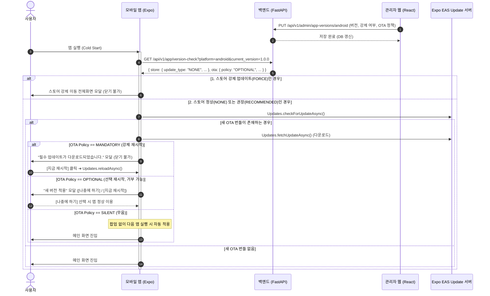

# 모바일 앱 업데이트 관리 기획 및 시나리오별 기술 명세서

본 문서는 **React Native (Expo) 모바일 앱의 업데이트 관리 체계**를 정의합니다.  
스토어 배포(Full Binary), 무선 코드 배포(OTA), 그리고 **관리자 웹(`admin_web`)에서의 실시간 제어(강제 업데이트 여부, OTA 필수/거부 제어, 점검 모드)**까지 포괄합니다.  
AI 코딩 도구(Claude Code 등)가 기획적 고민 없이 본 문서의 규격과 설계에 따라 즉시 구현할 수 있도록 **DB 모델, API 명세, 관리자 UI 스펙, 클라이언트 로직**을 상세히 제공합니다.

---

## 0. 목표 및 기본 원칙

1. **무중단 신속 배포**: 네이티브 수정이 없는 일반적인 UI/UX 개선 및 버그 수정은 앱스토어 심사 없이 **EAS Update (OTA)**를 통해 수분 내 사용자에게 전달한다.
2. **크래시 방지 (Regression 방지)**: 네이티브 바이너리와 맞지 않는 JS 번들이 배포되어 앱이 충돌하는 문제를 **`runtimeVersion: { policy: 'fingerprint' }`**로 원천 차단한다.
3. **관리자 실시간 통제 (Admin Control)**:
   - **스토어 업데이트**: 최소 지원 버전과 강제 업데이트 플래그(`force_update_enabled`)를 관리자에서 토글하여 즉시 구버전을 차단/유도할 수 있다.
   - **OTA 업데이트**: 새 JS 번들이 배포되었을 때 **무음(Silent)**, **권장(Optional, 거부/연기 가능)**, **필수(Mandatory, 즉시 재시작 강제)** 정책을 관리자가 선택할 수 있다.
4. **UX 피로도 최소화**: 일상 업데이트는 백그라운드 무음 다운로드 후 다음 앱 실행 시 적용하며, 긴급 공지나 필수 업데이트 시에만 팝업을 노출한다.

---

## 1. 업데이트 판별 기준 및 시나리오 분류

```
                                [코드/기능 변경 발생]
                                         │
                   네이티브 종속성/설정이 변경되었는가?
                   (새 라이브러리, SDK 버전, 권한, 네이티브 파일 등)
                       ├── YES ──► [시나리오 3/4] 스토어 심사 배포 (Full Binary)
                       └── NO  ──► [시나리오 1/2] EAS Update (OTA 번들 발행)
                                         │
                                         ▼
                [관리자 웹(admin_web)에서 업데이트 정책 지정]
        ┌────────────────────────────────┬────────────────────────────────┐
        │                                │                                │
[OTA 정책: SILENT]             [OTA 정책: OPTIONAL]             [OTA 정책: MANDATORY]
(무음 백그라운드)             (사용자 거부/연기 가능)          (강제/필수 즉시 재시작)
• 백그라운드 다운로드 완료      • 다운로드 완료 후 안내 팝업     • 다운로드 완료 후 차단 모달
• 다음 앱 재실행 시 적용       • [나중에 하기] vs [지금 재시작]  • 닫기 불가, [지금 재시작]만 노출
• 사용자 방해 없음              • 거부 시 앱 계속 이용 가능      • 재시작 전까지 앱 진입 불가
```

### 시나리오 매트릭스

| 구분 | 적용 상황 | 배포 수단 | 관리자 설정값 | 사용자 경험 (UX) |
|---|---|---|---|---|
| **시나리오 1: OTA 무음 적용** | 단순 오탈자, 스타일 보정, 일반 로직 패치 | `eas update` | `ota_policy: SILENT` | 팝업 없음. 다음 앱 실행 시 자동 적용 |
| **시나리오 2: OTA 권장 적용 (거부 가능)** | 중요 UI 개선, 신규 기능 배포, 일반 버그 수정 | `eas update` | `ota_policy: OPTIONAL` | "새 버전이 준비되었습니다"<br>`[나중에 하기]` / `[지금 재시작]` (거부 허용) |
| **시나리오 3: OTA 필수 적용 (강제 재시작)** | 긴급 보안 패치, 주문/결제 치명적 결함 픽스 | `eas update` | `ota_policy: MANDATORY` | "필수 업데이트가 적용되었습니다"<br>닫기 불가, `[지금 재시작]` 필수 |
| **시나리오 4: 스토어 권장 배포** | Expo SDK 업그레이드, 새 네이티브 기능 추가 | App Store / Google Play | `force_update_enabled: false`<br>`latest_version` 상향 | "새 버전이 출시되었습니다"<br>`[나중에 하기]` / `[스토어 이동]` |
| **시나리오 5: 스토어 강제 배포** | 백엔드 Breaking Change, 네이티브 구버전 지원 중단 | App Store / Google Play | `force_update_enabled: true` 또는<br>`min_supported_version` 상향 | "필수 업데이트가 필요합니다"<br>닫기 불가, `[스토어에서 업데이트]`만 노출 |

---

## 2. 전체 시스템 아키텍처 및 라이프사이클



---

## 3. 백엔드(FastAPI) 명세

### 3-1. DB 모델 (`app_version_configs`)

PostgreSQL 테이블 정의 (`backend/shared/models.py`):

| 컬럼명 | 타입 | Nullable | 설명 |
|---|---|---|---|
| `id` | Integer | PK | 고유 식별자 |
| `platform` | String(20) | Not Null | `android` 또는 `ios` (UNIQUE) |
| `latest_version` | String(20) | Not Null | 최신 스토어 버전 (예: "1.0.1") |
| `min_supported_version` | String(20) | Not Null | 최소 지원 버전 (예: "1.0.0") |
| `force_update_enabled` | Boolean | Not Null | 스토어 강제 업데이트 즉시 활성화 여부 (Default: false) |
| `store_url` | String(255) | Not Null | 구글 플레이스토어 / 앱스토어 링크 |
| `store_title` | String(100) | Not Null | 스토어 업데이트 모달 제목 |
| `store_message` | Text | Not Null | 스토어 업데이트 안내 문구 |
| `ota_policy` | String(20) | Not Null | `SILENT` / `OPTIONAL` / `MANDATORY` (Default: `SILENT`) |
| `ota_title` | String(100) | Nullable | OTA 팝업 제목 |
| `ota_message` | Text | Nullable | OTA 팝업 안내 문구 |
| `is_maintenance` | Boolean | Not Null | 긴급 서버 점검 모드 여부 (Default: false) |
| `maintenance_message` | Text | Nullable | 점검 중 안내 문구 |
| `updated_at` | DateTime | Not Null | 최근 수정 일시 |
| `updated_by` | String(100) | Nullable | 수정한 관리자 계정 |

### 3-2. 클라이언트용 API: `GET /api/v1/app/version-check`
- **인증**: 필요 없음 (Public)
- **Query Params**:
  - `platform`: `android` | `ios`
  - `current_version`: 클라이언트 앱 버전 (예: `1.0.0`)
- **응답 스키마 (`VersionCheckResponse`)**:
```json
{
  "maintenance": {
    "is_active": false,
    "message": null
  },
  "store": {
    "update_type": "FORCE", 
    "latest_version": "1.1.0",
    "min_supported_version": "1.0.0",
    "title": "업데이트 안내",
    "message": "안정적인 서비스 이용을 위해 최신 버전 업데이트가 필요합니다.",
    "store_url": "https://play.google.com/store/apps/details?id=com.stockapp"
  },
  "ota": {
    "policy": "OPTIONAL",
    "title": "새 기능 업데이트",
    "message": "새로운 기능과 버그 수정이 다운로드되었습니다. 지금 재시작하시겠습니까?"
  }
}
```
*판별 로직*:
1. `is_maintenance == True`이면 최우선으로 `maintenance.is_active = True`.
2. `force_update_enabled == True` 이거나 `current_version < min_supported_version`이면 `store.update_type = "FORCE"`.
3. 그렇지 않고 `current_version < latest_version`이면 `store.update_type = "RECOMMENDED"`.
4. 그 외에는 `store.update_type = "NONE"`.

### 3-3. 관리자용 API: `admin/app-versions`
- **인증**: 관리자 JWT 토큰 필수
- **`GET /api/v1/admin/app-versions`**: Android, iOS 전체 설정 목록 반환
- **`PUT /api/v1/admin/app-versions/{platform}`**:
  - Request Body:
    ```json
    {
      "latest_version": "1.0.1",
      "min_supported_version": "1.0.0",
      "force_update_enabled": false,
      "store_url": "https://play.google.com/store/apps/details?id=com.stockapp",
      "store_title": "최신 버전 출시 안내",
      "store_message": "더 좋아진 StockApp을 만나보세요.",
      "ota_policy": "OPTIONAL",
      "ota_title": "빠른 패치 적용",
      "ota_message": "최신 수정 사항이 다운로드되었습니다. 지금 재시작할까요?",
      "is_maintenance": false,
      "maintenance_message": ""
    }
    ```

---

## 4. 관리자 웹 (`admin_web`) UI 명세

관리자가 직관적으로 모바일 앱의 업데이트 정책을 통제할 수 있는 전용 관리 화면을 제공합니다.

### 4-1. 메뉴 및 라우팅
- **사이드바 메뉴**: `NAV_GROUPS`에 `앱 관리` 그룹 추가 ➔ `📱 앱 버전 & 업데이트` (`/app/versions`)
- **라우트**: `admin_web/src/pages/AppVersionsPage.tsx`

### 4-2. 화면 레이아웃 구성
1. **플랫폼 탭 전환기**:
   - `[ 🤖 Android ]` / `[ 🍎 iOS ]` 탭
2. **상단 긴급 조치 바 (Quick Actions)**:
   - **서버 점검 모드 스위치**: 켜지면 앱 진입 시 "점검 중" 팝업 노출.
   - **스토어 강제 업데이트 스위치**: 버전 비교와 무관하게 모든 구버전 사용자에게 스토어 이동 강제.
3. **스토어 버전 설정 카드**:
   - `최신 버전 (latest_version)`: 입력 필드 (예: `1.0.1`)
   - `최소 지원 버전 (min_supported_version)`: 입력 필드 (예: `1.0.0` 미만은 자동 차단)
   - `스토어 URL (store_url)`: 스토어 링크
   - `업데이트 안내 문구 (store_message)`: 텍스트에어리어
4. **OTA (EAS Update) 정책 설정 카드**:
   - 라디오 버튼 3개:
     - 🟢 **무음 적용 (SILENT)**: 백그라운드 다운로드 후 다음 앱 실행 시 자동 적용 (알림 없음)
     - 🟡 **권장 재시작 (OPTIONAL, 거부 가능)**: 다운로드 후 모달 노출, [나중에 하기] / [지금 재시작] 제공
     - 🔴 **강제 즉시 재시작 (MANDATORY, 거부 불가)**: 다운로드 후 즉시 재시작 유도, 닫기 버튼 비활성화
   - `OTA 안내 문구 (ota_message)`: 텍스트에어리어
5. **저장 버튼 및 상태 피드백**:
   - 우측 하단 `저장하기` 버튼 ➔ API 호출 성공 시 상단 토스터 알림 표시.

---

## 5. 모바일 클라이언트(Expo) 상세 스펙

### 5-1. 필수 라이브러리 및 설정
- **설치**: `expo-updates`, `expo-application`
- **`app.config.js`**:
  ```javascript
  updates: {
    url: `https://u.expo.dev/${EAS_PROJECT_ID}`,
    checkAutomatically: 'ON_LOAD_AND_BATTERY_CHARGING',
    fallbackToCacheTimeout: 0,
  },
  runtimeVersion: {
    policy: 'fingerprint',
  },
  ```
- **`eas.json`**: 각 빌드 프로필에 `channel` 명시 (`development`, `preview`, `production`).

### 5-2. 업데이트 모달 UI 컴포넌트 (`UpdateModal.tsx`)

| 모달 타입 | 헤더 | 본문 | 버튼 구성 | 취소/뒤로가기 차단 |
|---|---|---|---|---|
| **서버 점검 (MAINTENANCE)** | 서비스 점검 안내 | 점검 시간 및 사유 | `[앱 종료]` 또는 없음 | **차단** |
| **스토어 강제 (STORE_FORCE)** | 필수 업데이트 안내 | `store_message` | `[스토어에서 업데이트]` | **차단** (Android Back 차단) |
| **스토어 권장 (STORE_RECOMMENDED)** | 새 버전 출시 안내 | `store_message` | `[나중에 하기]`, `[업데이트]` | **허용** (닫으면 하루 동안 숨김) |
| **OTA 강제 재시작 (OTA_MANDATORY)** | 필수 패치 적용 | `ota_message` | `[지금 재시작]` | **차단** (터치 시 `Updates.reloadAsync()`) |
| **OTA 선택 재시작 (OTA_OPTIONAL)** | 새 버전 다운로드 완료 | `ota_message` | `[나중에 하기]`, `[지금 재시작]` | **허용** (나중에 하기를 누르면 다음 앱 실행 시 반영) |

---

## 6. 구현 체크리스트 (클로드코드 구현 범위)

- [ ] **백엔드 (`backend/`)**:
  - [ ] `app_version_configs` SQLAlchemy 모델 생성 및 마이그레이션 (기본값 시드 포함)
  - [ ] `GET /api/v1/app/version-check` 공용 API 구현
  - [ ] `GET /api/v1/admin/app-versions` 및 `PUT /api/v1/admin/app-versions/{platform}` 관리자 API 구현
- [ ] **관리자 웹 (`admin_web/`)**:
  - [ ] `Sidebar.tsx`에 `앱 관리 > 앱 버전 & 업데이트` 메뉴 추가
  - [ ] `AppVersionsPage.tsx` 구현 (Android/iOS 탭, 스토어 설정, OTA 정책 3단계 라디오, 점검 모드 토글)
  - [ ] `api/appVersions.ts` API 클라이언트 연동
- [ ] **모바일 (`mobile/`)**:
  - [ ] `expo-updates`, `expo-application` 설치 및 `app.config.js`, `eas.json` 채널 설정
  - [ ] `src/services/versionService.ts` (버전 체크 API 호출)
  - [ ] `src/services/otaService.ts` (EAS Update 확인 및 다운로드)
  - [ ] `src/components/common/UpdateModal.tsx` (점검/스토어강제/스토어권장/OTA강제/OTA선택 모달)
  - [ ] `app/_layout.tsx`에 업데이트 제어 라이프사이클 탑재
