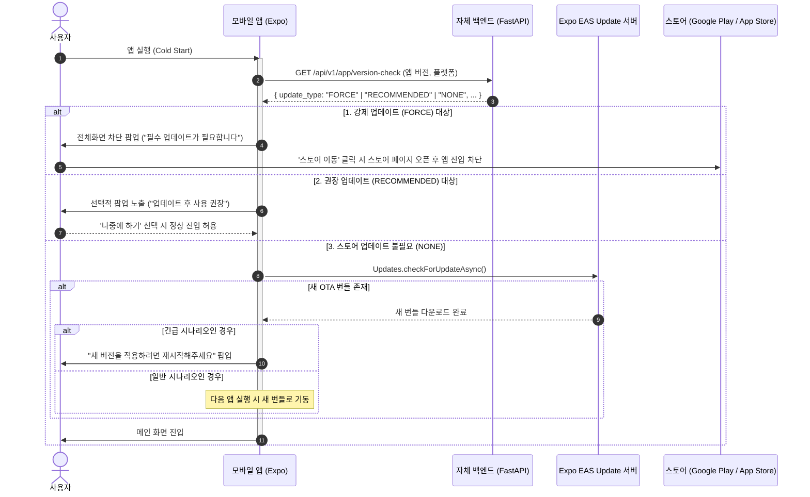

# 모바일 앱 업데이트 관리 기획 및 시나리오별 기술 명세서

본 문서는 **React Native (Expo) 모바일 앱의 업데이트 관리 체계**를 정의합니다.  
AI 코딩 도구(Claude Code 등)가 기획적 고민 없이 본 문서의 규격과 설계에 따라 즉시 구현할 수 있도록 **시나리오별 판별 기준, 아키텍처, 백엔드 API 명세, 클라이언트 구현 스펙, 배포 커맨드**를 상세히 제공합니다.

---

## 0. 목표 및 기본 원칙

1. **무중단 신속 배포**: 네이티브 수정이 없는 일반적인 UI/UX 개선 및 버그 수정은 앱스토어 심사 없이 **EAS Update (OTA)**를 통해 수분 내 사용자에게 전달한다.
2. **크래시 방지 (Regression 방지)**: 네이티브 바이너리와 맞지 않는 JS 번들이 배포되어 앱이 충돌하는 문제를 **`runtimeVersion: { policy: 'fingerprint' }`**로 원천 차단한다.
3. **강제 업데이트 안전망**: 백엔드 API 계약(Contract) 파괴, 보안 패치 등 하위 호환이 불가능한 변경 시 구버전 클라이언트를 안전하게 차단하고 스토어로 유도하는 **서버 제어 강제 업데이트(Force Update)** 체계를 갖춘다.
4. **UX 피로도 최소화**: 일상 업데이트는 백그라운드 무음 다운로드 후 다음 앱 실행 시 적용하며, 긴급 공지나 필수 업데이트 시에만 팝업을 노출한다.

---

## 1. 업데이트 판별 기준 및 시나리오 분류

수정 사항이 발생했을 때 개발팀과 AI가 따라야 하는 분기 기준입니다.

```
                  [코드/기능 변경 발생]
                           │
             네이티브 종속성/설정이 변경되었는가?
             (새 라이브러리, SDK 버전, 권한, 네이티브 파일 등)
                 ├── YES ──► [시나리오 3] 스토어 심사 배포 (Full Binary)
                 └── NO
                      │
             백엔드 API 호환성이 깨졌는가? (Breaking Change)
                 ├── YES ──► [시나리오 4] 백엔드 최소버전 상향 + 스토어 강제 업데이트
                 └── NO
                      │
             사용자에게 즉각 재시작/안내가 필요한 중대 버그인가?
                 ├── YES ──► [시나리오 2] EAS Update (인앱 알림 유도)
                 └── NO  ──► [시나리오 1] EAS Update (무음 백그라운드 적용)
```

### 시나리오 요약 매트릭스

| 시나리오 | 상황 예시 | 배포 채널 | 사용자 인지 방식 | 필수 조치 |
|---|---|---|---|---|
| **시나리오 1: 일반 OTA (무음)** | 오탈자, 단순 스타일/디자인 수정, 데이터 표기 오류 수정 | EAS Update | **인지 못 함 (Silent)**<br>다음 앱 실행 시 자동 반영 | JS 빌드 후 `eas update` 발행 |
| **시나리오 2: 중요 OTA (알림)** | 주문/결제 UI 오류 픽스, 긴급 기능 수정 | EAS Update | **인앱 알림 모달**<br>"새 업데이트가 있습니다. 지금 재시작할까요?" | `Updates.fetchUpdateAsync()` 후 재시작 모달 표시 |
| **시나리오 3: 스토어 정기 배포** | Expo SDK 업그레이드, 새 네이티브 패키지 추가 (예: 블루투스, 위젯) | App Store / Google Play | **스토어 업데이트 안내**<br>(선택적 업데이트 권장) | `app.config.js` 버전 업 + `eas build` & 스토어 제출 |
| **시나리오 4: 스토어 강제 배포** | DB/API 스키마 완전 개편, 보안 취약점 조치, 폐기된 API | App Store / Google Play | **차단형 강제 팝업**<br>닫기 불가, '업데이트' 클릭 시 스토어 이동 | 서버 `min_supported_version` 상향 + 스토어 배포 |

---

## 2. 전체 시스템 아키텍처 및 라이프사이클



---

## 3. 백엔드(FastAPI) 명세: 버전 관리 API

클라이언트가 스토어 업데이트(강제/권장)를 판단하기 위해 앱 기동 시 가장 먼저 호출하는 엔드포인트입니다.

### 3-1. 엔드포인트 정의
- **URL**: `GET /api/v1/app/version-check`
- **인증**: 필요 없음 (Public)
- **요청 쿼리 파라미터**:
  - `platform` (string, 필수): `android` 또는 `ios`
  - `current_version` (string, 필수): 현재 클라이언트 버전 (예: `1.0.0`)
  - `build_number` (int, 선택): 번들 빌드 번호

### 3-2. 응답 스키마 (`VersionCheckResponse`)
```json
{
  "update_type": "FORCE", 
  "latest_version": "1.2.0",
  "min_supported_version": "1.1.0",
  "title": "업데이트 안내",
  "message": "안정적인 서비스 이용을 위해 필수 업데이트가 필요합니다.",
  "store_url": "https://play.google.com/store/apps/details?id=com.stockapp",
  "notice_url": null
}
```

- `update_type` 열거형:
  - `NONE`: 최신 또는 지원 가능한 정상 버전 (스토어 팝업 띄우지 않음)
  - `RECOMMENDED`: 최신 버전이 나왔으나 현재 버전도 이용 가능 (닫기 가능한 권장 팝업)
  - `FORCE`: 최소 지원 버전 미만 (닫기 불가능한 강제 업데이트 팝업)

### 3-3. 서버 버전 비교 비즈니스 로직
- SemVer 비교 규칙 적용:
  1. `current_version < min_supported_version` ➔ `FORCE`
  2. `min_supported_version <= current_version < latest_version` ➔ `RECOMMENDED`
  3. `current_version >= latest_version` ➔ `NONE`
- 버전 및 스토어 URL 설정은 환경변수 또는 DB 테이블(`app_configs`)을 통해 무중단으로 변경 가능하도록 설계한다.

---

## 4. 모바일 클라이언트(Expo) 상세 스펙

### 4-1. 필수 라이브러리 및 설정
- **의존성**: `expo-updates`, `expo-constants`, `expo-application`
- **`mobile/app.config.js` 설정 스펙**:
  ```javascript
  updates: {
    url: `https://u.expo.dev/${EAS_PROJECT_ID}`,
    checkAutomatically: 'ON_LOAD_AND_BATTERY_CHARGING',
    fallbackToCacheTimeout: 0,
  },
  runtimeVersion: {
    policy: 'fingerprint', // 네이티브 해시 기반 자동 매칭
  },
  ```
- **`mobile/eas.json` 설정 스펙**:
  각 빌드 프로필에 채널(`channel`)을 명시하여 브랜치 업데이트가 알맞은 빌드 바이너리로 전달되도록 바인딩합니다.
  ```json
  {
    "build": {
      "development": {
        "channel": "development"
      },
      "preview": {
        "channel": "preview"
      },
      "production": {
        "channel": "production"
      }
    }
  }
  ```

### 4-2. 클라이언트 업데이트 상태 머신
앱 초기화 흐름(`mobile/src/providers/UpdateProvider.tsx` 또는 `app/_layout.tsx`):

1. **Phase 1: 서버 스토어 버전 검증**
   - 백엔드 `GET /api/v1/app/version-check` 호출.
   - 응답이 `FORCE`일 경우: 화면에 전체화면 차단 모달을 띄우고 메인 라우팅 중단. '업데이트하기' 누르면 `Linking.openURL(store_url)` 실행.
   - 응답이 `RECOMMENDED`일 경우: 팝업 띄우되 '나중에 하기' 누르면 로컬 저장소에 하루 동안 보지 않기 기록 후 Phase 2로 진행.
   - 응답이 `NONE`일 경우: Phase 2로 진행.

2. **Phase 2: EAS Update (OTA) 검증**
   - `__DEV__` 환경이면 OTA 스킵.
   - 프로덕션/릴리즈 빌드인 경우 `Updates.checkForUpdateAsync()` 수행.
   - 새 번들이 있으면 `Updates.fetchUpdateAsync()`로 백그라운드 다운로드.
   - 다운로드 완료 시:
     - 기본 정책: 로그 기록 후 앱 종료 시 자동 교체 대기.
     - (옵션) 플래그에 따라 `Updates.reloadAsync()`를 호출할 수 있는 안내 바(토스트) 표시.

---

## 5. 배포 및 운영 시나리오 가이드 (Runbook)

### 5-1. OTA 핫픽스 배포 (JS/CSS 수정 시)
코드 수정 후 스토어 심사 없이 즉시 배포할 때 사용합니다.
```bash
cd mobile

# 1. 린트 및 타입 체크
npm run lint
npm run typecheck

# 2. 운영 채널(production)로 OTA 번들 발행
eas update --branch production --message "수정: 차트 터치 이벤트 지연 현상 픽스"

# (필요시 프리뷰 채널 배포)
eas update --branch preview --message "테스트: 새 스크리너 필터 UI"
```

### 5-2. 네이티브 변경 배포 (스토어 심사)
새로운 네이티브 라이브러리를 추가하거나 네이티브 권한을 수정한 경우:
```bash
cd mobile

# 1. app.config.js 내 version 올림 (예: 1.0.0 -> 1.1.0)
# 2. 프로덕션 빌드 (AAB / IPA 생성)
npm run build:android:prod
npm run build:ios:prod

# 3. 스토어 콘솔(Google Play Console / App Store Connect)에 업로드 및 심사 요청
```

### 5-3. 강제 업데이트 전환 운영
구버전 클라이언트의 API 호출을 차단해야 하는 경우:
1. 백엔드 설정(`app_version_config`)에서 `min_supported_version` 값을 신규 스토어 배포 버전(예: `1.1.0`)으로 변경.
2. 1.1.0 미만 버전 앱을 켠 사용자는 즉시 스토어 업데이트 강제 모달을 보게 됨.

---

## 6. 구현 체크리스트 (클로드코드 구현 범위)

- [ ] **백엔드**:
  - [ ] `VersionCheckResponse` Pydantic 모델 정의
  - [ ] `GET /api/v1/app/version-check` API 엔드포인트 구현 (SemVer 비교 로직)
  - [ ] 최소 지원 버전 및 최신 버전 환경변수/설정 추가
- [ ] **모바일**:
  - [ ] `expo-updates` 패키지 설치
  - [ ] `app.config.js` 및 `eas.json` updates/channel/runtimeVersion 설정
  - [ ] `src/services/versionService.ts` (서버 버전 체크 API 클라이언트)
  - [ ] `src/services/otaUpdateService.ts` (EAS Update 확인 및 다운로드)
  - [ ] `src/components/common/ForceUpdateModal.tsx` (강제/권장 업데이트 UI 컴포넌트)
  - [ ] `app/_layout.tsx`에 업데이트 체크 로직 탑재
