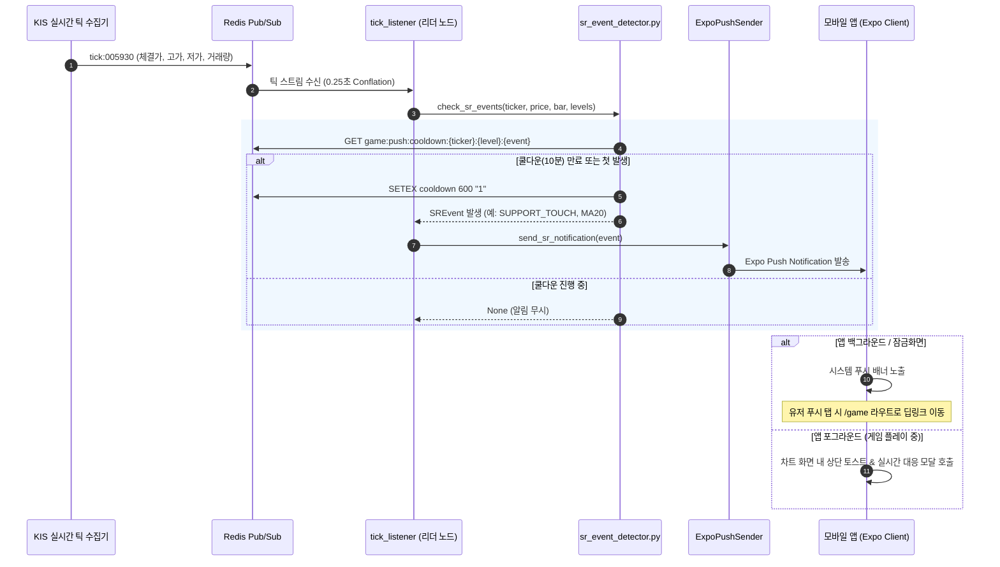

# 🔔 지지·저항 터치/관통 감지 엔진 및 모바일 푸시 알림 명세

> **문서 상태**: 설계 완료 및 구현 준비 (Ready for Implementation)  
> **파일 위치**: `docs/chart_game/02_event_detection_and_push_notification.md`  
> **관련 소스**:
> - Backend: `backend/apps/trading_game/services/tick_listener.py`, `backend/apps/collector/push/expo.py`, `backend/apps/blog/models.py` (PushDevice)
> - Mobile: `mobile/src/features/notifications/`

---

## 1. 이벤트 판정 알고리즘

실시간 틱 가격($P_{\text{last}}$)과 현재 진행 중인 캔들의 고가/저가/종가를 기준으로 지지선 및 저항선과의 상호작용 이벤트를 판정합니다.

### 1.1 오차 허용 범위 (Threshold $\epsilon$)
- 가격이 선에 정확히 1원 단위까지 일치하기는 어려우므로, **호가 단위 반올림 및 상대 오차 $\pm 0.15\%$**를 허용 범위($\epsilon$)로 설정합니다.
$$\epsilon = \max\left(\text{KRX 호가 단위}, P_{\text{level}} \times 0.0015\right)$$

### 1.2 이벤트 4대 유형

| 이벤트 코드 | 이벤트 명칭 | 판정 조건 (조건 만족 시 1회 발동) | 의미 및 트레이딩 시사점 |
| :--- | :--- | :--- | :--- |
| `SUPPORT_TOUCH` | **지지선 터치** | 직전 가격 > 지지선 이고, $P_{\text{last}} \le P_{\text{support}} + \epsilon$ 이며 $P_{\text{last}} \ge P_{\text{support}} - \epsilon$ | 기술적 반등 기대 구간. [매수 / 홀딩] 검토 타점 |
| `SUPPORT_BREAKDOWN` | **지지선 하향 이탈** | 직전 가격 $\ge P_{\text{support}}$ 이고, $P_{\text{last}} < P_{\text{support}} - \epsilon$ | 지지선 붕괴. 추가 급락 위험. [손절 🛡️] 필수 구간 |
| `RESISTANCE_TOUCH` | **저항선 터치** | 직전 가격 < 저항선 이고, $P_{\text{last}} \ge P_{\text{resistance}} - \epsilon$ 이며 $P_{\text{last}} \le P_{\text{resistance}} + \epsilon$ | 상단 매물 압박 구간. [익절 💰 / 관망] 검토 타점 |
| `RESISTANCE_BREAKOUT` | **저항선 상향 돌파** | 직전 가격 $\le P_{\text{resistance}}$ 이고, $P_{\text{last}} > P_{\text{resistance}} + \epsilon$ | 상방 매물대 돌파. 시세 분출. [추세 추종 / 홀딩 ✊] |

---

## 2. 실시간 감지 파이프라인 아키텍처



---

## 3. 중복 알림 방지 (Debounce & Cooldown) 정책

실시간 장중 틱은 1초에도 수십 번씩 발생하므로, 주가가 지지/저항선 부근에서 등락을 반복할 경우 **푸시 폭탄**이 발생할 위험이 있습니다.

### 3.1 쿨다운 키 규칙 (Redis TTL)
- **키 형식**: `game:push:cooldown:{season_id}:{ticker}:{indicator_key}:{event_type}`
  - 예: `game:push:cooldown:1:005930:ma20:SUPPORT_TOUCH`
  - 예: `game:push:cooldown:1:005930:vp_poc:RESISTANCE_TOUCH`
- **TTL**: **10분 (600초)**
- **동작**:
  - 이벤트가 감지되었을 때 Redis `SET key 1 EX 600 NX` 명령을 실행.
  - 반환값이 True(성공)인 경우에만 실제 푸시를 디스패치.
  - False인 경우(이미 10분 내 동일 지표 동일 이벤트가 발송됨) 즉시 스킵.

---

## 4. 백엔드 푸시 디스패처 명세

### 4.1 DB 마이그레이션 (`push_devices`)
기존 `push_devices` 테이블에 차트게임 알림 수신 여부 플래그를 추가합니다.
```sql
ALTER TABLE push_devices ADD COLUMN game_notice BOOLEAN NOT NULL DEFAULT true;
```

### 4.2 푸시 발송 쿼리
- 대상 기기: `push_devices` 테이블에서 `game_notice = true` 이며 유저가 `is_active = true`인 모든 기기.

### 4.3 푸시 메시지 템플릿

```json
{
  "to": "ExponentPushToken[xxxxxxxxxxxxxxxxxxxxxx]",
  "title": "[차트게임] 🎯 지지선 터치 발생!",
  "body": "삼성전자(005930)가 20일 이동평균선(72,000원)에 도달했습니다. 반등 여부를 확인하고 대응하세요!",
  "sound": "default",
  "channelId": "chart-game",
  "data": {
    "type": "chart_game_sr",
    "ticker": "005930",
    "event_type": "SUPPORT_TOUCH",
    "indicator_key": "ma20",
    "indicator_name": "20일 이동평균선",
    "price": 72000,
    "timestamp": 1730000000
  }
}
```

#### 지표별 메시지 문구 사전
1. **이동평균선 (MA5 / MA20 / MA60)**:
   - 터치: `"{ticker}가 {name}({price}원)을 터치했습니다! 지지/저항 반등 여부를 확인하세요."`
   - 돌파/이탈: `"{ticker}가 {name}({price}원)을 강력히 {돌파/이탈}했습니다! 추세 변화에 유의하세요."`
2. **볼린저밴드 (상단 / 하단)**:
   - 상단 터치: `"{ticker}가 볼린저밴드 상단 저항선({price}원)에 도달했습니다! (과매수 구간)"`
   - 하단 터치: `"{ticker}가 볼린저밴드 하단 지지선({price}원)에 도달했습니다! (기술적 반등 기대)"`
3. **매물대 (POC)**:
   - 터치: `"{ticker}가 최대 거래량 매물대({price}원)에 진입했습니다! 공방전이 예상됩니다."`

---

## 5. 모바일 수신 및 딥링크 라우팅 명세

### 5.1 안드로이드 알림 채널
- `channelId`: `chart-game`
- `name`: "차트게임 지지/저항 알림"
- `importance`: High (헤드업 배너 및 소리)

### 5.2 모바일 수신 핸들러 (`useNotifications.ts`)
```typescript
Notifications.addNotificationResponseReceivedListener(response => {
  const data = response.notification.request.content.data;
  if (data?.type === 'chart_game_sr') {
    // 1. 차트게임 화면으로 이동
    router.push('/game');
    
    // 2. Zustand 스토어에 강조 이벤트 전달
    useTradingGameStore.getState().setHighlightEvent({
      indicatorKey: data.indicator_key,
      eventType: data.event_type,
      price: data.price,
    });
  }
});
```
- 차트게임 화면 진입 시: 해당 지표 선이 차트에서 3초간 깜빡이며 하이라이트되고, 하단에 **[실시간 대응 액션 시트]**가 자동으로 올라와 유저가 즉각 [손절/익절/홀딩]을 선택할 수 있도록 합니다.
