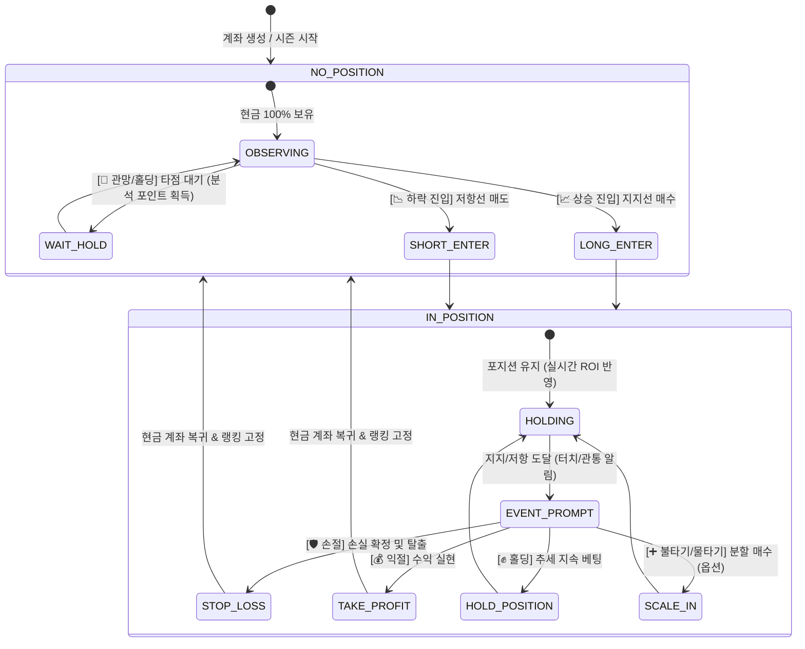

# 🎮 손절·익절·홀딩 인터랙티브 게임 규칙 & 랭킹 연계 명세

> **문서 상태**: 설계 완료 및 구현 준비 (Ready for Implementation)  
> **파일 위치**: `docs/chart_game/03_interactive_gameplay_rules.md`  
> **관련 소스**:
> - Backend: `backend/apps/trading_game/services/order_engine.py`, `backend/apps/trading_game/services/ranking_service.py`, `backend/apps/trading_game/services/quest_service.py`
> - Web: `web_client/src/components/game/OrderPanel.tsx`, `web_client/src/components/game/ActivePositionCard.tsx`
> - Mobile: `mobile/src/features/game/components/order-panel.tsx`, `mobile/src/features/game/components/position-card.tsx`

---

## 1. 게임 방식 개편 의도: '홀짝 베팅'에서 '실전 포지션 관리'로

기존 차트게임의 진입 장벽을 낮추기 위해 도입되었던 단순 **"상승에 걸기 / 하락에 걸기"** 방식은, 포지션 오픈 이후 유저가 할 수 있는 역할이 없어 수동적인 방치형 게임으로 흘러가기 쉬웠습니다.

실제 성공적인 트레이더의 핵심 역량은 진입 방향을 맞추는 것보다, **"시장이 지지선과 저항선에 도달했을 때 어떻게 대응(손절, 익절, 홀딩)하는가"**에 있습니다.  
본 개편은 유저가 차트의 주요 변곡점마다 **능동적으로 포지션을 운용하는 인터랙티브 의사결정 게임**으로 전환합니다.

---

## 2. 플레이어 상태 머신 (State Machine)

유저의 플레이 상태는 크게 **포지션 미보유(관망/탐색)** 상태와 **포지션 보유(대응/관리)** 상태의 2단계로 순환합니다.



---

## 3. 세부 의사결정 액션 명세

### 3.1 포지션 미보유 상태 (`NO_POSITION`)
- **[📈 상승 진입 (BUY / LONG)]**:
  - 조건: 현금 잔고 $\ge 100,000$원.
  - 타점: 주가가 **지지선(20일선, 볼린저 하단, 매물대 POC) 부근에서 반등**할 때 진입 권장.
- **[📉 하락 진입 (SELL / SHORT)]**:
  - 조건: 현금 잔고 $\ge 100,000$원.
  - 타점: 주가가 **저항선(볼린저 상단, 매물대) 부근에서 저항받고 꺾일 때** 진입 권장.
- **[👀 관망 / 홀딩 (WAIT / HOLD)]**:
  - 의미: "지금은 방향성이 애매하니 다음 캔들의 지지/저항 확인 후 진입하겠다."
  - 보상: 관망 선택 시 '인내심 게이지'가 차오르고, 일일 출석 퀘스트 및 분석 포인트가 지급됨.

### 3.2 포지션 보유 상태 (`IN_POSITION`)
- **[🛡️ 손절 (Stop Loss)]**:
  - 의미: 매수한 지지선이 붕괴되거나 예측과 반대로 움직일 때 즉시 손실을 끊어냄.
  - 시스템 동작: `close_position(position_id, reason="MANUAL_SL")`.
  - 랭킹 효과: 추가 손실을 막아 **시즌/주간 랭킹 순위 하락을 방어**.
  - 에듀테인먼트 피드백: "원칙대로 손실을 잘 끊어냈습니다! 훌륭한 자금 관리입니다." 토스트 & 퀘스트 점수 부여.
- **[💰 익절 (Take Profit)]**:
  - 의미: 목표한 저항선에 도달했거나 충분한 수익이 났을 때 이익을 실현.
  - 시스템 동작: `close_position(position_id, reason="MANUAL_TP")`.
  - 랭킹 효과: 수익이 현금으로 전환되어 **현재까지 달성한 고수익률(ROI)이 랭킹에 영구 보존**.
- **[✊ 홀딩 (Keep Holding)]**:
  - 의미: 저항선을 강하게 뚫을 것으로 기대하거나, 지지선 반등 추세를 끝까지 타기 위해 유지.
  - 시스템 동작: 포지션 상태(`OPEN`) 유지.
  - 랭킹 효과: 실시간 틱마다 미실현 손익이 랭킹 ZSET에 라이브로 반영되어 **역전 1위** 노림.

---

## 4. 지지·저항 이벤트 트리거 기반 실시간 인터랙션

캔들이 지지/저항선을 터치하거나 관통할 때, 앱 내에서는 아래와 같은 **'상황 맞춤형 의사결정 다이얼로그(바텀시트)'**가 즉시 활성화됩니다.

### 시나리오 A: LONG 보유 중 '저항선(볼린저 상단 or 매물대) 터치'
```
┌────────────────────────────────────────────────────────┐
│ 🔔 [저항선 도달] 볼린저밴드 상단(74,200원) 터치!       │
│ 현재 평가손익: +12.4% (+₩248,000)                      │
│ 상단 매물대 저항으로 단기 조정 가능성이 있습니다.      │
├────────────────────────────────────────────────────────┤
│ [ 💰 지금 전액 익절하기 ]   [ ✊ 돌파 기대하고 홀딩하기 ] │
└────────────────────────────────────────────────────────┘
```

### 시나리오 B: LONG 보유 중 '지지선(20일 이동평균선) 하향 이탈'
```
┌────────────────────────────────────────────────────────┐
│ ⚠️ [지지선 붕괴] 20일선(72,000원) 하향 이탈 경고!     │
│ 현재 평가손익: -3.2% (-₩64,000)                        │
│ 주요 지지선이 깨져 추가 하락 위험이 큽니다.            │
├────────────────────────────────────────────────────────┤
│ [ 🛡️ 원칙 손절 (순위 방어) ]  [ ✊ 지지 반등 믿고 홀딩 ]   │
└────────────────────────────────────────────────────────┘
```

---

## 5. 랭킹 시스템 (Redis ZSET)과의 완전한 정합성

| 유저 선택 액션 | 호출 API 및 메서드 | Redis ZSET 및 랭킹 영향 | 회귀 방지 보장 |
| :--- | :--- | :--- | :--- |
| **손절 (Stop Loss)** | `POST /api/game/orders/close`<br>`{reason: "MANUAL_SL"}` | 포지션 청산 ➜ `cash_balance` 차감 확정 ➜ `sync_account_rank` 호출로 Redis ZSET 스코어 영구 확정 | `order_engine.close_position` 원자적 UPDATE 유지 |
| **익절 (Take Profit)** | `POST /api/game/orders/close`<br>`{reason: "MANUAL_TP"}` | 포지션 청산 ➜ 수익금 잔고 입금 ➜ `sync_account_rank` 호출로 고수익률 스코어 영구 확정 | 기존 청산 로직 그대로 사용 |
| **홀딩 (Holding - 보유)** | API 호출 없음 (상태 유지) | `tick_listener.py`의 `pnl_loop`가 1초마다 실시간 가격으로 `update_rank` 자동 갱신 | 기존 ZSET 갱신 루프 100% 호환 |
| **관망 (Wait - 미보유)** | `POST /api/game/orders/hold`<br>(로깅 및 퀘스트용) | 자산 변동 없음 (총자산 = 현금잔고). 시장 하락 시 타 유저 손실로 인해 **상대 랭킹 상승** | 랭킹 스코어 유지 |

---

## 6. 게이미피케이션 & 에듀테인먼트 연동

1. **원칙 손절가 칭호 (Trading MBTI)**:
   - 지지선 붕괴 시 -3% 이내에 손절한 횟수가 5회 이상인 유저에게 **'냉철한 원칙주의자'** 뱃지 및 가상머니 +50만 원 지급.
2. **손익비 마스터 (Quest)**:
   - 손절폭 대비 익절폭 2:1 이상으로 익절 성공 시 **'손익비 마스터'** 퀘스트 달성.
3. **추세 서퍼 (Streak)**:
   - 지지선 반등 후 저항선까지 5봉 이상 홀딩하여 15% 이상 수익 실현 시 특별 경험치 지급.
