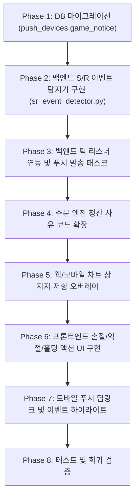

# 🛠️ Claude Code 전용 단계별 엔지니어링 구현 가이드

> **문서 상태**: 구현 준비 완료 (Ready to Code)  
> **파일 위치**: `docs/chart_game/04_claude_code_implementation_guide.md`  
> **목적**: 본 문서는 Claude Code가 추가 질의 없이 즉각적이고 정확하게 코드 작성 및 수정을 진행할 수 있도록, 파일별 변경 사항, 함수 시그니처, DTO, 테스트 체크리스트를 완벽하게 정의합니다.

---

## 1. 구현 원칙 (절대 준수)

1. **기존 랭킹 시스템 무결성 유지**: `ranking_service.py`의 `compute_live_roi`, `update_rank`, Redis ZSET 구조를 일체 수정하지 않는다.
2. **원자적 주문 체결 보장**: `order_engine.py`의 DB UPDATE 및 잔고 차감/반환 원자성을 유지한다.
3. **모바일 차트 빌드 스크립트 준수**: `mobile/src/features/game/chart-web/page/chart-page-script.ts` 수정 후 반드시 `node scripts/gen-chart-page.js`를 실행하여 `page-script.generated.ts`를 갱신해야 한다.
4. **문서 변경 자동 커밋**: 본 작업 중 `.md` 수정 시 자동으로 git commit을 수행한다.

---

## 2. 단계별 구현 체크리스트 (Phase 1 ~ Phase 8)



---

### Phase 1: DB 스키마 마이그레이션

#### 1.1 Alembic 마이그레이션 생성
- **파일 경로**: `backend/alembic/versions/{timestamp}_push_devices_game_notice.py`
- **목적**: `push_devices` 테이블에 `game_notice` 플래그 추가
```python
def upgrade():
    op.add_column(
        'push_devices',
        sa.Column('game_notice', sa.Boolean(), nullable=False, server_default='true')
    )

def downgrade():
    op.drop_column('push_devices', 'game_notice')
```

#### 1.2 SQLAlchemy 모델 수정
- **파일 경로**: `backend/apps/blog/models.py` (또는 PushDevice 정의 위치)
```python
# PushDevice 클래스에 필드 추가
game_notice: Mapped[bool] = mapped_column(Boolean, default=True, nullable=False)
```

---

### Phase 2: 지표별 S/R 이벤트 탐지 엔진 (`sr_event_detector.py`)

- **파일 경로**: `backend/apps/trading_game/services/sr_event_detector.py` (신규 파일)
- **책임**: 현재가, 직전가, 이평선, 볼린저밴드, 매물대 POC를 입력받아 터치/돌파/이탈 이벤트 판정 및 Redis 쿨다운 검사.

```python
from decimal import Decimal
from typing import NamedTuple, Optional

class SREvent(NamedTuple):
    event_type: str        # SUPPORT_TOUCH, SUPPORT_BREAKDOWN, RESISTANCE_TOUCH, RESISTANCE_BREAKOUT
    indicator_key: str     # ma5, ma20, ma60, bb_upper, bb_lower, vp_poc
    indicator_name: str    # "20일 이동평균선", "볼린저 상단", etc.
    level_price: Decimal
    current_price: Decimal

def detect_sr_events(
    prev_price: Decimal,
    curr_price: Decimal,
    levels: dict[str, Decimal], # {"ma20": Decimal("72000"), ...}
) -> list[SREvent]:
    """오차범위 eps 이내 터치 및 관통 감지 순수 함수"""
    events = []
    for key, lvl in levels.items():
        eps = max(Decimal("1"), (lvl * Decimal("0.0015")).quantize(Decimal("1")))
        # 1. 지지선 판정 (curr_price 기준)
        if lvl <= curr_price:
            # 터치: 위에서 내려와 지지선에 닿음
            if prev_price > lvl + eps and curr_price <= lvl + eps and curr_price >= lvl - eps:
                events.append(SREvent("SUPPORT_TOUCH", key, _get_name(key), lvl, curr_price))
            # 이탈: 지지선을 하향 관통
            elif prev_price >= lvl and curr_price < lvl - eps:
                events.append(SREvent("SUPPORT_BREAKDOWN", key, _get_name(key), lvl, curr_price))
        # 2. 저항선 판정
        else:
            # 터치: 아래에서 올라와 저항선에 닿음
            if prev_price < lvl - eps and curr_price >= lvl - eps and curr_price <= lvl + eps:
                events.append(SREvent("RESISTANCE_TOUCH", key, _get_name(key), lvl, curr_price))
            # 돌파: 저항선을 상향 관통
            elif prev_price <= lvl and curr_price > lvl + eps:
                events.append(SREvent("RESISTANCE_BREAKOUT", key, _get_name(key), lvl, curr_price))
    return events

async def check_and_acquire_cooldown(
    redis, season_id: int, ticker: str, key: str, event_type: str, ttl_sec: int = 600
) -> bool:
    """Redis SET NX EX를 통한 10분 쿨다운 원자적 검사"""
    cd_key = f"game:push:cooldown:{season_id}:{ticker}:{key}:{event_type}"
    res = await redis.set(cd_key, "1", ex=ttl_sec, nx=True)
    return bool(res)
```

---

### Phase 3: 백엔드 틱 리스너 연동 & 푸시 디스패처

#### 3.1 틱 리스너 연동
- **파일 경로**: `backend/apps/trading_game/services/tick_listener.py`
- **수정 위치**: `_store_latest` 또는 `broadcast_loop`
- **구현 내용**:
  1. 이전 틱 가격 `_prev_price` 유지.
  2. 현재 틱 가격과의 차이 발생 시 `sr_event_detector.detect_sr_events` 호출.
  3. 이벤트 발생 시 `check_and_acquire_cooldown` 통과 건에 대해 비동기 푸시 태스크 실행:
     `asyncio.create_task(dispatch_sr_push(event, ticker, season_id))`

#### 3.2 푸시 발송 서비스
- **파일 경로**: `backend/apps/trading_game/services/game_push_service.py` (신규 파일)
- **책임**: `push_devices` 조회 (조건: `game_notice == True`) ➜ `ExpoPushSender.send_batch` 호출.

---

### Phase 4: 주문 엔진 청산 사유 코드 확장

- **파일 경로**: `backend/apps/trading_game/services/order_engine.py`
- **파일 경로**: `backend/apps/trading_game/routers/orders.py`
- **수정 내용**:
  - `close_position` 호출 시 허용되는 `reason` 열거형/상수에 다음을 추가:
    - `MANUAL_SL`: 사용자의 수동 손절
    - `MANUAL_TP`: 사용자의 수동 익절
    - `HOLD_ACTION`: 홀딩 선택에 대한 감사/로깅(DB 저장 선택사항)

---

### Phase 5: 프론트엔드 차트 상 지지·저항 오버레이

#### 5.1 Web lightweight-charts 시각화
- **파일 경로**: `web_client/src/components/game/TradingChart.tsx`
- **수정 내용**:
  1. `linesRef` 갱신 로직에 현재가 기준 상위 2개 저항선, 하위 2개 지지선에 대해 `axisLabelVisible: true` 설정.
  2. 라벨 텍스트: `[저항] 20선 73,500`, `[지지] 매물대 71,800`.
  3. `VolumeProfilePrimitive` 내 POC 빈(최대 거래량)에 붉은색/보라색 포인트 마커 드로잉 추가.

#### 5.2 Mobile 차트 시각화
- **파일 경로**: `mobile/src/features/game/chart-web/page/chart-page-script.ts`
- **수정 내용**:
  1. 지표 선(MA, BB) 및 매물대 POC의 우측 라벨에 `[지지]`, `[저항]` 텍스트 접두사 추가.
  2. 수정 후 반드시 번들 재생성 실행:
     ```bash
     node scripts/gen-chart-page.js
     ```

---

### Phase 6: 프론트엔드 손절/익절/홀딩 액션 UI 구현

#### 6.1 Web `ActivePositionCard.tsx` 및 `OrderPanel.tsx`
- **파일 경로**: `web_client/src/components/game/ActivePositionCard.tsx`
- **UI 변경**:
  - 기존 단순 `[즉시 전액 청산하기]` 버튼 단일 구조에서:
    - **[ 🛡️ 손절하기 ]** (빨강/회색, 현재 평가손익 음수일 때 강조)
    - **[ 💰 익절하기 ]** (초록, 현재 평가손익 양수일 때 강조)
    - **[ ✊ 홀딩하기 ]** (파랑, 상태 유지 토스트 피드백)
  - 3개 버튼 바로 개편.

#### 6.2 Mobile `order-panel.tsx` 및 `sr-action-sheet.tsx`
- **파일 경로**: `mobile/src/features/game/components/order-panel.tsx`
- **파일 경로**: `mobile/src/features/game/components/sr-action-sheet.tsx` (신규 파일)
- **UI 변경**:
  - 포지션 보유 중일 때 하단 바에 `[손절]`, `[익절]`, `[홀딩]` 버튼 그룹 노출.
  - S/R 도달 시 자동으로 바텀시트가 열려 [지금 익절] vs [돌파 홀딩] 선택지 제공.

---

### Phase 7: 모바일 푸시 딥링크 및 이벤트 하이라이트

- **파일 경로**: `mobile/src/features/notifications/`
- **수정 내용**:
  1. Expo 알림 수신 리스너에서 `data.type === 'chart_game_sr'` 분기 처리.
  2. `router.push('/game')` 실행.
  3. `useTradingGameStore`에 이벤트 정보 전달 ➜ 차트 로드 시 해당 지표 라인을 3초간 점멸(Highlight).

---

### Phase 8: 테스트 및 회귀 검증

1. **백엔드 단위 테스트**:
   - `backend/tests/test_sr_event_detector.py`: 터치/돌파/이탈 경계값 수학적 검증.
   - `backend/tests/test_game_push_cooldown.py`: 10분 쿨다운 동작 검증.
   - 실행: `pytest backend/tests/test_sr_event_detector.py`
2. **기존 랭킹 시스템 회귀 테스트**:
   - `pytest backend/tests/test_ranking_service.py`
   - `pytest backend/tests/test_order_engine.py`
3. **프론트엔드 타입스크립트 및 빌드 검증**:
   - Web: `cd web_client && npm run build`
   - Mobile: `cd mobile && npm run test`
