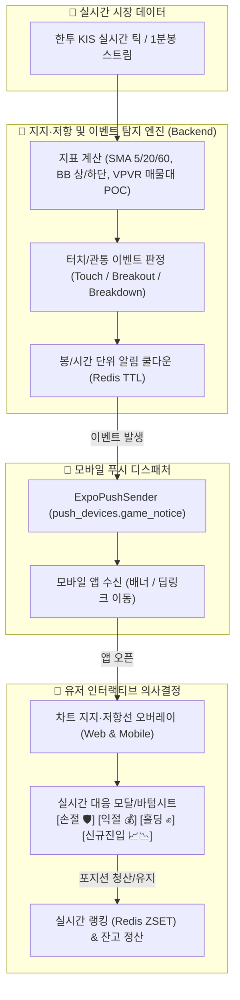

# 🎮 차트게임: 지지·저항 시스템 & 인터랙티브 트레이딩 종합 아키텍처

> **문서 상태**: 설계 완료 및 구현 준비 (Ready for Claude Code Implementation)  
> **최종 수정일**: 2026-10-27  
> **대상 플랫폼**: Web Client (`/web_client`), Mobile App (`/mobile`), Backend (`/backend`)  
> **관련 문서**:
> - [`01_support_resistance_specs.md`](file:///Users/kyuseok/Documents/private/projects/ivyro/work_space/stock_app/docs/chart_game/01_support_resistance_specs.md) — 지표별 지지·저항 정의 및 차트 시각화
> - [`02_event_detection_and_push_notification.md`](file:///Users/kyuseok/Documents/private/projects/ivyro/work_space/stock_app/docs/chart_game/02_event_detection_and_push_notification.md) — 터치/관통 감지 및 모바일 푸시 알림
> - [`03_interactive_gameplay_rules.md`](file:///Users/kyuseok/Documents/private/projects/ivyro/work_space/stock_app/docs/chart_game/03_interactive_gameplay_rules.md) — 손절·익절·홀딩 인터랙티브 게임 규칙 & 랭킹 연계
> - [`04_claude_code_implementation_guide.md`](file:///Users/kyuseok/Documents/private/projects/ivyro/work_space/stock_app/docs/chart_game/04_claude_code_implementation_guide.md) — Claude Code 전용 단계별 구현 가이드

---

## 1. 개편 배경 및 목표

기존의 차트게임은 단순 **"상승(BUY) / 하락(SELL)"** 방향을 맞추는 홀짝형 베팅 구조에 머물러 있었습니다.  
포지션을 오픈한 뒤에는 주가가 자동 TP(익절)/SL(손절)에 도달하거나 유저가 수동으로 '전액 청산'을 누르기 전까지 유저가 개입할 수 있는 인터랙션이 부족했습니다.

본 개편은 **실전 프로 트레이더의 핵심 분석 도구인 '지지선과 저항선'**을 차트에 시각화하고, 주가가 이 가격대에 도달했을 때 **실시간 모바일 푸시 알림**을 통해 유저를 불러들이며, **[손절 / 익절 / 홀딩]** 등의 능동적 의사결정을 내리게 하는 **실전 대응형 트레이딩 에듀테인먼트 게임**으로 시스템을 진화시키는 것을 목표로 합니다.



---

## 2. 기존 시스템과의 완벽한 호환성 (회귀 방지)

본 개편은 기존에 견고하게 구축된 **실시간 랭킹 시스템, 계좌 원장 모델, 틱 처리 파이프라인을 100% 보존**합니다.

### 2.1 랭킹 시스템 (Redis ZSET)과의 완전 호환
- **기존 원리 유지**: 
  - `game:season:{id}:ranking` (Score = `current_roi` %)
  - `compute_live_roi`: 총자산($\text{Cash} + \text{Position Size} + \text{Live PnL}$) 기반 평가
- **신규 액션과의 매핑**:
  - **손절(Stop Loss)**: 즉시 청산(`close_position`, reason=`MANUAL_SL`) ➜ 현금화로 추가 손실 방지 ➜ 확정 ROI로 랭킹 방어.
  - **익절(Take Profit)**: 즉시 청산(`close_position`, reason=`MANUAL_TP`) ➜ 현금화로 수익률 영구 고정 ➜ 상위권 랭킹 굳히기.
  - **홀딩(Holding)**: 
    - 포지션 보유 중: 매 틱마다 실시간 미실현 손익이 랭킹에 연속 반영 (`tick_listener` 무수정 동작).
    - 포지션 미보유 중: 현금 100% 보존으로 하락장/변동성 장세에서 상대 순위 상승 효과.
- **주간/월간 랭킹 무영향**: `weekly_ranking.py`, `monthly_ranking.py` 변경 불필요.

### 2.2 주문 엔진(`order_engine.py`) 및 DB 스키마 무영향
- `GameAccount`, `GamePosition`, `GameTrade` 테이블 구조 변경 없음.
- `GameTrade.reason` 필드에 세부 사유 코드(`MANUAL_SL`, `MANUAL_TP`, `TAKE_PROFIT_TOUCH`)만 추가 확장.

---

## 3. 핵심 변경 요소 요약

| 구분 | 기존 방식 | 신규 개편 방식 | 관련 문서 |
| :--- | :--- | :--- | :--- |
| **차트 지표 및 지지/저항** | 이평선·볼린저밴드가 선으로만 표시됨 | 현재가 기준 **이평선(5/20/60), BB 상·하단, 매물대(POC)에 [지지] / [저항] 역할 태그 및 가격선 오버레이** | `01_support_resistance_specs.md` |
| **이벤트 알림 (Push)** | 푸시 알림 없음 (유저가 보고 있을 때만 확인) | 캔들이 지지/저항선을 **터치하거나 관통할 때 Expo 모바일 푸시 발송 (쿨다운 10분 적용)** | `02_event_detection_and_push_notification.md` |
| **게임 방식 (의사결정)** | 단순 상승/하락 배팅 후 수동 청산 대기 | **[진입 / 홀딩 / 손절 / 익절]** 의사결정 루프, S/R 도달 시 실시간 대응 바텀시트 호출 | `03_interactive_gameplay_rules.md` |
| **모바일 연동** | 웹뷰 차트와 주문 버튼 분리 | 푸시 알림 탭 시 **게임 차트 딥링크 + 해당 지지/저항선 하이라이트 + 대응 액션창 즉시 팝업** | `02`, `03`, `04` |

---

## 4. 디렉토리 및 문서 구성

```
docs/chart_game/
├── README.md                                    # (본 문서) 종합 아키텍처 및 개요
├── 01_support_resistance_specs.md               # 지표별 지지·저항 정의 및 차트 렌더링 명세
├── 02_event_detection_and_push_notification.md  # 터치/관통 감지 엔진, 쿨다운, Expo 푸시 연동
├── 03_interactive_gameplay_rules.md             # 손절/익절/홀딩 게임 루프 및 랭킹 정합성 설계
└── 04_claude_code_implementation_guide.md      # Claude Code 전용 파일별 상세 구현 체크리스트
```
