# 관리자 웹 (admin_web)

> React + Vite + TailwindCSS · 로컬 `http://localhost:5173` · 캡처: 2026-10-22(스크리너 탭 화면만 10-24), 개발 DB 기준(1366px 데스크톱)

## 한눈에 보기

| 구분 | 수 | 내용 |
|---|---|---|
| 라우트 | 20 | `/login` + 레이아웃 하위 18개 + 그 밖의 경로는 `/boards`로 이동 |
| 사이드바 메뉴 | 14 | 7개 그룹: 블로그 관리, 트레이딩 게임, 시장 데이터, 알림, 앱 관리, 회원 관리, 통계 |
| 완료 | 13 | 로그인, 게시판, 게시글 목록, 글 작성/수정, 코치, 아카데미, 퀴즈, 게임 설정, 테마 보정, 데이터 검증, 스크리너 탭, 펀드 알림, 앱 버전 |
| 부분 | 2 | 게시글 상세(댓글 수정 UI 없음), 데이터 현황(설정은 읽기 전용) |
| 준비 중 | 2 | 회원 목록, 통계 대시보드 |

**공통 구조**
- **상단 바**: 로고, 로그인한 관리자 닉네임과 역할 배지, 로그아웃 버튼.
- **사이드바**: 데스크톱에서는 고정 사이드바, 모바일에서는 ☰ 드로어.
- **새 글 토스트**: 오른쪽 아래에 실시간 새 글 토스트가 뜹니다. blog 서비스의 SSE `GET /notifications/stream`을 받아서 띄웁니다.
- **권한**
  - 화면에서는 토큰이 있는지만 확인합니다.
  - 관리자인지는 서버의 `require_admin`이 확인합니다(역할이 ADMIN이 아니면 거부).
  - 401 응답을 받으면 토큰을 지우고 `/login`으로 보냅니다.
- **API 서비스**

  | 서비스 | 포트 / 경로 | 호출 방식 |
  |---|---|---|
  | blog | 8000 | REST |
  | auth | 8001 | REST |
  | stock_api | 8002 | GraphQL `/graphql`, 관리자 REST `/api/v1/admin/*` |
  | trading_game | 8003 | `/api/game/admin/*` |

- **게임 서버 주소가 없을 때**: 빌드할 때 `VITE_GAME_API_URL`이 비어 있으면 게임 메뉴 4개는 "게임 서버 미연결" 안내만 보여 줍니다.

---

## 0. 로그인 — `/login`

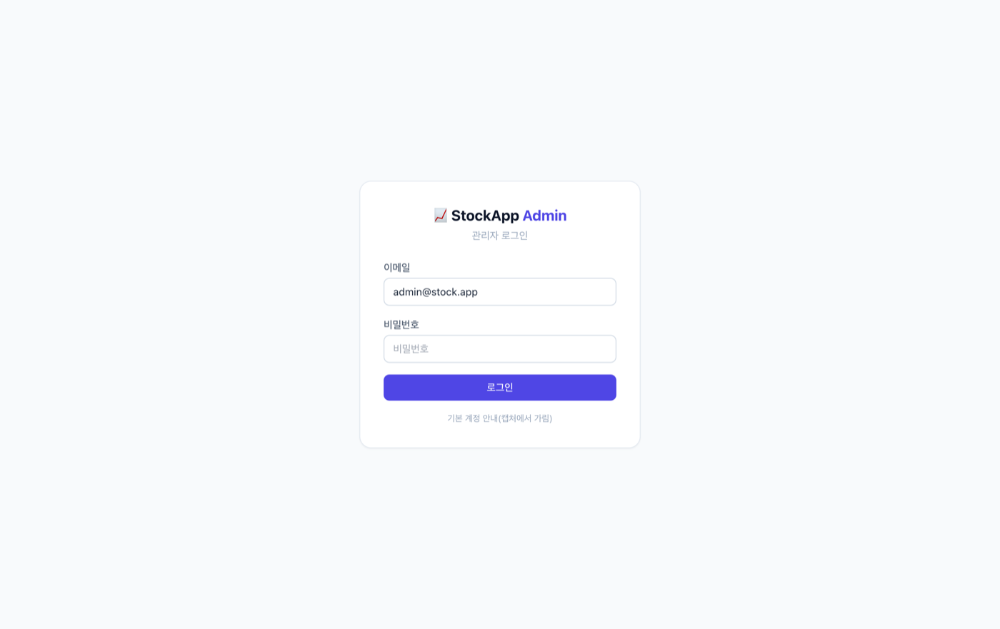

- 이메일과 비밀번호로 로그인합니다(`POST /auth/login`, auth). 로그인하면 처음 가려던 화면, 기본값은 `/boards`로 이동합니다.
- 서버가 응답하지 않으면 "백엔드 연결 불가", 비밀번호가 틀리면 "비밀번호 오류"를 따로 보여 줍니다.
- 화면 아래에 기본 계정 안내 문구가 고정으로 나옵니다. 캡처에서는 가렸습니다. **운영 배포 전에 이 문구를 지울지 검토가 필요합니다.**
- 상태: **완료**

## 1. 게시판 관리 — `/boards`

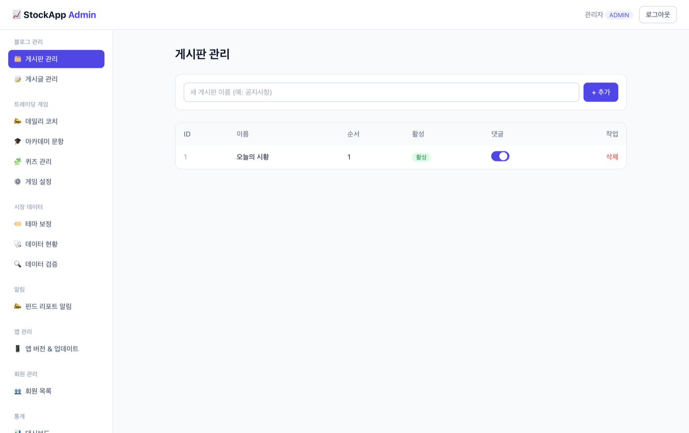

- 게시판을 조회하고 추가합니다. 이름만 넣으면 순서는 맨 뒤로 자동으로 붙습니다.
- 게시판마다 **댓글 허용** 스위치가 있습니다. 삭제하면 하위 글도 함께 삭제된다는 확인창이 뜹니다.
- API(blog): `GET/POST /boards`, `PUT /boards/{id}`, `DELETE /boards/{id}`
- 상태: **완료**. 이름 수정, 순서 변경, 활성화를 바꾸는 UI는 없습니다. API는 있습니다.

## 2. 게시글 관리 — `/blogs`

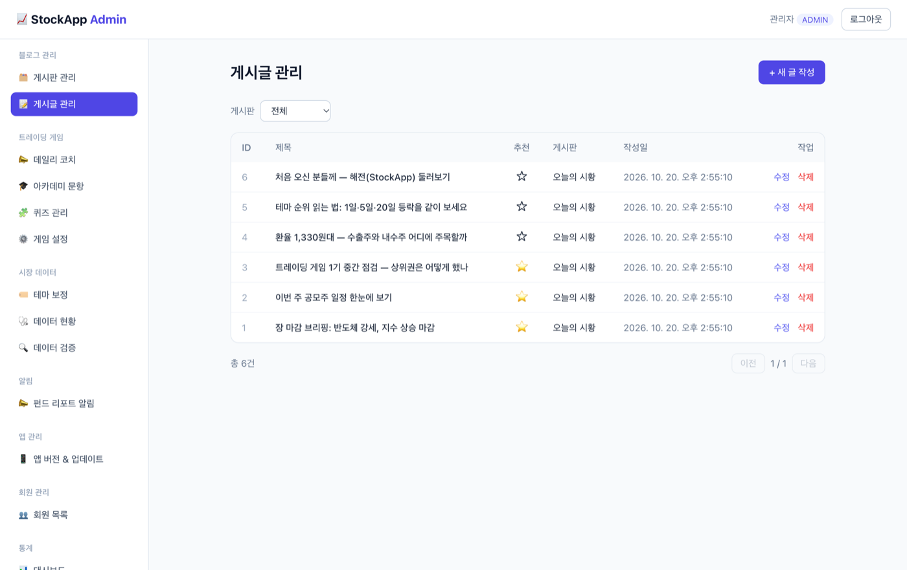

- 게시판 필터로 글 목록을 봅니다(10건씩 페이지).
- ⭐를 누르면 **홈 추천 글**로 지정하거나 해제합니다. 화면에 먼저 반영하고, 실패하면 원래대로 되돌립니다.
- 수정·삭제 버튼과 "+ 새 글 작성" 버튼이 있습니다.
- API(blog): `GET /blogs?board_id&page&size`, `PUT /blogs/{id}` (`featured`), `DELETE /blogs/{id}`
- 상태: **완료**. 검색 기능은 없습니다.

## 3. 글 작성/수정 — `/blogs/new`, `/blogs/:id/edit`

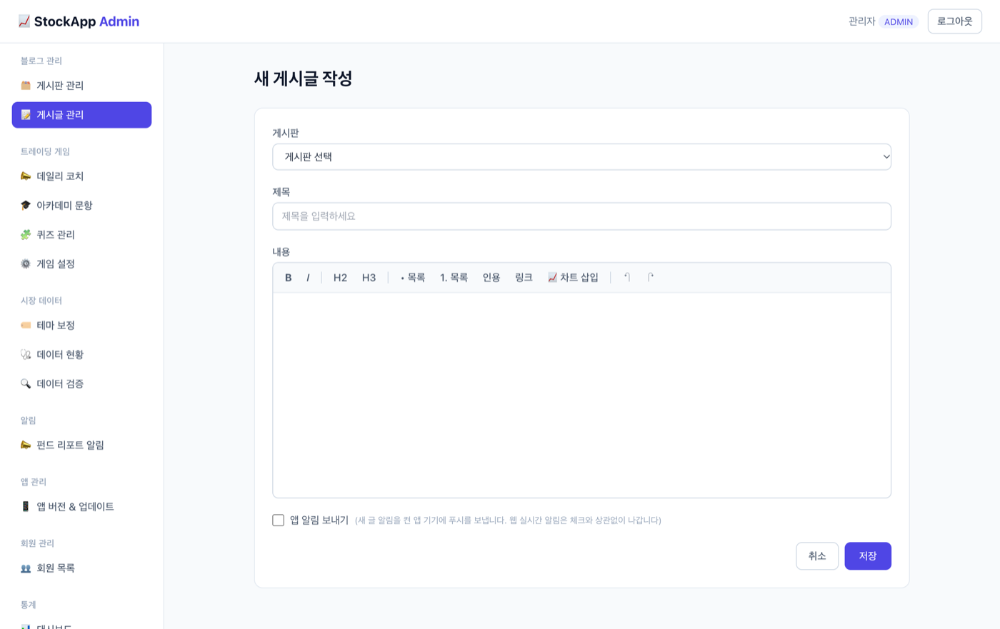

- TipTap 리치 에디터를 씁니다. 툴바: 굵게, 기울임, H2, H3, 목록, 인용, 링크, **📈 차트 삽입**, 실행 취소/다시 실행.
- **앱 알림 보내기** 체크박스는 새 글에만 있습니다. 체크하면 새 글 알림을 켠 앱 기기에 푸시가 갑니다. 웹 실시간 알림은 체크하지 않아도 항상 나갑니다.

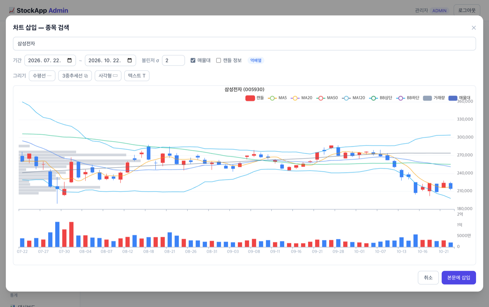

- **차트 삽입 모달**은 관리자 웹의 핵심 기능입니다.
  - 국내외 종목·지수를 검색하고 기간을 정합니다.
  - 캔들 차트에 MA5/20/50/120, 볼린저 σ, 매물대, 캔들 정보를 켜고 끌 수 있습니다.
  - 그리기 도구 4종(수평선, 3중 추세선, 사각형, 텍스트)으로 표시한 뒤 PNG로 캡처해 본문에 넣습니다.
- API
  - blog: `POST /blogs`(`notify` 포함), `PUT /blogs/{id}`
  - stock_api GraphQL: `SearchStocks`, `GetChartData`
- 상태: **완료**

## 4. 게시글 상세 — `/blogs/:id`

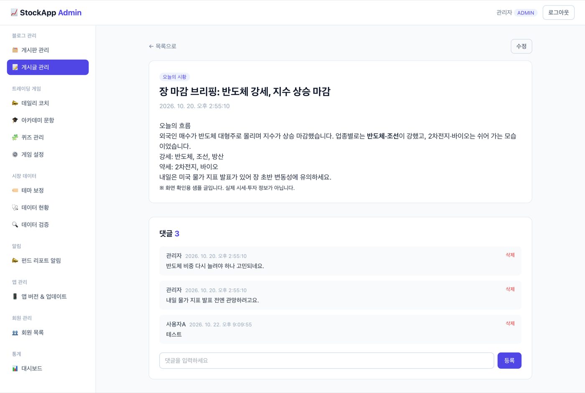

- 본문(차트 이미지 포함)과 댓글 목록을 보여 줍니다. 관리자 계정으로 댓글을 쓰거나 지울 수 있습니다.
- 게시판에서 댓글을 꺼 두었으면 입력창 대신 안내 문구가 나옵니다.
- 상태: **부분**
  - 댓글 수정 API(`PUT /comments/{id}`)는 있지만 화면에 수정 UI가 없습니다.
  - 본문을 정화(sanitize) 없이 그대로 넣고 있습니다. 코드에 TODO가 남아 있습니다.
- 캡처에서는 사용자 닉네임 1개를 `사용자A`로 바꿨습니다.

## 5. 데일리 코치 — `/game/coach`

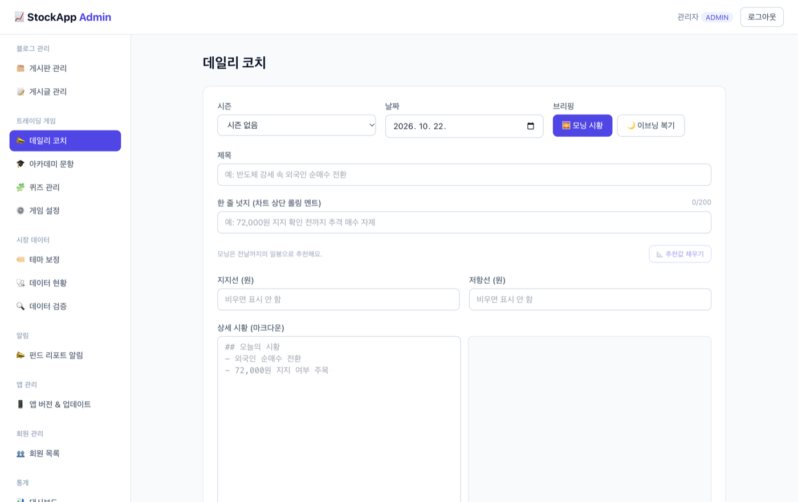

- 시즌, 날짜, 종류(🌅 모닝 시황 / 🌙 이브닝 복기)를 고르면 그 슬롯의 브리핑을 불러옵니다.
- 입력 항목: 제목, 한 줄 넛지(200자), 지지선·저항선, 마크다운 상세 시황(작성/미리보기, DOMPurify로 정화).
- **📐 추천값 채우기**: 서버가 일봉으로 계산한 지지·저항선 추천값을 채워 넣습니다.
- **임시저장**과 **🚀 실시간 발행**이 있습니다. 이미 발행한 브리핑은 다시 발행해서 수정합니다.
- API(game): `GET seasons`, `GET/PUT coach-messages`, `GET coach-levels/suggest`
- 상태: **완료**. 운영 작업이 하나 남았습니다: 오늘 브리핑을 실제 지지·저항선 값으로 다시 발행해야 합니다.

## 6. 아카데미 문항 — `/game/academy`

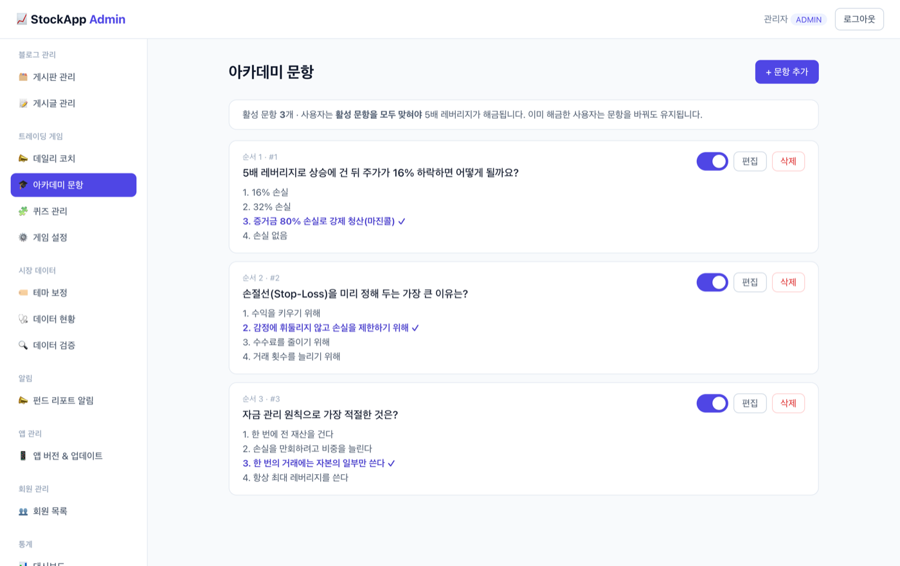

- 5배 레버리지를 해금하는 퀴즈 문항을 추가·조회·수정·삭제합니다. 질문, 선택지 2~6개, 정답, 해설, 순서, 활성 여부를 다룹니다.
- 활성 문항을 모두 맞혀야 해금된다는 안내가 있고, 활성 문항이 0개면 경고가 뜹니다.
- 상태: **완료**. 웹 모달에 바뀐 내용이 반영되는지 브라우저 확인이 남아 있습니다.

## 7. 퀴즈 관리 — `/game/quizzes`

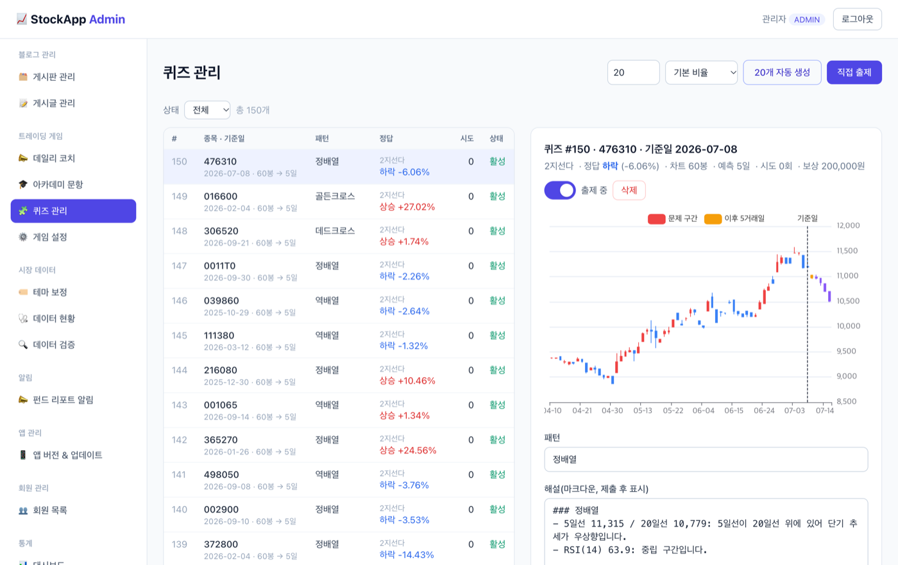

- 야간 차트 퀴즈 풀을 목록(20개씩)과 상세 두 칸으로 관리합니다.
- **자동 생성**: 1~200개, 유형은 기본 비율 / 2지선다 / 등락폭 구간 / 신호 맞히기 중에서 고릅니다.
- **직접 출제**: 종목과 기준일을 넣으면 정답과 해설이 자동으로 계산됩니다. 데이터가 부족하거나, 등락이 1% 미만이거나, 중복이면 거절됩니다.
- **상세**
  - 문제 차트 다음 5봉을 미리 볼 수 있습니다.
  - 패턴명과 해설을 수정하고, 활성 여부를 토글하고, 삭제할 수 있습니다.
  - 응시 기록이 있는 문제는 삭제할 수 없습니다.
- 상태: **완료**. 한 번에 200개를 만들면 Cloudflare의 100초 제한에 걸릴 수 있어 50개씩 만드는 것을 권장합니다.

## 8. 게임 설정 — `/game/settings`

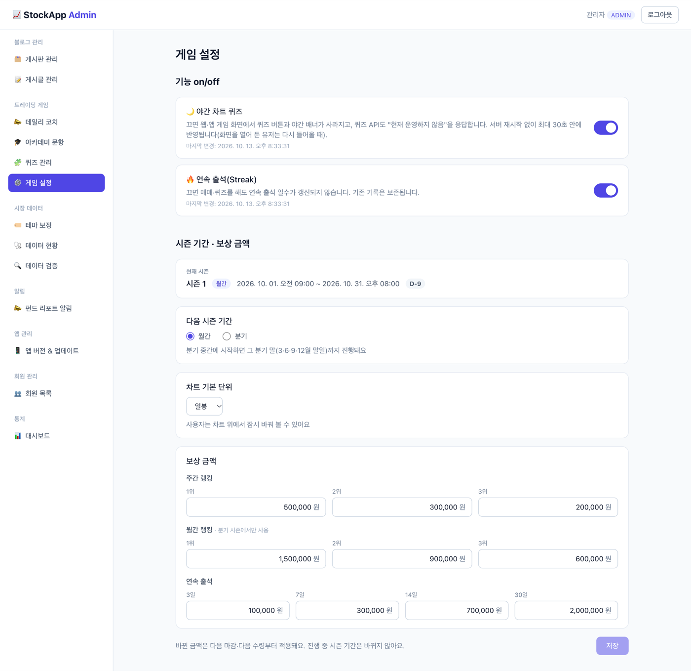

- 기능 켜기/끄기: 🌙 야간 차트 퀴즈, 🔥 연속 출석.
- 현재 시즌 정보(기간, D-day)와 **다음 시즌 기간**(월간/분기)을 다룹니다.
- **차트 기본 단위**: 일봉, 1분, 5분, 15분, 60분.
- **보상 금액**: 주간 1~3위, 월간 1~3위, 연속 출석 3/7/14/30일. 0~1억 사이 정수만 받습니다.
- 바뀐 항목만 저장합니다.
- 상태: **완료**. 10/31 정산 전에 다음 시즌 기간을 확인해야 합니다.

## 9. 테마 보정 — `/market/themes`

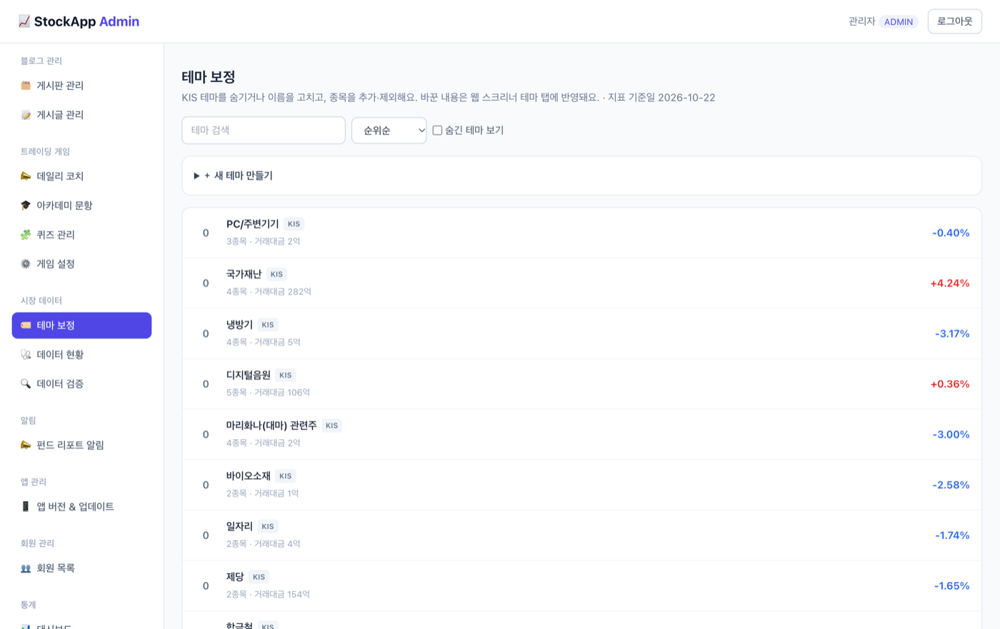

- KIS 테마와 관리자가 만든 테마를 지표(순위, 1일 등락, 거래대금, 종목 수)와 함께 보여 줍니다. 검색과 정렬이 되고, 숨긴 테마도 볼 수 있습니다.
- 새 테마 만들기, 이름·설명 수정, 숨기기/해제를 합니다. 구성 종목은 추가(편입 사유 입력), 제외, 복구할 수 있습니다.
- 바뀐 내용은 **웹·앱 스크리너의 테마 탭에 반영**되고, 순위는 서버가 다시 계산합니다.
- API(stock_api REST): `/api/v1/admin/themes*`
- 상태: **완료**

## 10. 데이터 현황 — `/market/status`

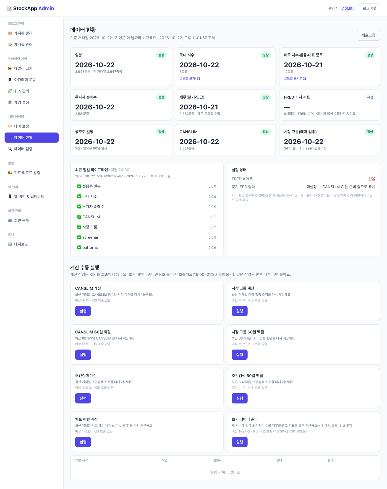

- 데이터셋별 상태 카드를 보여 줍니다(정상/오래됨/주의/없음/꺼짐/오류).
  - 대상 데이터: 일봉, 국내·미국 지수, 투자자 순매수, 재무, FRED, 공모주, CANSLIM, 시장 그룹.
  - 기준 거래일과 비교해 판정합니다.
- 최근 일일 파이프라인(매일 20:30)의 단계별 결과를 보여 줍니다.
- 설정 상태: FRED 키가 있는지, 분기 EPS 형식. 값 자체는 보여 주지 않습니다.
- **계산 수동 실행** 8종
  - CANSLIM, 시장 그룹, 조건검색, 차트 패턴 계산과 각각의 60일 백필
  - **초기 데이터 준비**: KIS를 대량 호출하는 작업이라 16:00~21:30에는 실행할 수 없습니다.
  - 실행 중일 때는 5초마다 다시 조회하고, 실행 기록 표가 있습니다.
- 상태: **부분**. 분기 EPS 형식 변경, KIS 수집 수동 실행, 단계별 재시작은 다음 단계로 미뤄 두었습니다.
- 캡처 시점에 FRED 키가 없어서 **FRED 거시 지표가 '꺼짐'**으로 나옵니다.

## 11. 데이터 검증 — `/market/verify`

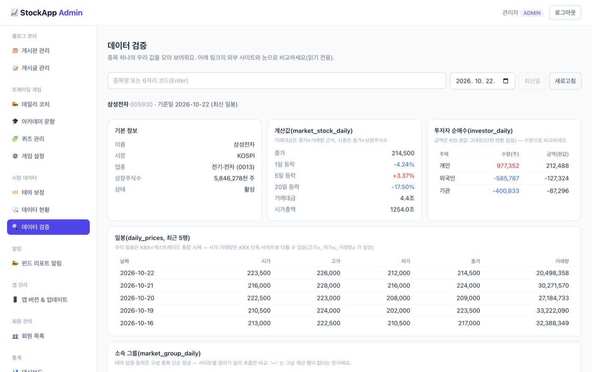

- 종목 하나에 대해 우리 DB에 있는 값을 모아 보여 주는 **읽기 전용** 화면입니다. 외부 사이트 링크와 눈으로 비교하는 용도입니다.
- 카드 구성: 프로필, 계산값, 투자자, 일봉 표, 테마·업종 소속, CANSLIM, 외부 링크, 재무.
- 종목과 기준일이 주소(`?ticker=&date=`)에 남아서 새로고침하거나 주소를 공유해도 같은 화면이 나옵니다.
- 상태: **완료**

## 11-1. 🆕 스크리너 탭 — `/market/screener` (2026-10-24)

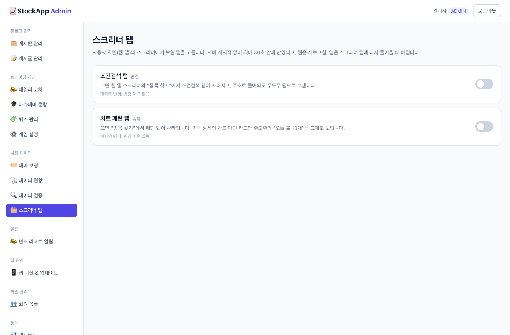

- 사용자 웹·앱 스크리너에서 **조건검색**과 **차트 패턴** 탭을 보일지 정하는 스위치 2개입니다.
- **기본은 숨김**입니다. 스위치 기록(`screener_features` 테이블)에 행이 없거나 조회에 실패해도 숨김으로 처리합니다. 다듬는 중인 탭을 기본으로 막아 두려는 설계입니다.
- 바꾸면 서버 재시작 없이 최대 30초 안에 반영됩니다(공개 조회 30초 캐시). 웹은 새로고침할 때, 앱은 스크리너 탭에 다시 들어올 때 바뀝니다.
- 탭을 숨겨도 **종목 상세의 차트 패턴 카드와 주도주의 '오늘 볼 종목' 카드는 그대로** 보입니다. 숨긴 탭 주소로 들어오면 주도주 탭으로 보냅니다.
- 스위치는 누르는 즉시 화면에 반영하고, 저장에 실패하면 되돌립니다. 각 카드에 마지막 변경 시각이 나옵니다.
- API(stock_api): `GET`·`PUT /api/v1/admin/screener/features`. 사용자 쪽은 GraphQL `screenerFeatures`.
- 캡처 시점(10-24): 두 스위치 모두 꺼짐, "변경 이력 없음".
- 작은 불일치: 이 화면 설명은 "오늘 볼 10개"라고 쓰지만, 사용자 화면의 카드 제목은 "오늘 볼 종목"입니다.
- 상태: **완료**(커밋 `e7c7e23`)

## 12. 펀드 리포트 알림 — `/fund-notices`

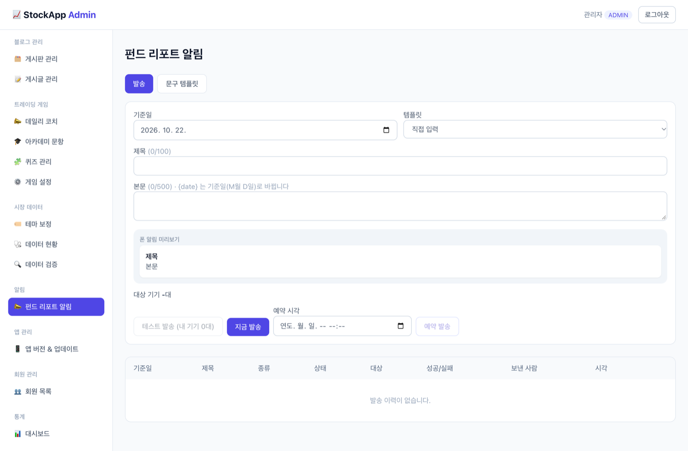

- **발송 탭**
  - 기준일과 템플릿을 고르고 제목(100자)과 본문(500자)을 씁니다. `{date}`는 "M월 D일"로 바뀝니다.
  - 휴대폰 알림 미리보기, 대상 기기 수, 같은 기준일에 이미 보냈는지를 보여 줍니다.
  - 발송 방법: **테스트 발송**(내 기기), **지금 발송**, **예약 발송**. 예약은 취소할 수 있습니다.
  - 펀드 알림을 보내면 앱이 꺼져 있어도 기록되도록, 무음 깨우기 푸시(`fund_refresh`)도 함께 나갑니다.
  - 웹에는 SSE로 갱신 신호를 보냅니다.
- **문구 템플릿 탭**: 템플릿을 추가·수정·삭제합니다.
- API(blog): `/admin/fund-notices*`, `/admin/push-sends*`, `/admin/push-templates*`
- 상태: **완료**. Android 실기기에서 확인했습니다. iOS 발송은 아직 범위 밖입니다.
- 캡처의 "대상 기기 -대 / 내 기기 0대"는 고장이 아닙니다. 대상 기기 수는 미리보기 응답을 받기 전까지 "-"로 나오고, 캡처에 쓴 관리자 계정에는 등록된 기기가 없었습니다.

## 13. 앱 버전 & 업데이트 — `/app/versions`

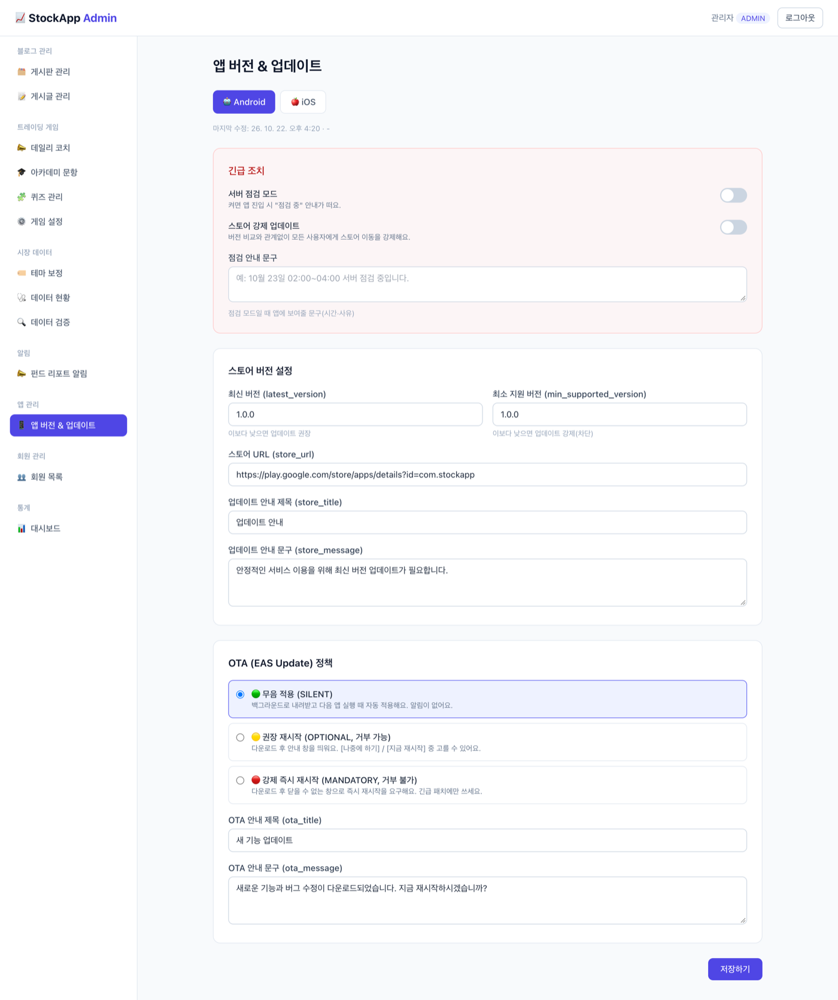

- Android와 iOS 탭을 따로 둡니다.
- **긴급 조치**: 서버 점검 모드(안내 문구 포함), 스토어 강제 업데이트.
- **스토어**: 최신 버전과 최소 지원 버전(semver 검사), 스토어 URL(https만), 안내 문구.
- **OTA 정책**: SILENT / OPTIONAL / MANDATORY와 OTA 안내 문구.
- 위험한 설정을 켜고 저장하면 확인창이 뜹니다.
- API(blog): `GET /admin/app-versions`, `PUT /admin/app-versions/{platform}`
- 상태: **완료**. iOS 스토어 링크는 출시 후에 바꿉니다.

## 14. 회원 목록 — `/members` (준비 중)

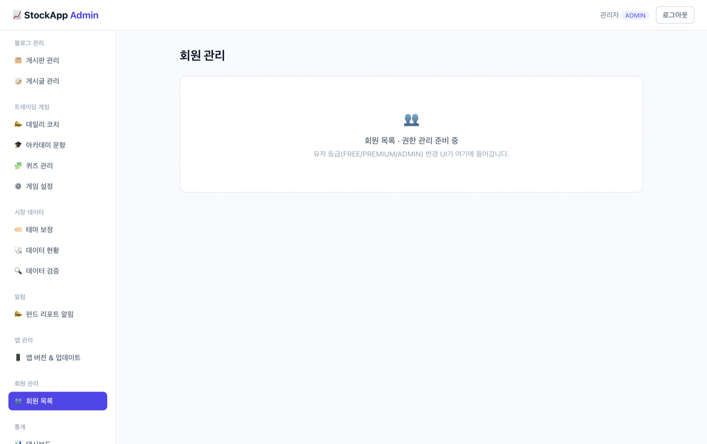

- "회원 목록 · 권한 관리 준비 중" 안내만 있습니다. 회원 등급(FREE/PREMIUM/ADMIN)을 바꾸는 UI가 들어갈 자리입니다.
- 상태: **미구현**. ROADMAP에 구현 계획이 없습니다.

## 15. 통계 대시보드 — `/stats` (준비 중)

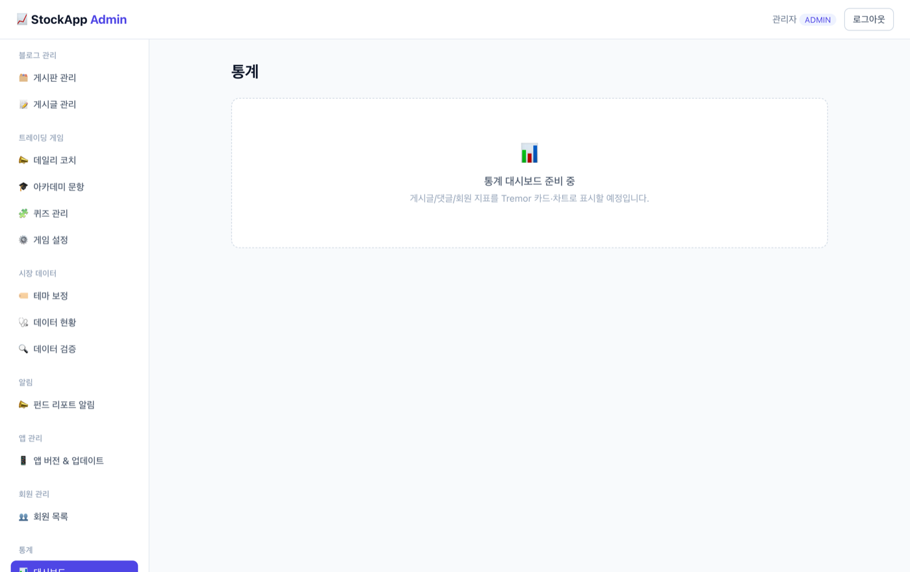

- 게시글, 댓글, 회원 지표를 보여 줄 자리입니다. 지금은 안내 문구만 있습니다.
- 상태: **미구현**
