# 모바일 앱 (mobile)

> React Native(Expo) · Expo Router · Unistyles v3 · 캡처: 2026-10-22, Android 에뮬레이터(개발 빌드 `com.stockapp.dev`, 1080×2400) + 로컬 백엔드(개발 DB)

## 한눈에 보기

| 구분 | 내용 |
|---|---|
| 라우트 화면 | 12개. 하단 탭 5개(홈, 커뮤니티, 게임, 스크리너, 내정보)와 스택 화면 7개 |
| 스택 화면 | 글 상세, 펀드 목록, 펀드 리포트, 수익 히스토리, 기록 백업, 테마/업종 상세, 종목 상세 |
| 화면 안의 하위 뷰 | 스크리너 칩 7개, 게임 시트 8개(랭킹, 규칙, 퀘스트, 아카데미, 퀴즈, 연속 출석, 주문 설정, 로그인 안내) |
| 앱 전체 오버레이 | 앱 업데이트 안내(5가지 모드), 토스트, API 진행 막대, 푸시 권한 시트 |
| 기기 기능 | 푸시(Expo → FCM), 백그라운드 작업, 파일 저장, SecureStore, Google Drive 백업, 딥링크, OTA 업데이트 |
| 빌드 분리 | 개발 빌드: `StockApp Dev`, `com.stockapp.dev`, 스킴 `stockapp-dev` 운영 빌드: `StockApp`, `com.stockapp`, 스킴 `stockapp` |

**디자인**
- 토스식 레이아웃과 파스텔 C안 팔레트를 씁니다. 바탕은 라벤더, 카드는 흰색, 핑크는 포인트에만 씁니다.
- 상승은 핑크레드, 하락은 블루로 표시합니다.
- 라이트/다크 테마는 OS 설정을 따릅니다. 기준 문서는 `docs/mobile_design_language.md`입니다.

**로그인**
- 카카오·네이버 간편 로그인은 인앱 브라우저로 이동했다가 돌아오는 방식입니다. 이때 일회용 교환 코드와 PKCE를 씁니다.
- 접근 토큰은 60분, 리프레시 토큰은 30일이며 회전 방식입니다. 플랫폼마다 세션은 1개만 유지됩니다.
- 개발용 닉네임 로그인은 개발 빌드에서만 보입니다. 애플 로그인은 iOS 출시 직전에 붙일 예정입니다.
- 🆕 개발 서버에 카카오 키를 적용했고 **앱 카카오 로그인 성공을 확인**했습니다(2026-10-23). 네이버는 키를 발급받은 뒤 확인합니다.

---

## 1. 홈 탭 — `/`

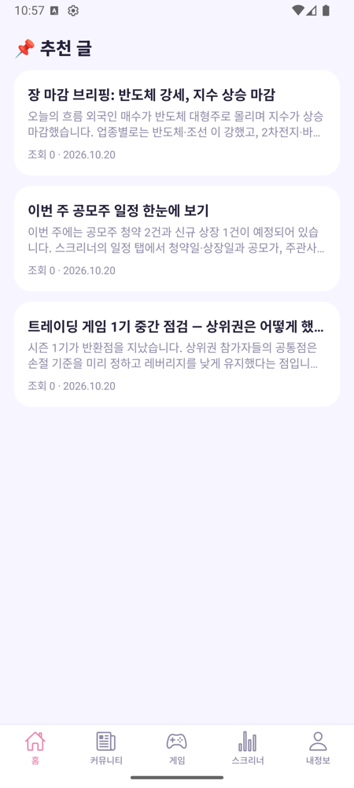

- 관리자가 ⭐로 지정한 **추천 글** 목록을 보여 줍니다. 당겨서 새로고침할 수 있습니다.
- 로그인한 사용자에게 새 글 알림 권한을 묻는 시트를 1번 띄웁니다.
- API(blog): `GET /api/v1/blogs?featured=true`
- 상태: **완료**

## 2. 커뮤니티 탭 — `/blog`

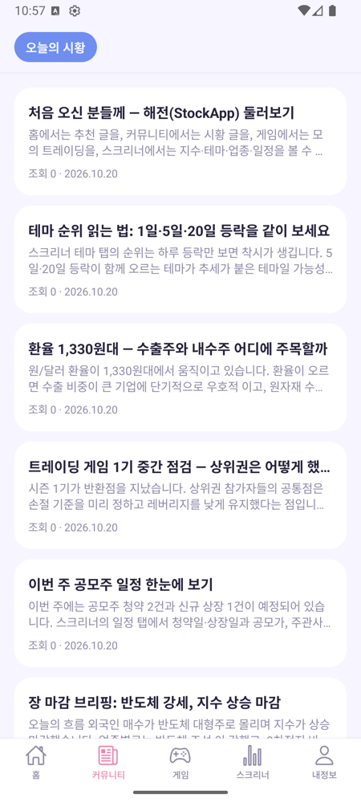

- 가로 게시판 탭에서 게시판을 고르면 글 목록이 10개씩 나옵니다. 이전/다음 페이지로 넘깁니다.
- 앱에서는 글을 쓸 수 없고, 댓글만 쓸 수 있습니다.
- API(blog): `GET /boards`, `GET /blogs?board_id&page&size`
- 상태: **완료**

## 3. 글 상세 — `/blog/[id]`

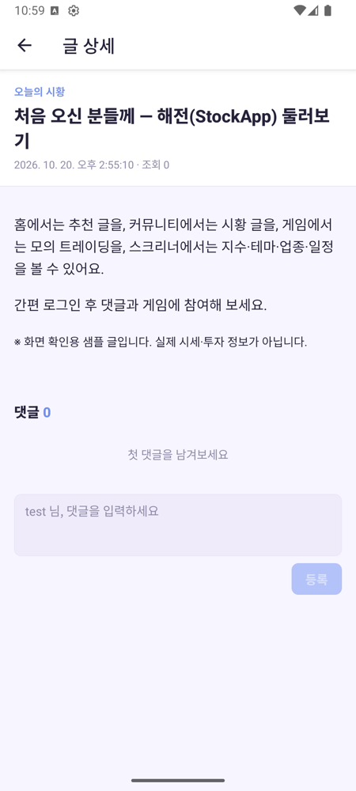

- 진입 경로: 홈·커뮤니티 카드를 누르거나, **새 글 푸시 알림**을 누르면 이 화면으로 옵니다.
- 본문 HTML은 WebView로 그리고, 높이를 본문에 맞춥니다. 댓글은 로그인하면 쓸 수 있습니다(1000자).
- 상태: **완료**

## 4. 게임 탭 — `/game` (가장 큰 화면)

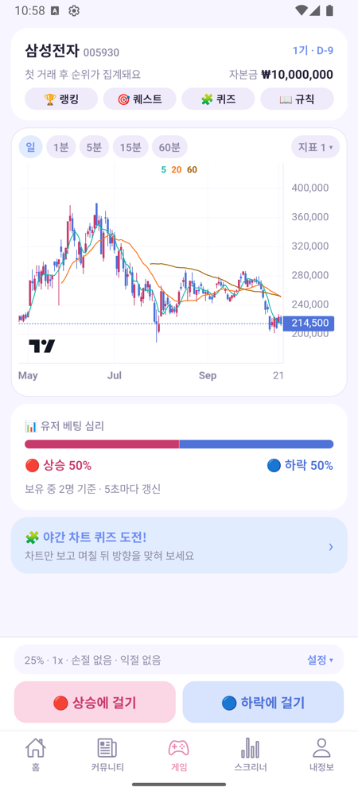

- 한 달 동안 한 종목으로 하는 **실시간 가상 트레이딩**입니다.
- **주문**
  - 상승/하락에 거는 원클릭 주문입니다.
  - 비중(25/50/100%, 10~90% 추가), 배율(1·2·5배), 손절과 익절을 고릅니다.
  - 5배는 아카데미를 통과해야 쓸 수 있습니다.
- **차트**: lightweight-charts를 WebView로 띄웁니다.
  - 봉 단위: 일봉, 1/5/15/60분.
  - 표시 항목: 이동평균, 볼린저 밴드, 코치 지지·저항선, 진입가, 손절선.
- **화면 구성 요소**: 유저 베팅 심리 바, 데일리 코치 배너, 장운영 배너(VI·거래정지·서킷브레이커), 야간 퀴즈 배너.
- **실시간 연결**: WebSocket으로 시세 틱, 개인 손익, 시장 심리를 받습니다. 순위는 30초마다 새로 받습니다.

| 랭킹 시트 | 규칙 시트 |
|---|---|
| 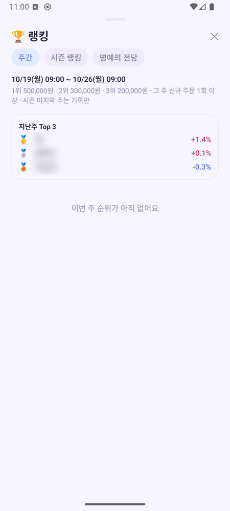 | 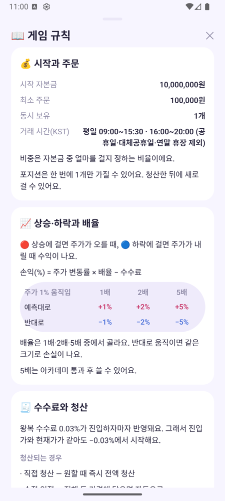 |

- **랭킹**: 주간, 시즌, 명예의 전당. 캡처에서는 다른 사용자 닉네임을 흐리게 처리했습니다.
- **규칙**: 시작 자본금, 거래 시간, 배율별 손익, 수수료, 청산 조건을 설명합니다.
- 그 밖의 시트: 퀘스트(보상 받기), 아카데미(5배 해금 시험), 야간 차트 퀴즈, 연속 출석 보상.
- API: trading_game `/api/game/*` 30여 개 + WebSocket `/ws/game/stream` + stock_api GraphQL `GameDailyCandles`.
- 상태: **코드 완료**
  - 실기기 확인이 남은 항목: 시트 열기/닫기, Android 뒤로가기, WebSocket 재연결.
  - 운영 `.env.production`에 `EXPO_PUBLIC_GAME_API_URL`이 없어서, 운영 빌드에서는 "시즌 준비 중"이 뜹니다.

## 5. 스크리너 탭 — `/screener`

화면 위쪽의 가로 칩 7개로 전환합니다. 모두 stock_api GraphQL을 쓰는 공개 데이터라 로그인이 필요 없습니다. 데이터는 장 마감 뒤 매일 20:30에 갱신되고, 국내 지수만 장중에 30초마다 갱신합니다.

| 시장 | 테마 | 일정 |
|---|---|---|
| 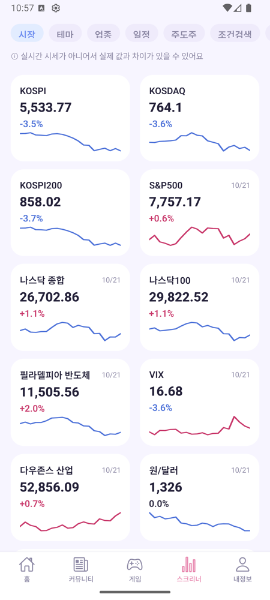 | 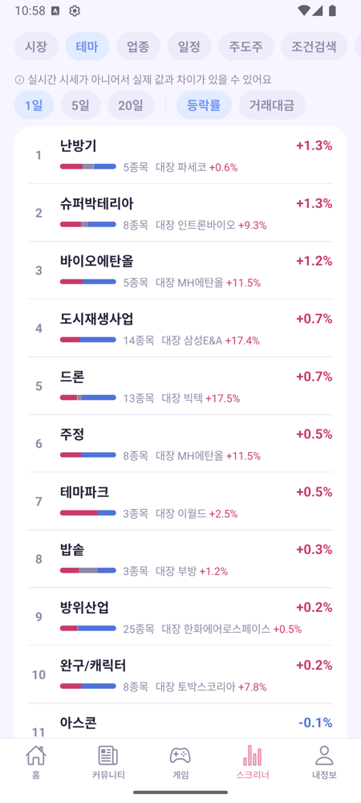 | 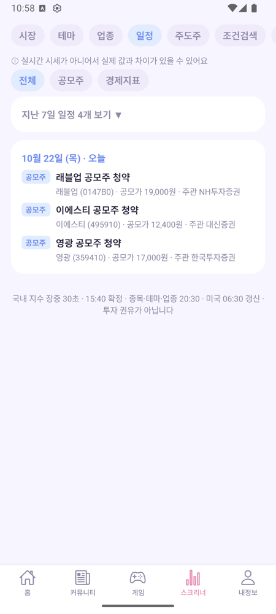 |

| 주도주(CANSLIM) | 조건검색 | 패턴 |
|---|---|---|
| 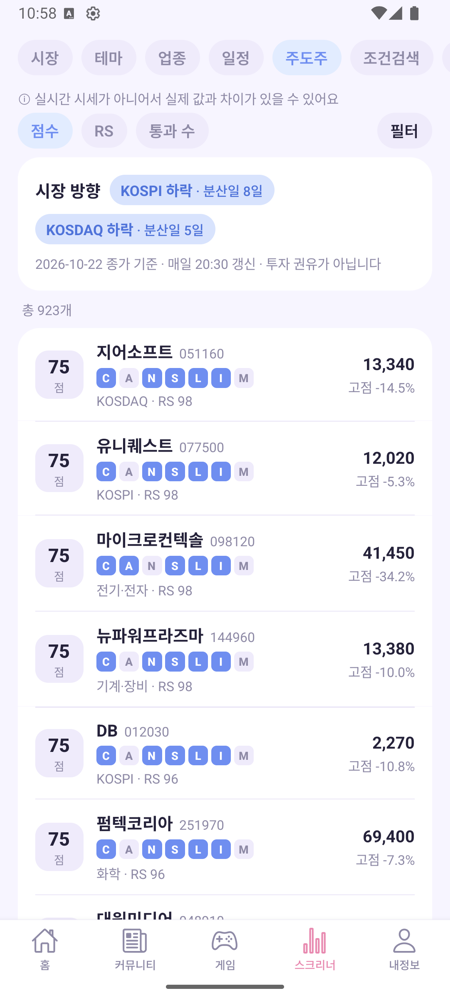 | 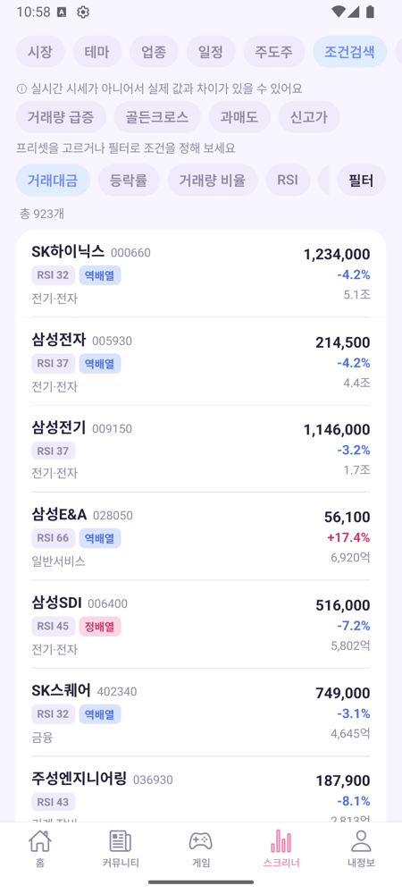 | 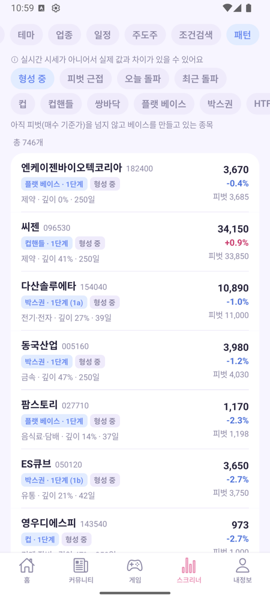 |

| 칩 | 하는 일 | GraphQL |
|---|---|---|
| 시장 | 국내·미국 지수 카드(스파크라인), 거시 지표, 주도 테마 Top 5, 다가오는 일정 | `MarketOverview` |
| 테마 / 업종 | 기간(1·5·20일)과 정렬(등락률·거래대금)을 고르는 순위 목록, 무한 스크롤 | `MarketGroups` |
| 일정 | 공모주 청약·상장, 미국 경제지표 발표일(앞으로 60일, 지난 7일은 펼쳐 보기) | `MarketCalendar` |
| 주도주 | CANSLIM 점수·RS·통과 수, 시장 방향 줄, 필터 시트 | `CanslimScreen` |
| 조건검색 | 프리셋(거래량 급증, 골든크로스, 과매도, 신고가)과 정렬, 필터 시트 | `ScreenerScreen` |
| 패턴 | 형성 중, 피벗 근접, 오늘 돌파, 최근 돌파 / 컵, 컵핸들, 쌍바닥 등 | `PatternScreen` |

- 상태
  - 시장, 테마, 업종, 일정: **완료**
  - 주도주, 조건검색: **코드 완료**(10-21), 실기기 확인 대기
  - 패턴: **코드 완료**(10-22), 실데이터 검증 대기

## 6. 테마/업종 상세 — `/market/[kind]/[id]`

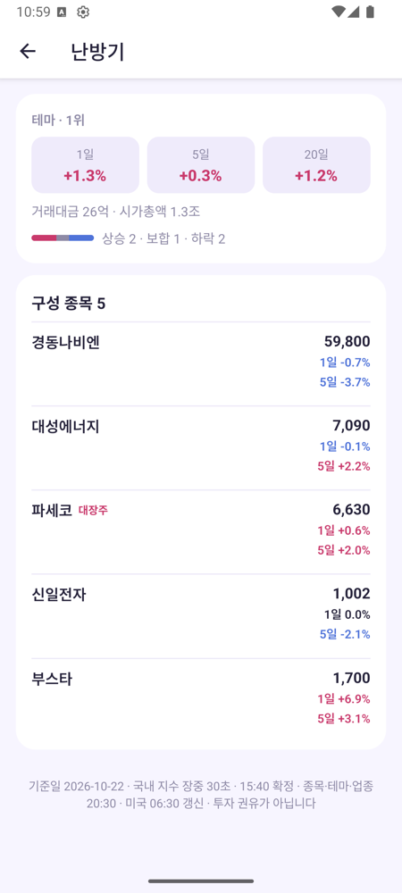

- 순위, 1·5·20일 등락, 거래대금, 시가총액, 상승/보합/하락 막대, 구성 종목(대장주 배지)을 보여 줍니다.
- 종목을 누르면 종목 상세로 이동합니다.
- API: GraphQL `MarketGroup`
- 상태: **완료**

## 7. 종목 상세 — `/stock/[ticker]`

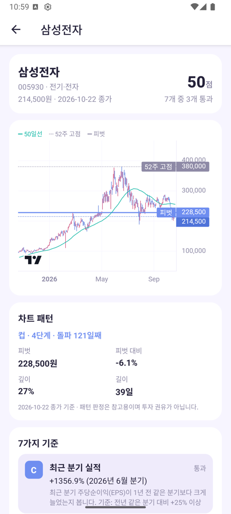

- 종가와 **CANSLIM 점수**(7개 기준 중 몇 개를 통과했는지)를 보여 줍니다.
- 약 1년치 일봉 차트에 50일선, 52주 고점, 패턴 피벗, 손절선이 표시됩니다.
- 현재 차트 패턴(피벗, 깊이, 길이), 7가지 기준 점수표, 점수 추이가 있습니다.
- API: GraphQL `CanslimScore`, `PatternBases`, `GameDailyCandles`
- 상태: **코드 완료**, 실기기 확인 대기

## 8. 내정보 탭 — `/profile`

| 로그인 전 | 로그인 후 |
|---|---|
| 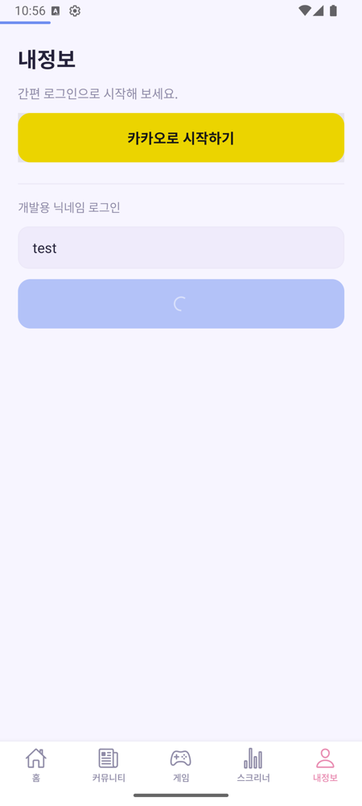 | 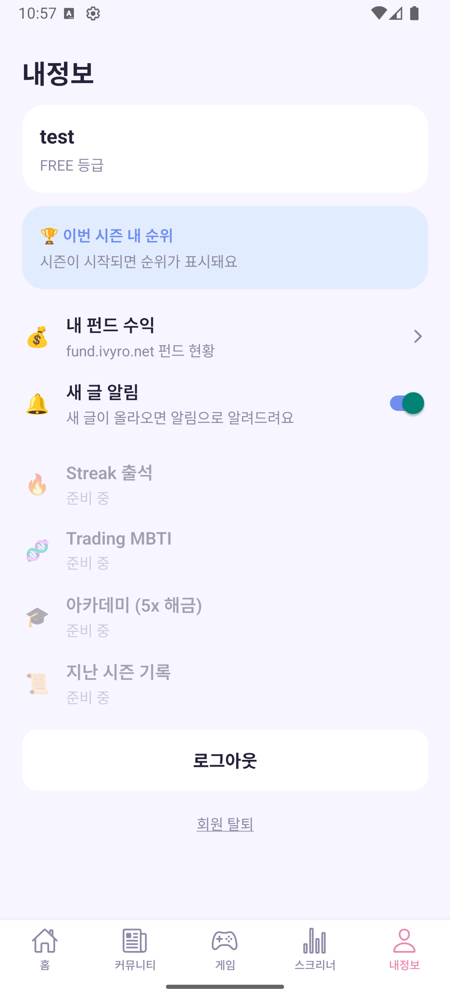 |

- **로그인 전**: 카카오(·네이버) 간편 로그인 버튼이 있습니다. 서버에서 켜 둔 공급자만 보입니다. 개발 빌드에서는 닉네임 로그인도 보입니다.
- **로그인 후**
  - 닉네임과 등급을 보여 줍니다.
  - **내 펀드 수익** 메뉴가 있습니다.
  - **새 글 알림** 스위치는 푸시 등록 플래그 `post_notice`를 바꿉니다.
  - 로그아웃과 회원 탈퇴(“탈퇴” 입력 후 확인)가 있습니다. 🆕 탈퇴가 성공하면 그 계정의 기기 펀드 데이터를 지우고 Google에서도 로그아웃합니다(9-4).
- 상태: **부분**
  - "이번 시즌 내 순위" 카드는 고정 문구만 나오고 실제 순위와 연결되어 있지 않습니다.
  - Streak 출석, Trading MBTI, 아카데미, 지난 시즌 기록 4줄은 "준비 중"입니다. 출석과 아카데미는 게임 탭 시트에는 있습니다.

## 9. 내 펀드 수익 — `/fund`

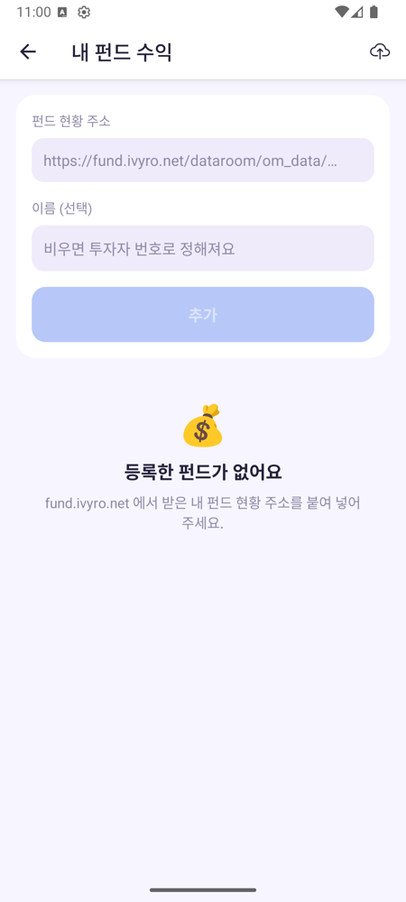

- fund.ivyro.net 펀드 현황 주소(`…/dataroom/om_data/*.htm`만 허용)와 이름(선택)을 넣어 펀드를 추가합니다. 최대 10개까지입니다.
- **목록은 기기에만 저장되고 서버에는 저장되지 않습니다.** 앱이 원본 HTML을 직접 가져와 파싱합니다.
- 앱을 켤 때와 다시 앞으로 가져올 때 **자동 갱신**합니다(10분 안에 확인한 펀드는 건너뜀). 당겨서 새로고침하면 강제로 갱신합니다.
- 첫 펀드를 등록하면 푸시 권한 시트가 뜹니다. 펀드를 추가하거나 지우면 푸시 등록과 백그라운드 작업 설정을 다시 맞춥니다.
- 헤더의 ☁️ 아이콘을 누르면 기록 백업 화면으로 갑니다.
- 상태: **완료**

### 9-1. 펀드 리포트 — `/fund/[id]` (캡처 없음)

- 실제 리포트에는 **투자자 실명, 투자자 번호, 계좌별 금액**이 들어 있어서 캡처하지 않았습니다.
- 동작
  - 캐시를 먼저 보여 준 뒤, 화면을 열 때마다 원본을 다시 가져옵니다.
  - 새로 가져오는 데 성공한 회차만 **날짜별 히스토리에 기록**합니다. 같은 날짜는 덮어씁니다.
  - 가져오기 실패, 원본 형식 변경, 일부 항목 누락이 생기면 배너와 "원본 열기" 링크를 보여 줍니다.
  - 헤더에 수익 히스토리 아이콘과 새로고침 버튼이 있습니다.
- 상태: **완료**

### 9-2. 수익 히스토리 — `/fund/history/[id]` (캡처 없음)

- 기기에 쌓인 계좌별 기록을 차트와 날짜별 목록으로 보여 줍니다. 계좌 칩과 기간 칩(1개월, 3개월, 전체)이 있습니다.
- 기록이 빠진 날이 있으면 "이전 기록 M.D"로 표시합니다. 빈 값을 추정해서 채우지 않습니다.
- 상태: **완료**. 금액이 보이는 화면이라 캡처하지 않았습니다.

### 9-3. 백그라운드 기록 (화면 없음)

- 관리자가 펀드 알림을 보내면 **무음 깨우기 푸시**가 함께 갑니다.
  - 앱이 꺼져 있어도 백그라운드 작업 `fund-refresh-push`가 깨어나 리포트를 기록합니다.
  - 여러 기기가 한꺼번에 몰리지 않도록 0~10초 랜덤 지연을 둡니다. 한 번 실행은 25초 안에 끝냅니다.
- 안전망으로 약 6시간마다 도는 정기 작업 `fund-refresh-periodic`이 있습니다.
- Android 실기기(갤럭시 A53)에서 즉시 발송, 알림 탭, 무음 푸시(백그라운드 상태와 완전히 꺼진 상태 모두)를 확인했습니다. 정기 작업이 꺼진 상태에서 실제로 도는지는 아직 측정하지 않았습니다.
- 사용자가 앱을 강제 종료했거나 iOS가 잠겨 있으면 기록되지 않을 수 있습니다.

### 9-4. 🆕 로그인 계정별 저장과 앱 삭제 시 정리 (2026-10-23, 캡처 없음)

- **바뀐 이유**
  - 예전에는 펀드 목록과 백업 상태를 기기에 키 하나로 저장했습니다. 그래서 개발용 게스트로 추가한 펀드가 카카오 계정에서도 보였습니다.
  - 앱을 지워도 Android 자동 백업이나 iOS 키체인 때문에 데이터가 되살아날 수 있었습니다.
- **원칙은 그대로**: 서버는 여전히 펀드 URL과 잔액을 모릅니다. 데이터는 기기 안에서 계정별로 나눌 뿐입니다. 다른 기기로 옮길 때는 같은 계정으로 Drive 복원을 씁니다.

| 항목 | 바뀐 내용 |
|---|---|
| 목록 저장 | SecureStore 키를 `fund_list_v1`에서 `fund_list_v1_u<회원ID>`로 바꿨습니다. 로그인하지 않았거나 복원 전이면 읽기와 쓰기를 모두 막아, 빈 목록으로 덮어쓰는 일을 방지합니다. |
| 캐시·기록 파일 | 펀드 id가 무작위라 겹치지 않으므로 그대로 둡니다. 어느 계정이 볼 수 있는지는 목록이 정합니다. |
| 옛 데이터 | 옛 공용 키에 펀드가 있으면 펀드 화면에 **"저장된 펀드를 가져올까요?"** 바텀시트를 띄웁니다(웹 9-1과 같은 문구). [가져오기]는 URL 중복을 빼고 최대 10개까지 합칩니다. 한도를 넘는 펀드는 기기에 남겨 다른 계정이 가져갈 수 있게 합니다. [버리기]는 쌓인 기록까지 지웁니다. |
| Drive 백업 | 백업 파일, 백업 상태, 대기 표시를 모두 **계정별**로 나눴습니다(`…-u<회원ID>`). Drive 작업 직전마다 현재 Google 계정이 연결할 때의 이메일과 같은지 확인하고, 다르면 작업하지 않습니다. 내 백업 파일이 없을 때만 옛 백업 파일로 복원합니다. |
| 계정 전환 | 자동 갱신과 목록 저장은 시작할 때의 계정으로 고정합니다. 저장하는 순간 계정이 바뀌어 있으면 저장하지 않습니다. 푸시 등록은 복원(hydrate)이 끝나기 전에는 `fund_notice=false`를 보내지 않습니다. |
| 회원 탈퇴 | 탈퇴가 성공하면 그 계정의 목록, 캐시, 기록, 백업 상태를 지우고 Google에서도 로그아웃합니다. Google 로그아웃은 그 계정이 Google을 연결했을 때만 합니다. |
| 앱 삭제(Android) | `allowBackup: false`로 Google 자동 백업이 재설치 때 펀드 파일과 설정을 되살리지 못하게 했습니다. **네이티브 변경이라 OTA로는 안 되고 새 APK가 필요합니다.** |
| 앱 삭제(iOS) | 재설치 후 첫 실행 때 키체인에 남은 로그인 정보와 펀드 키를 지웁니다. 키 목록을 볼 수 없어서 소유자 목록 `fund_owners_v1`을 따로 둡니다. 삭제가 계속 실패해도 매번 로그아웃되지 않도록 재시도는 3번까지만 합니다. |

- 캡처하지 않은 이유
  - 가져오기 시트를 띄우려면 옛 키에 데이터를 직접 써야 합니다.
  - 지금 에뮬레이터에 설치된 APK에는 `allowBackup` 변경이 들어 있지 않습니다.
  - 화면 문구와 동작은 웹과 같으니 [웹 9-1 캡처](web.md)를 참고하세요.
- 상태: **코드 완료**(jest 테스트 포함). **새 APK 빌드 후 실기기 확인 대기.** 확인 시나리오: 게스트로 추가 → 카카오 로그인 → 가져오기 안내 → 게스트로 다시 로그인했을 때 분리되는지 → 앱 삭제·재설치 후 데이터가 없는지.

## 10. 기록 백업 — `/fund/backup`

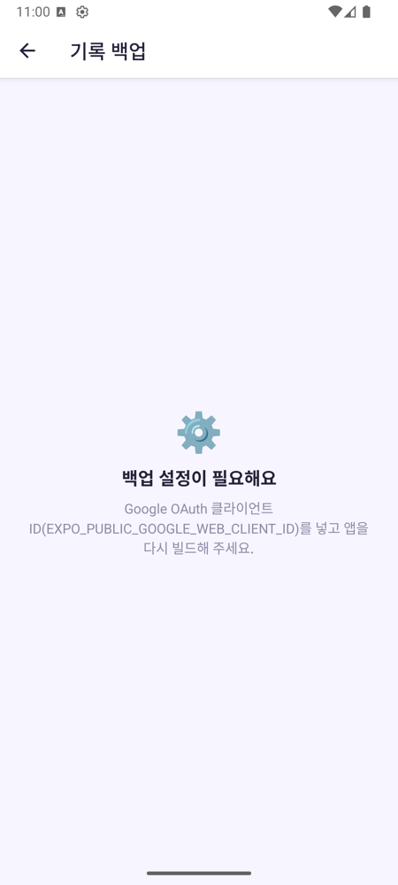

- Google 계정을 연결해 펀드 목록과 히스토리를 Google Drive의 앱 전용 폴더(appdata)에 백업하고 복원합니다.
- 새 기록이 생기면 하루 1번 자동으로 백업합니다. 백그라운드에서 생긴 기록은 앱을 다시 앞으로 가져올 때 백업합니다.
- 🆕 10-23부터 백업 파일과 상태가 **앱 계정별**로 나뉘고, 작업마다 Google 계정 이메일을 확인합니다(9-4). Google 계정을 확인하지 못하면 "Google 계정을 확인하지 못했어요"를 보여 줍니다.
- 상태: **코드 완료, 설정 대기**. `EXPO_PUBLIC_GOOGLE_WEB_CLIENT_ID`가 없어서 캡처처럼 **"백업 설정이 필요해요"** 화면이 나옵니다.

---

## 앱 전체 기능

| 기능 | 내용 | 상태 |
|---|---|---|
| 앱 업데이트 관리 | 실행할 때 `GET /app/version-check`로 점검 모드와 스토어 강제/권장 업데이트를 확인하고, 그다음 expo-updates OTA를 확인합니다. 결과에 따라 시트 5종 중 하나를 띄웁니다. | 코드 완료, 실기기 확인 대기 |
| 푸시 | Expo Push → FCM. Android 채널은 "펀드 리포트"와 "새 글" 2개. 알림을 누르면 펀드 알림은 `/fund`, 새 글 알림은 `/blog/{id}`로 이동합니다. | Android 확인 완료, iOS는 APNs 준비 전 |
| 실시간 신호 | 앱이 앞에 있을 때 SSE로 `fund_report_updated`를 받으면 0~30초 뒤 펀드를 갱신합니다. | 완료 |
| 세션 | 앱을 켤 때와 다시 앞으로 가져올 때(60초 간격 제한) `/auth/me`로 세션을 확인합니다. 401 사유 코드별로 안내 문구가 다릅니다. | 완료 |
| 웹(expo web) | WebView와 SecureStore가 웹에서 동작하지 않아 차트, 본문, 펀드 화면을 웹에서 쓸 수 없습니다. 웹은 `web_client`가 맡습니다. | 해당 없음 |
