# 사용자 웹 (web_client)

> React + Vite + TailwindCSS · 로컬 `http://localhost:3000` · 캡처: **2026-10-24 다시 찍음**(impeccable 디자인 정리 반영, 10/23 종가 데이터). 조건검색·패턴과 펀드 화면은 10-22·10-23 캡처 그대로. 개발 DB 기준, 데스크톱 1366px, 모바일 390px 폭.

## 한눈에 보기

| 구분 | 내용 |
|---|---|
| 화면 | 16개: 홈(오늘 시장 노트), 게시판 글 목록, 글 상세, 게임, 스크리너 7개, 종목 상세, 내정보, 펀드 목록, 펀드 리포트, 로그인 완료 |
| 그 밖 | `/community`는 첫 게시판으로 바로 이동 |
| 모달 | 9개: 로그인, 회원 탈퇴, 게임 모달 6개(랭킹, 규칙, 퀘스트, 아카데미, 차트 퀴즈, 연속 출석), 주문 설정 시트 |
| 메뉴 | 홈, 커뮤니티, 게임, 스크리너, 내정보. 640px 이상에서는 위쪽 메뉴, 그보다 좁으면 하단 탭바(선 아이콘)로 보입니다 |
| 탭 제목 | 경로마다 브라우저 탭 제목이 다릅니다(예: "세계 시장 · StockApp"). 글·종목 상세는 데이터가 오면 글 제목·종목명으로 바뀝니다 |
| 반응형 | 모든 화면이 모바일 폭에 맞춰집니다. 게임과 스크리너는 넓은 화면에서 2단, 좁은 화면에서 1단으로 바뀌고 항목을 펼쳐서 봅니다 |
| 웹에 없는 기능 | 푸시, 수익 히스토리, Drive 백업은 앱에만 있습니다 |

**전역 요소**
- 맨 위 API 진행 막대가 있습니다.
- SSE 알림 토스트를 띄웁니다. 새 글이 올라오면 "새 글: 제목"을, 펀드 리포트가 갱신되면 "오늘 수익률 리포트가 올라왔어요"를 보여 줍니다.
- 탭으로 돌아올 때 `/auth/me`로 세션을 확인합니다(60초 간격 제한).
- 로그인 상태에서는 펀드를 자동으로 갱신합니다.

**로그인**
- 카카오·네이버 간편 로그인을 씁니다. 브라우저 전체가 공급자 페이지로 이동했다가 `/auth/complete`로 돌아오고, PKCE 교환을 거칩니다.
- 개발 서버에서는 닉네임(게스트) 로그인도 보입니다. 이 기능은 운영으로 바꿀 때 꺼야 합니다.
- JWT는 localStorage에 저장하고 12시간 유지됩니다. 리프레시 토큰은 없습니다.

**운영 프록시**
- 운영에서는 `server.cjs`가 같은 도메인에서 서비스별로 요청을 넘깁니다.
- 경로: `/_api/blog`, `/_api/auth`, `/_api/stock`, `/_api/game`(WS 포함).

---

## 🆕 디자인·접근성 정리 (2026-10-23, impeccable)

impeccable 스킬로 웹 전체를 평가(critique)하고 고친 결과입니다. 점수는 **25/40 → 26/40 → 27/40**로 올랐고, 3차 평가에서 나온 P1 3건과 P2 2건도 그 뒤 커밋(`d43b960`, `7e6c991`)에서 처리했습니다.

- **기준 문서**
  - `PRODUCT.md`: 누구를 위한 제품인지(초보~중급 개인 투자자), 차별점 4가지, 원칙, 접근성 기준 **WCAG 2.2 AA**.
  - `DESIGN.md` + `.impeccable/design.json`: 웹 디자인 시스템. 북극성은 '저녁의 라벤더 노트'로, 평평한 면과 색 층, "말랑하고 또렷하게"가 방향입니다. 토큰, 컴포넌트, 규칙을 적어 두었습니다.
  - 평가 기록: `.impeccable/critique/` 3개 파일.
- **색**
  - 파스텔 C안의 색상(hue)은 그대로 두고, 글자로 쓰는 토큰의 명도만 낮춰 **모든 글자 대비를 4.5:1 이상**으로 맞췄습니다. 검출기로 다시 검사하니 저대비 요소가 1,678건에서 0건이 됐습니다.
  - 주 버튼은 파스텔 블루 바탕에 진한 글자를 씁니다(사용자 결정).
  - **색의 뜻을 하나로**: 핑크는 상승에만 씁니다. 오류·위험은 새 `danger`(호박색)로 바꿨습니다. 분류 배지는 중립색이고, 0.0%는 회색으로 보입니다.
- **레이아웃**
  - 모든 화면의 왼쪽 선이 같습니다(1280px 기준 x=80). 헤더 폭은 고정해서, 화면을 옮겨도 로고와 메뉴가 움직이지 않습니다.
  - 제목은 24px `PageHeader`, 카드 여백은 `Card`(16/12/0px)로 통일했습니다.
  - 넓은 화면에서 홈과 게시판 목록은 2단이고, 옆 칸에 추천 글을 둡니다.
- **글자·말투**
  - 12px보다 작은 글자를 없앴습니다(하단 탭바 이름만 예외).
  - 한국어는 어절 단위로 줄을 바꿉니다(`word-break: keep-all`).
  - 화면 문구는 "~해요"체로 통일했습니다. 기준일 안내도 "10/23 종가 기준 · 투자 권유가 아니에요"로 줄였습니다.
- **조작**
  - 누르는 영역은 44px입니다. 칩만 32px로, 의도한 예외로 `DESIGN.md`에 기록했습니다.
  - 버튼 변형으로 `tertiary`(라벤더 채움)와 `danger`를 추가했습니다.
  - 조작 요소에서 이모지를 빼고 선 아이콘으로 바꿨습니다. 출석 보상만 이모지를 유지합니다.
- **로딩**: 최종 화면과 같은 크기의 뼈대를 먼저 그려서, 데이터가 들어올 때 화면이 밀리지 않습니다. CLS 측정값은 홈 모바일 0.255 → 0.012, 종목 상세 0.097 → 0.008입니다.
- **남은 것**
  - 모바일 앱 팔레트는 아직 대비를 맞추기 전 값입니다(`PRODUCT.md`).
  - 카카오·네이버 공식 로그인 버튼 이미지는 사용자가 넣어 주길 기다리고 있습니다.
  - 3차 평가의 사소한 관찰: 404 안내 없음, 종목 상세에 당일 등락률 없음, 로고의 📈 이모지 등.

---

## 1. 홈 — `/` (오늘 시장 노트)

| 데스크톱 | 모바일 |
|---|---|
| 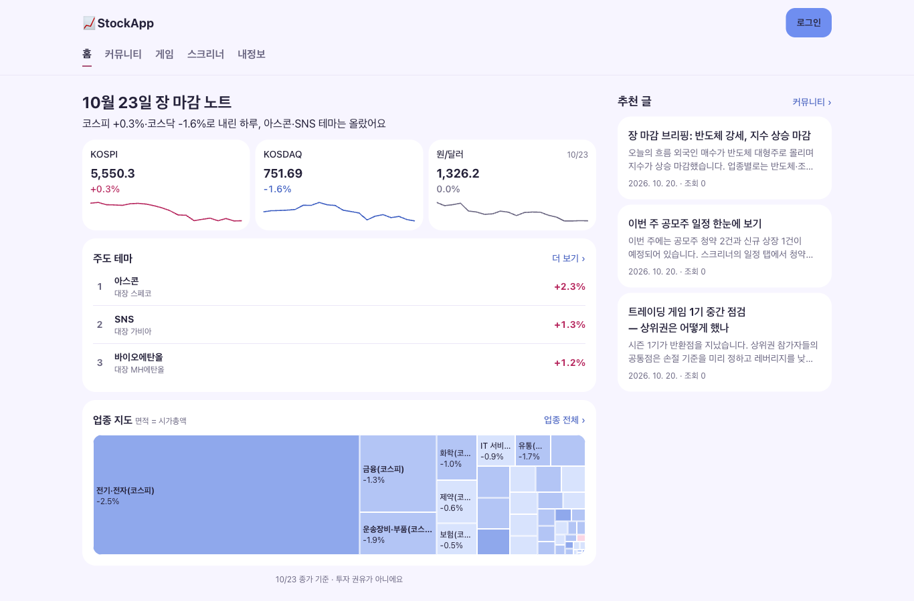 | 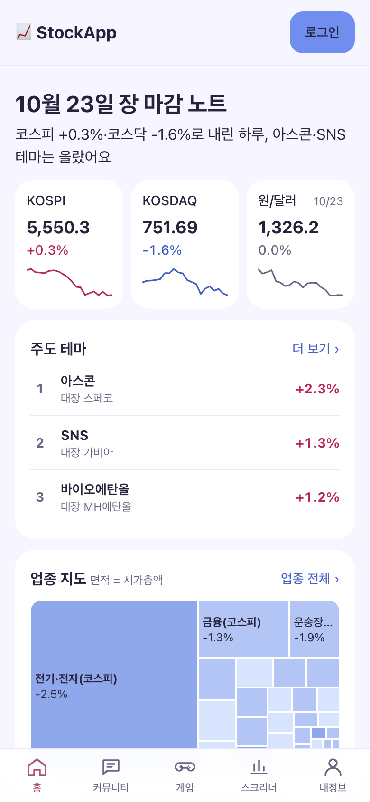 |

- 🆕 추천 글만 보여 주던 홈을 **'오늘 시장 노트'**로 바꿨습니다(10-23). 위에서부터 다음 순서로 나옵니다.
  1. **날짜 제목**: "10월 23일 장 마감 노트"처럼 나오고, 장중이면 "장중 노트"로 바뀝니다.
  2. **한 줄 요약**: 받은 숫자만으로 화면에서 만드는 문장입니다. 예: "코스피 +0.3%·코스닥 -1.6%로 내린 하루, 아스콘·SNS 테마는 올랐어요".
     - 오른 하루/내린 하루/보합은 코스피·코스닥 평균으로 정하고, ±0.3% 안이면 보합입니다.
     - 오른 테마는 최대 2개까지 넣습니다.
     - 해석이나 전망은 넣지 않습니다(`lib/marketSummary.ts`).
  3. **지수 카드 3장**: 코스피, 코스닥, 원/달러. 장중에는 30초마다 갱신하고, 선 색은 오늘 등락을 따릅니다(0.0%면 회색).
  4. **주도 테마 3개**와 대장주. '더 보기'를 누르면 테마 탭으로 갑니다.
  5. **업종 지도 미리보기**(면적 = 시가총액). '업종 전체'를 누르면 업종 탭으로 갑니다.
- **추천 글**: 넓은 화면(1024px 이상)에서는 오른쪽 칸에 4개, 좁은 화면에서는 노트 아래에 2개가 나옵니다. 전체 목록은 커뮤니티에 있습니다.
- 조각마다 따로 불러와서, 하나가 실패해도 나머지는 보입니다. 로딩 중에는 실제 높이와 같은 뼈대를 그려 둡니다.
- API: stock_api GraphQL(지수·테마·업종), blog `GET /blogs?featured=true`. 로그인 없이 볼 수 있습니다.
- 앱 홈 탭은 아직 추천 글만 보여 줍니다(웹 먼저 적용).
- 상태: **완료**

## 2. 로그인 모달

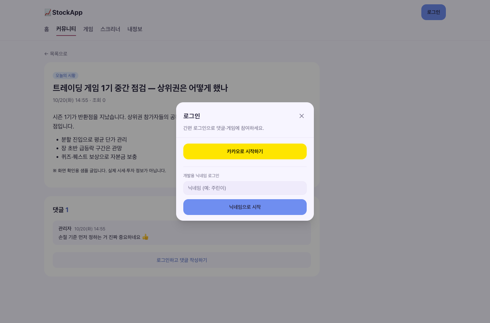

- 서버에서 켜 둔 공급자 버튼만 보입니다(`GET /auth/social/providers`). 캡처 시점에는 카카오만 켜져 있었습니다.
- 다음 화면에서 로그인 모달이 열립니다: 헤더의 [로그인] 버튼, 내정보, 글 상세의 댓글 영역, 게임에서 주문할 때.
- 🆕 **접근성과 오류 복구 정리**(10-23)
  - 공용 `Modal` 위에 올렸습니다. 화면 읽기 프로그램에 대화상자로 읽히고(`role=dialog`), ESC로 닫힙니다. 포커스는 창 안에 머물다가 닫으면 원래 버튼으로 돌아갑니다.
  - 공급자 목록을 못 받아 오면 '다시 시도' 버튼이 나옵니다.
  - 간편 로그인 버튼을 누르면 이동하는 동안 비활성화됩니다("이동하고 있어요…"). 그래서 두 번 눌리지 않습니다.
  - 닉네임 입력칸은 이름표와 연결돼 있고, 빈 값으로 제출하면 입력칸으로 포커스를 옮깁니다. 모바일에서는 16px이라 iOS가 화면을 확대하지 않습니다.
- 상태: **완료**. 개발 서버에 카카오 키를 적용했고 **웹 카카오 로그인 성공을 확인**했습니다(2026-10-23). 남은 일: 네이버 키 발급 뒤 확인, 공식 버튼 디자인.

## 3. 커뮤니티 — `/boards/:boardId`

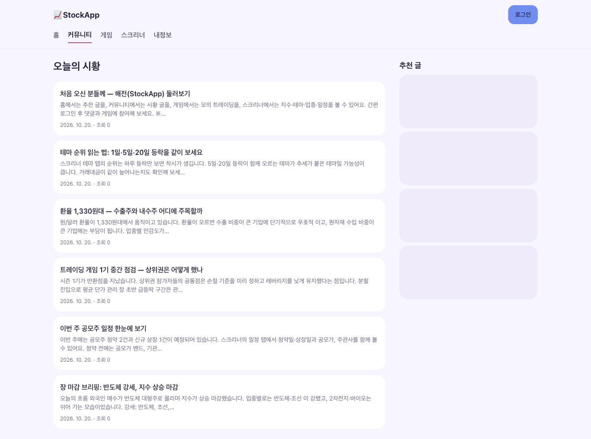

- 헤더 아래 게시판 칩에서 게시판을 고르면 글 목록이 10개씩 나옵니다. 게시판이 하나뿐이면 칩을 숨깁니다.
- 🆕 넓은 화면에서는 목록 옆 칸에 추천 글이 나옵니다. 로딩 뼈대가 있고, 페이지 버튼은 공용 `Button`(44px)으로 바꿨습니다.
- 웹에서는 글을 쓸 수 없습니다. 글은 관리자 웹에서 씁니다.
- 상태: **완료**

## 4. 글 상세 — `/posts/:id`

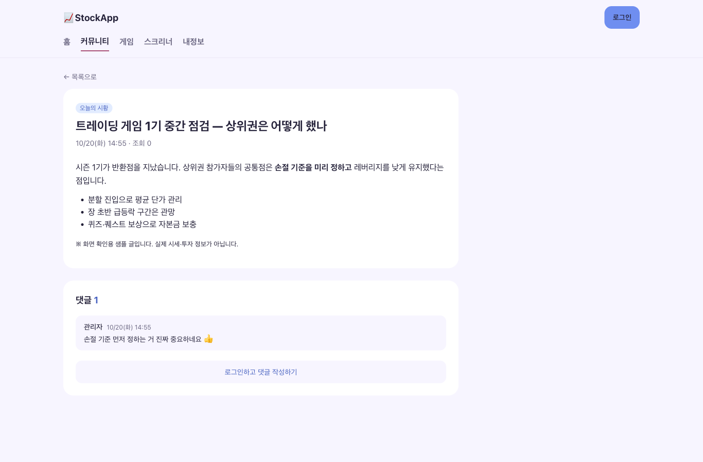

- 게시판 배지, 제목, 작성 시각(🆕 초 없이 KST "10/20(화) 14:55"), 조회수, 본문(관리자가 넣은 차트 이미지 포함)을 보여 줍니다.
- 로그인하면 댓글을 쓸 수 있습니다(1000자). 댓글을 꺼 둔 게시판이면 안내 문구가 나옵니다.
- 상태: **완료**. 댓글 수정·삭제와 대댓글은 없습니다.
- 10-24 캡처의 댓글 작성자는 "관리자"라 따로 가리지 않았습니다.

## 5. 트레이딩 게임 — `/game`

| 데스크톱(2단) | 모바일(하단 주문 바) |
|---|---|
| 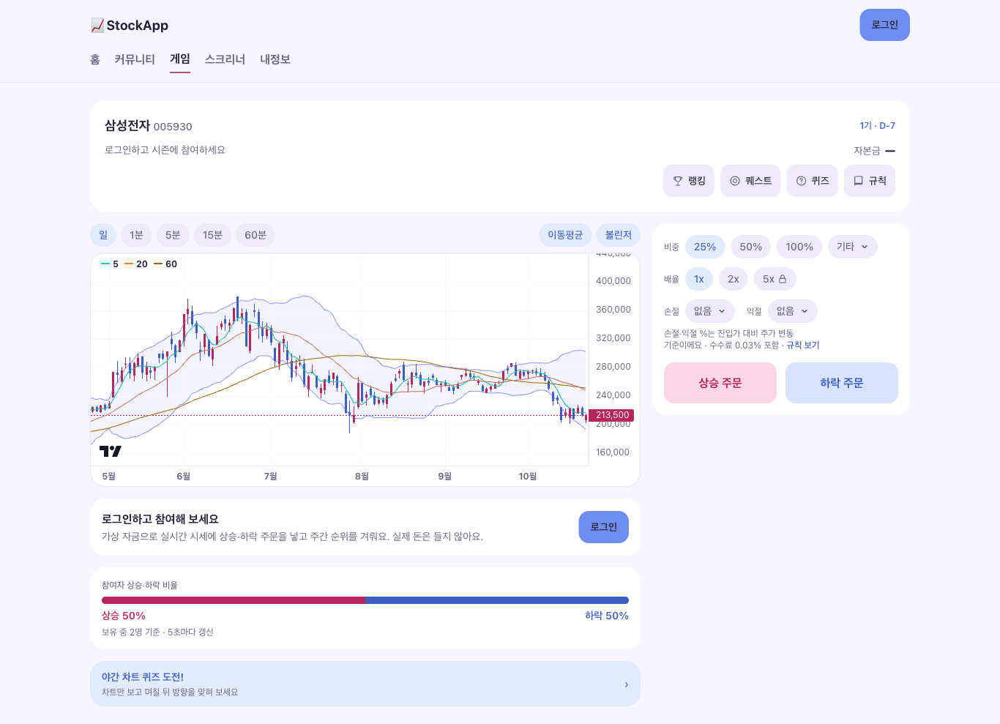 | 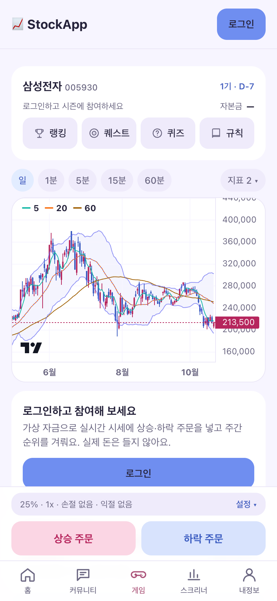 |

- 앱과 같은 실시간 가상 롱/숏 게임입니다.
- **배치**
  - 넓은 화면에서는 차트와 오른쪽 sticky 주문 패널을 2단으로 둡니다.
  - 좁은 화면에서는 아래에 고정 주문 바를 두고, "주문 설정" 시트로 세부 값을 고릅니다.
- **차트**: lightweight-charts를 씁니다. 봉 단위는 일봉과 1/5/15/60분, 보조지표는 이동평균과 볼린저 밴드입니다.
- **로그인 없이 볼 수 있는 것**: 차트, 참여자 상승·하락 비율, 랭킹, 규칙. 주문을 하거나 개인 모달을 열면 로그인 모달이 뜹니다.
- 🆕 **10-23 바뀐 점**
  - 비로그인 사용자에게는 **"로그인하고 참여해 보세요"** 카드(설명 + 로그인 버튼)가 나옵니다.
  - 헤더의 랭킹·퀘스트·퀴즈·규칙 버튼은 무채색 선 아이콘에 44px 영역입니다. 5배 잠금은 🔒 대신 선 자물쇠와 "잠김" 이름으로 표시합니다.
  - 용어도 바꿨습니다: "상승/하락에 걸기" → **"상승/하락 주문"**, "유저 베팅 심리" → **"참여자 상승·하락 비율"**, 순위 "Top 3" → "1~3위".
  - 차트의 가격선 이름(진입·손절·지지·저항 등)은 차트 안에서 빼고 왼쪽 위 범례로 옮겼습니다. 가까운 선끼리 이름이 겹쳤기 때문입니다.
- **실시간 연결**: WebSocket `/ws/game/stream`
  - 토큰이 없으면 공개 연결로 시세 틱과 심리만 받습니다.
  - 토큰이 있으면 개인 손익, 넛지, 코치 메시지, 장 상태도 받습니다.
- 상태: **완료**. 일부 모달(연속 출석 보상, 주간 랭킹 보상 토스트)은 브라우저 확인이 남았습니다.

## 6. 스크리너 — `/screener/*`

모든 탭이 stock_api GraphQL만 씁니다. 로그인이 필요 없고 개인정보도 없습니다. 탭마다 주소가 따로 있습니다.

- 🆕 **메뉴**: 한 줄에 두 묶음으로 나눴습니다. 위아래 2층이던 메뉴를 1층으로 줄여서 높이가 약 100px에서 65px이 됐습니다.
  - **시장**: 세계 시장 · 테마 · 업종 · 일정
  - **종목 찾기**: 주도주 · 조건검색 · 패턴
  - 주소(`/screener/<탭>`)는 예전 그대로라 기존 링크가 깨지지 않습니다. 좁은 화면에서는 가로로 넘기고, 지금 탭이 보이도록 자동으로 이동합니다.
- 🆕 **조건검색·패턴 탭은 지금 숨겨져 있습니다.** 관리자 웹 '스크리너 탭' 스위치([admin.md 11-1](admin.md))가 기본으로 꺼져 있어서, 캡처 화면의 메뉴에도 '주도주'만 보입니다.
  - 숨긴 탭 주소로 들어오면 주도주로 보냅니다.
  - 스위치 상태를 묻는 동안이나 조회에 실패했을 때도 숨깁니다.
- 모든 탭 위에 "실시간 시세가 아니어서 실제 값과 차이가 있을 수 있어요" 안내가 있습니다.

### 6-1. 세계 시장 — `/screener/market`

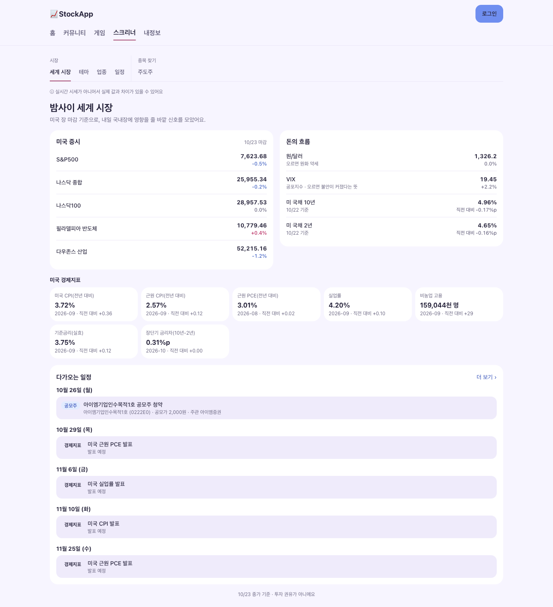

- 🆕 '시장 요약'이던 탭을 **'밤사이 세계 시장'**으로 바꿨습니다(10-23). 국내 지수, 주도 테마, 업종 지도는 홈 노트로 옮겨서 중복을 없앴습니다. 이 탭은 **바깥 신호**만 모읍니다.
  - **미국 증시**: S&P500, 나스닥 종합, 나스닥100, 필라델피아 반도체, 다우. 미국 마감일을 함께 표시합니다.
  - **돈의 흐름**: 원/달러, VIX, 미 국채 10년·2년.
    - 원/달러와 VIX는 회색 숫자에 부호와 뜻풀이를 붙입니다("오르면 원화 약세", "오르면 불안이 커졌다는 뜻"). 오르는 게 좋은 일이 아니기 때문입니다.
    - 국채는 FRED 데이터가 있을 때만 보입니다.
  - **미국 경제지표**(FRED) 카드와 **다가오는 일정**. 데이터가 없으면 숨깁니다.
- 넓은 화면에서는 2단이고, 카드는 내용 높이만큼만 차지합니다. 지수와 거시 지표는 탭이 보이는 동안 30초마다 다시 받습니다.
- 🆕 근원 PCE 카드가 빠지던 문제를 고쳤습니다. PCE는 발표가 두 달 늦어서 1년 전 값이 430일 창 밖에 있었습니다. 그래서 읽는 기간을 500일로 늘렸습니다(`fca10ef`).

### 6-2. 테마 / 6-3. 업종 — `/screener/themes`, `/screener/sectors`

| 테마(목록 + 상세) | 업종(트리맵) |
|---|---|
| 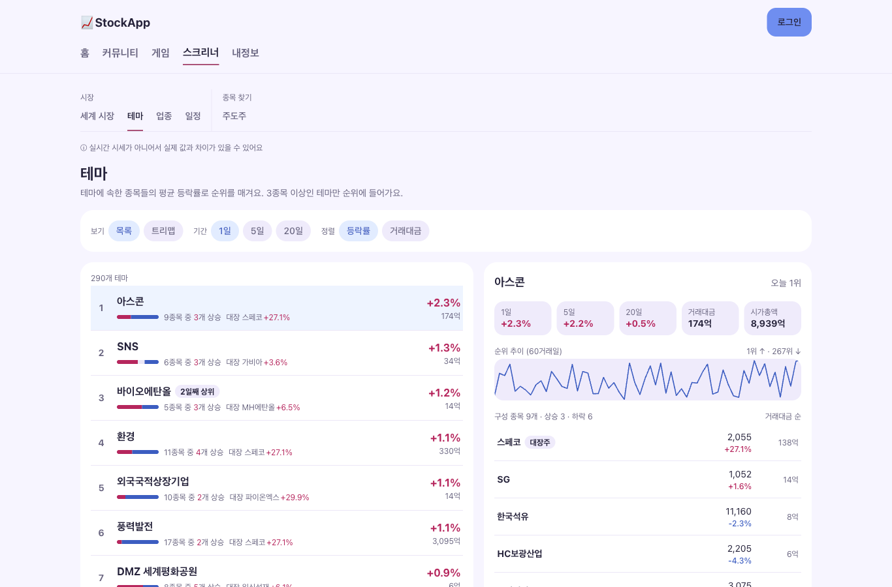 | 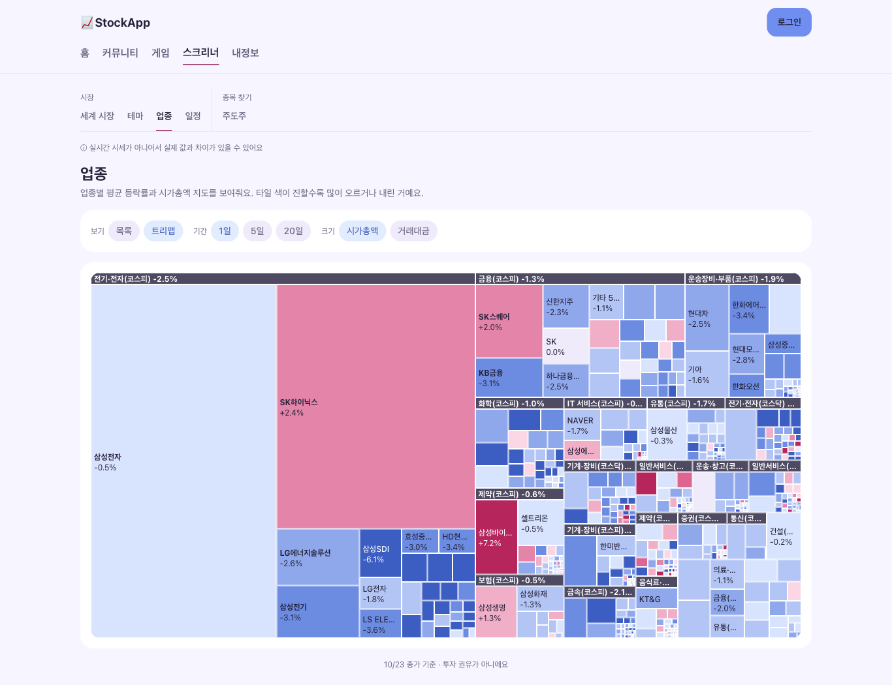 |

- **목록과 트리맵**
  - 보기 방식은 목록과 트리맵 두 가지입니다.
  - 기간은 1/5/20일, 정렬은 등락률/거래대금입니다.
  - 목록 각 행에 연속 상위 일수, 상승/하락 종목 수, 대장주가 나옵니다.
  - 🆕 미니 막대 옆에 "9종목 중 3개 상승"처럼 글자도 씁니다. 색만으로 구분하지 않으려는 것입니다.
- 🆕 트리맵에서 12px 글자가 들어가지 않는 작은 칸은 글자를 숨깁니다. 대신 마우스를 올리거나 화면 읽기 프로그램으로 이름을 알 수 있습니다(예전에는 10px로 줄였음).
- **상세**: 등락, 순위 추이 그래프, 구성 종목이 나옵니다. 넓은 화면에서는 오른쪽 sticky 영역에, 좁은 화면에서는 항목 아래에 펼쳐집니다.

### 6-4. 일정 — `/screener/calendar`

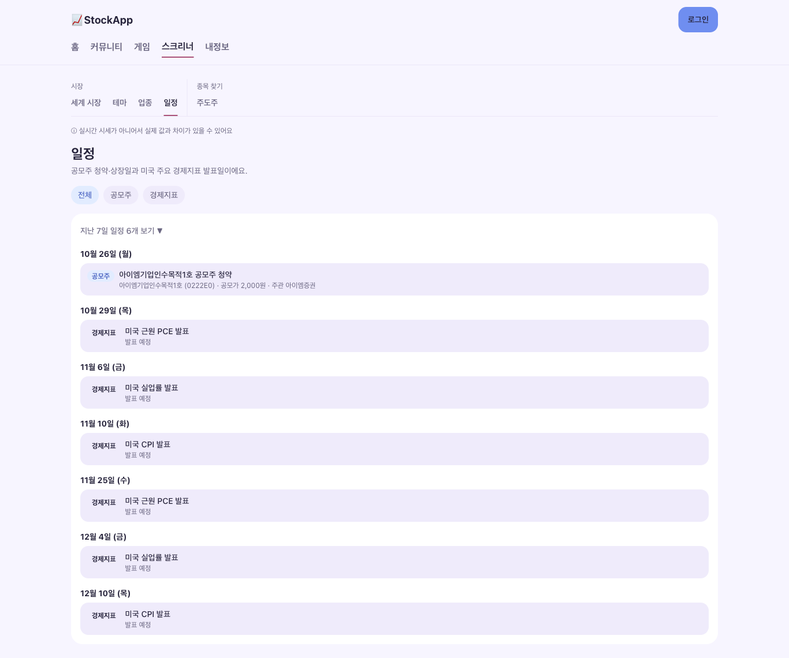

- 공모주 청약·상장일과 미국 경제지표(CPI, 고용, PCE) 발표일을 보여 줍니다. 앞으로 60일을 보여 주고, 지난 7일은 접어 둡니다.
- 🆕 지난 일정을 흐리게(opacity) 하던 처리를 없앴습니다(대비 때문). 일정 탭에는 기준일 안내도 넣지 않습니다.
- 남은 문제: 공모주 제목이 종목코드로 나오는 경우가 있습니다.

### 6-5. 주도주(CANSLIM) — `/screener/leaders`

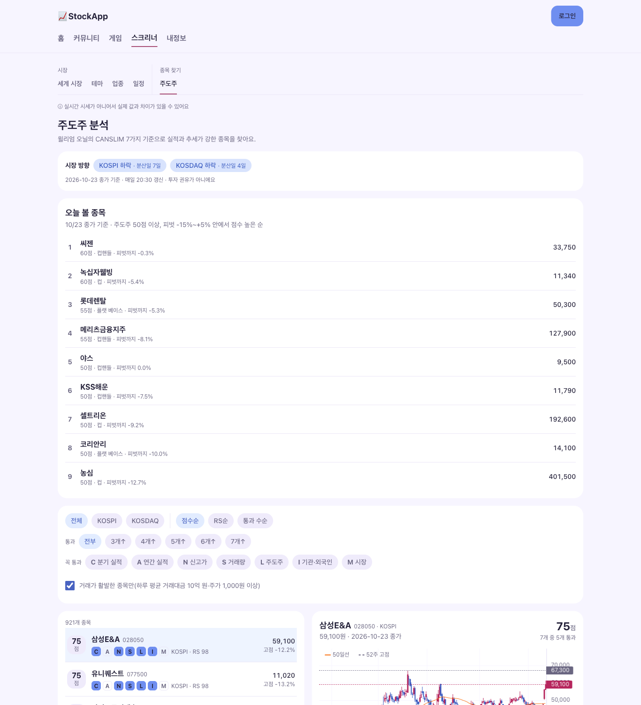

- CANSLIM 7개 기준으로 종목을 고릅니다.
- 위쪽에 시장 방향 띠가 있고, 필터는 시장, 최소 통과 수, 꼭 통과할 글자, 유동성입니다. 좁은 화면에서는 필터를 접어 두고 '필터 · n개 적용'으로 보여 줍니다.
- 🆕 **'오늘 볼 종목' 카드**(맨 위, 10-23)
  - 주도주 50점 이상이면서 활성 패턴의 피벗까지 −15%~+5% 안에 있는 종목을 점수 높은 순으로(같으면 피벗에 가까운 순) **최대 10개** 보여 줍니다. 기준은 카드 부제에 적혀 있습니다.
  - 10/23 종가 기준으로는 9개였습니다. 70점 + 피벗 ±5%처럼 고정 기준을 쓰면 하락장(10/22)에서 0개가 나와서, 넉넉한 후보 안에서 순위로 자르는 방식을 택했습니다.
  - 불러오기에 실패하면 카드만 숨깁니다.
  - 판정 근거와 한계(막 돌파한 종목이 실제로는 빠지는 문제 등)는 [screener-guide.md 2-4](screener-guide.md)에 정리했습니다.
- 🆕 **목록 행 통일**
  - 주도주, 조건검색, 패턴 세 탭이 같은 공용 `StockRow`를 씁니다. 순서는 이름·코드 → 배지 줄 → 오른쪽 숫자입니다.
  - 배지는 `Tag` 네 가지 톤(분류·상태·상승 사건·주의)으로만 고릅니다.
- 🆕 **CANSLIM 글자 배지**: 통과는 채운 배지, 미달은 빈 테두리입니다. 색을 못 봐도 구분할 수 있고, 화면 읽기 프로그램은 묶음 전체를 요약 문장으로 읽습니다.
- 상세에는 글자별 점수표, 일봉(50일선, 52주 고점), 60거래일 점수 추이가 나옵니다.

### 6-6. 조건검색 — `/screener/finder` (지금 숨김)

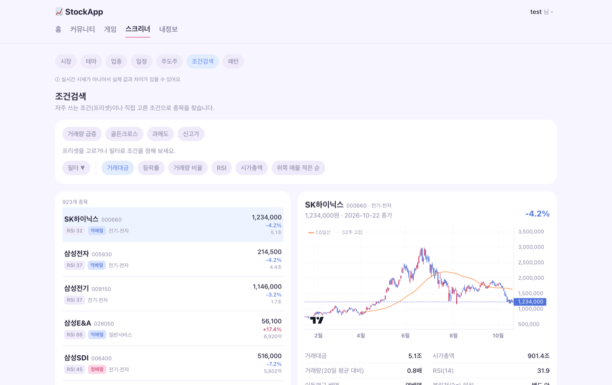

> 10-22 캡처입니다. 지금은 관리자 스위치로 숨겨져 있고, 그 뒤 행 모양이 공용 `StockRow`로 바뀌었습니다.

- **프리셋**: 거래량 급증, 골든크로스, 과매도, 신고가.
- **필터**: 가격, 시가총액, 거래대금, 정배열/역배열, 볼린저, 위쪽 매물, ROE, PER, PBR, 부채비율, 성장률.
- **정렬 칩**은 6개입니다.
- 🆕 배지 색에 뜻을 붙였습니다. RSI 과열은 주의색에 "과열" 글자를 붙이고, 과매도·배열·골든크로스는 중립색입니다.
- 기획에는 있었지만 빠진 것: 관심 종목 담기, 미니 스파크라인, 배당·MACD 필터.

### 6-7. 패턴 — `/screener/patterns` (지금 숨김)

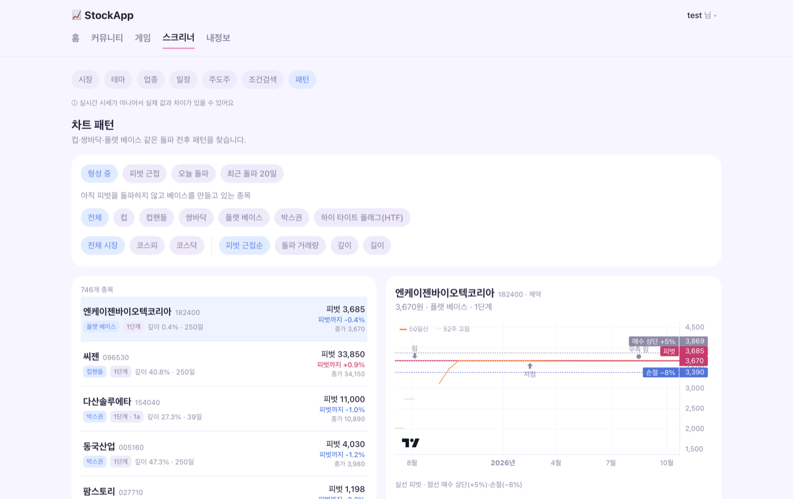

> 10-22 캡처입니다. 지금은 관리자 스위치로 숨겨져 있습니다.

- **리포트**: 형성 중, 피벗 근접, 오늘 돌파, 최근 20일 돌파.
- **패턴**: 컵, 컵핸들, 쌍바닥, 플랫 베이스, 박스권, HTF.
- **상세**: 일봉에 피벗, 매수 상단, 손절선, 베이스 꼭짓점 마커가 표시되고, 베이스 이력 표가 있습니다.
- 🆕 **접히는 용어 설명**(베이스·피벗·깊이·길이·단계)을 넣었습니다. 패턴 종류 배지는 중립색, 단계는 테두리이고, "피벗까지"는 거리라서 회색입니다.
- 상태: **코드 완료, 숨김**. 37개월치 일봉 백필 후 실데이터 검증이 필요합니다.

## 7. 종목 상세 — `/stock/:ticker` (10-22 신규)

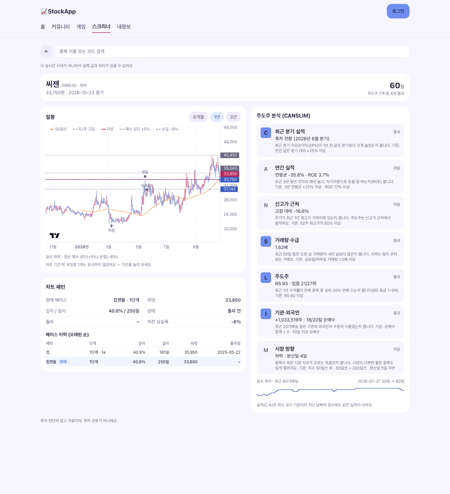

> 10-24 캡처: 씨젠(096530), '오늘 볼 종목' 1위.

- 위쪽에 **종목 검색창**이 있습니다(이름이나 6자리 코드, 자동완성).
- 종가, CANSLIM 점수, 통과 수를 보여 줍니다.
- 일봉은 기간을 6개월, 1년, 3년 중에서 고릅니다. 50일선, 52주 고점, 피벗과 돌파 마커가 표시됩니다.
- 🆕 선 이름(50일선·52주 고점·피벗·매수 상단 +5%·손절 −8%)은 차트 안이 아니라 **왼쪽 위 범례**에 나옵니다. '52주 고점'은 그 선이 실제로 있을 때만 범례에 넣습니다. 예전에는 없는 선도 안내했습니다.
- 🆕 브라우저 탭 제목은 종목명으로 바뀝니다(예: "씨젠 · StockApp"). 로딩 중에는 점수표와 패턴 카드 자리에 뼈대를 그립니다.
- **차트 패턴** 카드: 현재 베이스, 피벗, 깊이와 길이, 상태, 베이스 이력.
- **주도주 분석** 카드: C·A·N·S·L·I·M 7개 항목의 설명과 기준, 점수 추이.
- 스크리너의 주도주, 조건검색, 패턴, 테마 상세에 있는 "종목 상세 보기 →" 링크로 들어옵니다.
- API: GraphQL `StockSearch`, `CanslimScore`, `PatternBases`, `GameDailyCandles`
- 상태: **완료**(커밋 8d7d3c7)

## 8. 내정보 — `/me`

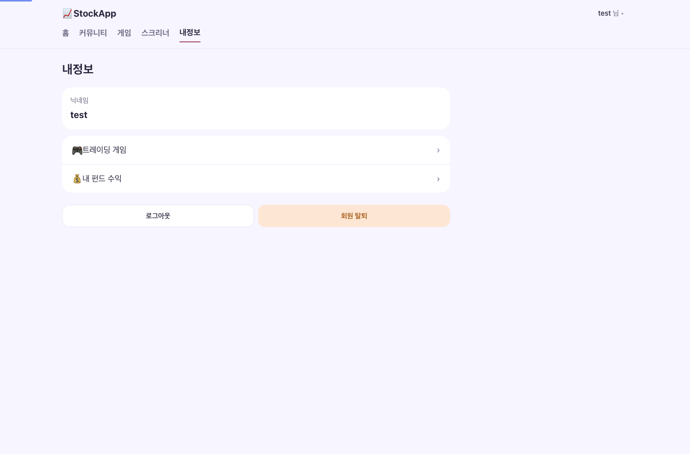

- **로그인 전**: 로그인 안내 카드가 보입니다.
- **로그인 후**: 닉네임 카드, 바로가기(🎮 트레이딩 게임, 💰 내 펀드 수익), 로그아웃, 회원 탈퇴가 있습니다. 회원 탈퇴는 `DELETE /auth/me`이고 확인 모달을 거칩니다.
- 🆕 회원 탈퇴 버튼은 위험 색(`danger`, 호박색)입니다. 읽기 폭 768px로 왼쪽에 붙입니다. 바로가기의 이모지는 3차 평가에서 '사소한 관찰'로 남아 있습니다.
- 상태: **완료**. 알림 설정 같은 항목은 앱에만 있습니다.

## 9. 내 펀드 수익 — `/me/funds`, `/me/funds/:id`

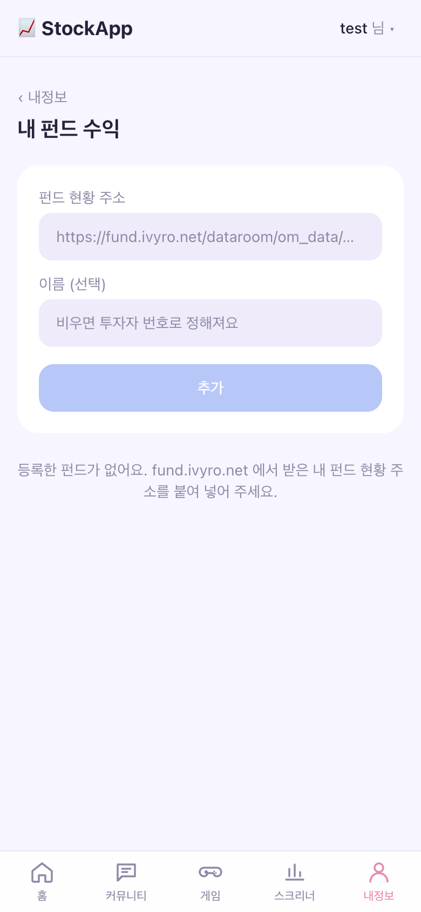

- 앱과 같은 펀드 현황 기능의 **웹 버전**입니다. 로그인해야 들어올 수 있습니다.
- **목록**
  - fund.ivyro.net 주소를 넣어 추가하고, 지울 수 있습니다.
  - 목록 화면에서 기준일, 마지막 확인 시각, "확인 중…" 상태를 보여 줍니다.
  - 목록과 캐시는 **브라우저 localStorage에만** 저장되고, 로그인 계정별로 나뉩니다(9-1).
- **리포트**: 캐시를 먼저 보여 준 뒤 원본을 다시 가져옵니다. 가져오기 실패, 형식 변경, 누락이 생기면 배너를 보여 줍니다.
  - 리포트 화면은 실명과 금액이 나와서 캡처하지 않았습니다.
  - 🆕 리포트 화면의 색과 크기를 디자인 토큰으로 바꾸고, 가운데 정렬을 왼쪽 정렬로 맞췄습니다(10-23).
- **데이터 흐름**
  - 브라우저가 fund.ivyro.net에 직접 `fetch`합니다. 원본이 CORS를 허용합니다.
  - 백엔드는 갱신 신호(SSE `fund_report_updated`)만 보냅니다.
- **앱과 코드 공유**: 파싱·표시 로직의 원본은 `mobile/src/features/fund/core/`이고, `web_client/src/lib/fundCore/`에 같은 내용을 복사해 씁니다. 두 곳이 같은지는 `scripts/check-fund-core-sync.sh`로 검사합니다.
- 웹에서 일부러 뺀 것: 수익 히스토리, Drive 백업, 웹과 앱 사이 목록 동기화.
- 상태: **완료**(웹 범위 기준)

### 9-1. 🆕 로그인 계정별 저장 (2026-10-23)

| 가져오기 안내 | 가져온 뒤 (계정별 목록) |
|---|---|
| 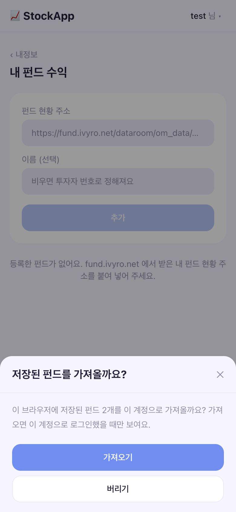 | 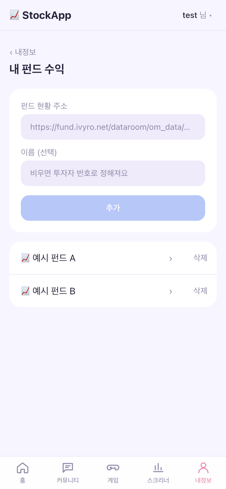 |

- **바뀐 이유**: 예전에는 펀드 목록을 브라우저에 키 하나(`fund_list_v1`)로 저장해서, 어느 계정으로 로그인해도 같은 펀드가 보였습니다.
- **지금 동작**
  - 목록은 `fund_list_v1_u<회원ID>` 키에 **계정별로** 저장됩니다.
  - 로그아웃 상태에서는 목록이 보이지 않습니다.
  - 리포트 캐시는 펀드 id 기준이라 따로 옮기지 않습니다.
- **옛 목록 가져오기 안내**
  - 옛 공용 키에 펀드가 남아 있으면, 펀드 화면에 처음 들어온 계정에게 **"저장된 펀드를 가져올까요?"** 창을 1번 띄웁니다.
  - **가져오기**: 내 목록과 합칩니다. URL이 같은 펀드는 하나로 합치고, 최대 10개까지만 가져옵니다. 한도를 넘는 펀드는 이 브라우저에 남겨 두고 개수를 알려 줍니다.
  - **버리기**: 확인을 받은 뒤 옛 목록과 해당 캐시를 지웁니다.
  - 창을 닫기만 하면 아무것도 바꾸지 않고, 다음에 들어올 때 다시 묻습니다.
- **회원 탈퇴**: 탈퇴가 성공했을 때만 그 계정의 펀드 목록과 캐시를 브라우저에서 지웁니다.
- **자동 갱신**: 갱신하는 도중에 계정이 바뀌어도 처음 시작한 계정으로만 저장합니다. 다른 계정 목록으로 새지 않습니다.
- 캡처는 가짜 펀드 2개(`예시 펀드 A/B`)로 찍었고, 찍은 뒤 지웠습니다.
- 상태: **완료**(커밋 `6ba9a85`, `03d906a`). 설계 문서: `docs/superpowers/specs/2026-10-23-fund-per-account-storage-design.md`

## 10. 간편 로그인 완료 — `/auth/complete` (캡처 없음)

- 소셜 로그인 콜백이 돌아오는 경로입니다. 화면에는 "로그인 중…"만 잠깐 보입니다.
- `?code=`를 받으면 PKCE verifier와 함께 교환해서 JWT를 저장하고, 로그인 전에 있던 경로로 돌아갑니다.
- `?error=`를 받으면 사유를 보여 줍니다: 취소, 이용 제한, 만료, 실패.
- 상태: **완료**
