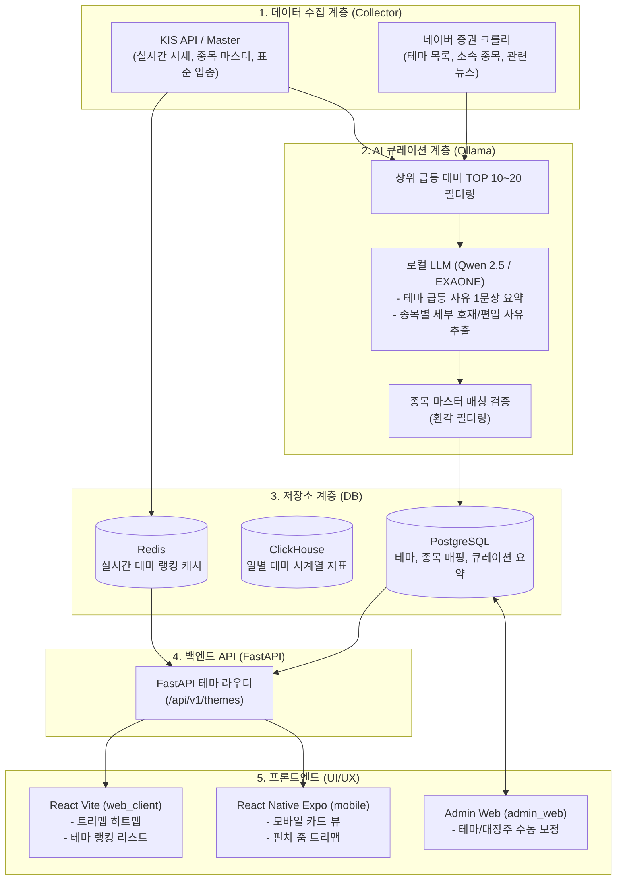

# 주달(Judal) 스타일 주식 큐레이션 서비스 기획 및 구현 로드맵

본 문서는 **주달(Judal)** 스타일의 주식 테마·섹터 큐레이션 및 시각화 서비스를 본 프로젝트(React / React Native / FastAPI / KIS / Ollama)에 구축하기 위한 종합 기획서, 아키텍처 설계, 구현 로드맵, 그리고 발생 가능한 문제점 및 장단점 분석을 담고 있습니다.

---

## 1. 개요 및 기획 목적

### 1.1 배경
* 시장 참여자(개인 투자자)들은 개별 종목뿐만 아니라 **시장의 자금이 어디로 쏠리는지(주도 테마, 섹터)**를 파악하는 것을 가장 중요하게 생각합니다.
* 기존 증권사 MTS/HTS는 공식 산업분류(WICS/KRX)에 치우쳐 있어 시장의 실제 유행 테마(예: CXL, 초전도체, 온디바이스 AI, 정책 수혜주 등)를 빠르게 반영하지 못합니다.
* '주달(judal.co.kr)'은 이러한 시장의 니즈를 파고들어 **테마 묶음, 대장주 식별, 핀비즈(Finviz) 스타일의 트리맵(TreeMap), 일정 캘린더**를 직관적으로 제공해 높은 인기를 얻고 있습니다.

### 1.2 목표
1. **정확한 골격 + 똑똑한 AI 살붙이기 (Hybrid Curation)**: 네이버 증권 테마 크롤링으로 신뢰도 높은 종목 풀을 확보하고, 로컬 LLM(Ollama)으로 "오늘 오른 이유"와 "대장주 맥락"을 비용 없이 자동 요약.
2. **멀티 플랫폼 시각화**: 웹(`web_client`)과 모바일(`mobile`)에 ECharts 기반의 반응형 트리맵 및 테마 대시보드 구축.
3. **독립적이고 비용 없는 운영**: 상용 유료 테마 API 없이 KIS API + 크롤링 + 로컬 Ollama만으로 유지비 0원의 자동화 파이프라인 완성.

---

## 2. 전체 시스템 아키텍처



---

## 3. 핵심 기능 명세

### 3.1 실시간 주도 테마 랭킹 (Theme Ranking)
* **내용**: 테마에 속한 종목들의 등락률 평균 및 총 거래대금을 기준으로 정렬.
* **지표**:
  * 테마 평균 등락률 (%)
  * 테마 총 거래대금 (억원)
  * 상승 종목 수 vs 하락 종목 수 비율
* **갱신 주기**: 장중 1~3분 간격 캐시 갱신 (Redis 활용).

### 3.2 섹터 & 테마 트리맵 (TreeMap Visualization)
* **내용**: 시장 전체 또는 특정 섹터/테마 내 종목 비중과 등락률을 사각형 타일로 시각화 (Finviz 스타일).
* **표현 규칙**:
  * 타일 면적: 시가총액 또는 당일 거래대금 비례.
  * 타일 색상: 
    * 상승: 빨간색 (진한 빨강일수록 +20% 이상)
    * 하락: 파란색 (진한 파랑일수록 -20% 이하)
    * 보합: 회색/어두운 배경색
* **인터랙션**: 테마 박스 클릭 시 해당 테마 상세 뷰로 드릴다운.

### 3.3 테마 상세 및 종목 큐레이션 카드 (AI Theme Detail)
* **테마 헤더**:
  * 테마명, 평균 등락률, 총 거래대금
  * **AI 브리핑**: Ollama가 요약한 "오늘 테마가 시장에서 주목받는 이유" 1~2문장 노출.
* **종목 리스트**:
  * **대장주(주도주) 뱃지**: 거래대금 및 상승률 최상위 종목에 `대장주` 태그 부여.
  * **편입 사유 / 당일 호재**: 각 종목별로 왜 이 테마에 속해 있는지 핵심 키워드 표시.
  * 실시간 현재가, 등락률, 거래대금.

### 3.4 주식 일정 및 이슈 캘린더 (Event Calendar)
* **내용**: 향후 주가에 영향을 줄 수 있는 주요 일정 캘린더 제공.
* **항목**: 공모주 청약/상장일, 기업 실적 발표일, 정부 정책 발표, 글로벌 학회/박람회(CES, 바이오 학회 등).

---

## 4. 데이터베이스 모델링 (PostgreSQL)

```sql
-- 1. 테마 마스터
CREATE TABLE themes (
    id SERIAL PRIMARY KEY,
    name VARCHAR(100) UNIQUE NOT NULL,      -- 예: 'CXL(컴퓨트익스프레스링크)'
    category VARCHAR(50) DEFAULT '일반',     -- '반도체', '바이오', '정책', '원자재' 등
    description TEXT,                       -- 테마 일반 설명
    ai_summary TEXT,                        -- 오늘자 Ollama 생성 테마 브리핑
    summary_updated_at TIMESTAMP,
    created_at TIMESTAMP DEFAULT NOW()
);

-- 2. 테마-종목 매핑 테이블
CREATE TABLE theme_stocks (
    id SERIAL PRIMARY KEY,
    theme_id INT REFERENCES themes(id) ON DELETE CASCADE,
    stock_code VARCHAR(10) NOT NULL,        -- 단축코드 6자리 (예: 394280)
    stock_name VARCHAR(100) NOT NULL,       -- 종목명 (오픈엣지테크놀로지)
    is_leader BOOLEAN DEFAULT FALSE,        -- 대장주 여부
    reason TEXT,                            -- 테마 편입 사유
    today_trigger TEXT,                     -- 오늘 오른 세부 사유 (Ollama 추출)
    updated_at TIMESTAMP DEFAULT NOW(),
    UNIQUE(theme_id, stock_code)
);

-- 3. 일별 테마 시세 지표 (ClickHouse 또는 PostgreSQL)
CREATE TABLE theme_daily_stats (
    trade_date DATE NOT NULL,
    theme_id INT NOT NULL,
    avg_change_rate NUMERIC(6, 2),          -- 테마 평균 등락률
    total_volume_amount BIGINT,             -- 총 거래대금
    leader_stock_code VARCHAR(10),          -- 당일 대장주
    PRIMARY KEY(trade_date, theme_id)
);

-- 4. 주식 캘린더/일정
CREATE TABLE stock_events (
    id SERIAL PRIMARY KEY,
    event_date DATE NOT NULL,
    title VARCHAR(200) NOT NULL,
    category VARCHAR(50) NOT NULL,          -- '실적', '공모주', '정책', '학회'
    related_theme_id INT REFERENCES themes(id) ON DELETE SET NULL,
    description TEXT
);
```

---

## 5. 단계별 구현 로드맵 (Phases)

| 단계 | 목표 | 주요 작업 내용 | 예상 산출물 |
| :--- | :--- | :--- | :--- |
| **Phase 1**<br/>(수집 & AI 파이프라인) | 테마 데이터 수집 및 Ollama 요약 워커 구축 | • 네이버 증권 테마 및 소속 종목 크롤러 개발<br>• 최신 뉴스 크롤링 연동<br>• Ollama JSON 프롬프트 작성 및 환각 검증 레이어 구축<br>• Celery 스케줄러 등록 (일 2회 또는 장중 30분 단위) | `theme_crawler.py`<br>`ollama_curator.py`<br>PostgreSQL 적재 |
| **Phase 2**<br/>(백엔드 API 구축) | 테마 시세 집계 및 REST API 제공 | • KIS 실시간 시세와 테마 종목 조인 집계 로직<br>• Redis 캐싱 적용 (응답속도 50ms 이내 유지)<br>• `/api/v1/themes/ranking` (테마 순위)<br>• `/api/v1/themes/{id}` (테마 상세 및 AI 브리핑)<br>• `/api/v1/themes/treemap` (트리맵 계층 데이터) | `apps/stock_api/routes/theme.py`<br>Swagger API 문서 |
| **Phase 3**<br/>(웹 클라이언트 & 어드민) | Web UI 및 관리자 기능 완성 | • `web_client`: ECharts 기반 트리맵 컴포넌트 개발<br>• 실시간 테마 랭킹 및 아코디언 카드 뷰<br>• `admin_web`: 대장주 수동 토글 및 AI 요약 보정 페이지 | 웹 테마 대시보드<br>어드민 큐레이션 도구 |
| **Phase 4**<br/>(모바일 앱 연동) | React Native 모바일 화면 구현 | • `mobile`: `react-native-echarts` 모바일 최적화 트리맵<br>• 카드형 테마 탐색 탭 추가<br>• 당일 급등 알림 및 일정 캘린더 화면 연동 | 모바일 앱 테마 탭 UI |

---

## 6. 장단점 분석 (Pros & Cons)

### 6.1 장점 (Pros)
1. **운영 비용 0원 (Cost Free)**
   * 유료 테마 전문 API(월 수십~수백만 원) 없이 네이버 크롤링 + 로컬 Ollama를 활용하므로 인프라 추가 비용이 전혀 들지 않습니다.
2. **환각 없는 정확한 AI 요약 (Grounding)**
   * LLM에게 종목을 임의로 상상하게 하지 않고, 크롤러가 수집한 실제 종목 목록과 뉴스 본문만을 바탕으로 요약하므로 환각 발생 확률이 극히 낮습니다.
3. **사용자 경험 극대화 (주달 수준의 직관성)**
   * 복잡한 재무제표나 긴 공시를 일일이 읽을 필요 없이, "어떤 테마가 왜 올랐고 대장주가 무엇인지"를 3초 안에 파악할 수 있습니다.
4. **기존 프로젝트 인프라와의 완벽한 정합성**
   * 이미 프로젝트에 세팅된 Celery 워커, ClickHouse, ECharts, FastAPI 아키텍처를 그대로 활용하므로 최소한의 공수로 추가 가능합니다.

### 6.2 단점 (Cons)
1. **외부 플랫폼(네이버) 의존성**
   * 네이버 증권의 웹 페이지 DOM 구조가 변경되면 크롤러가 일시적으로 실패할 수 있습니다.
2. **로컬 머신 GPU/CPU 자원 소모**
   * Ollama 추론 시 로컬 서버의 VRAM/CPU를 점유합니다.
3. **제도권 공인 분류와의 괴리**
   * 테마주는 시장의 유행을 타므로 일부 테마는 단기 소멸하거나, 기업의 실질 사업과 무관한 루머성 매핑이 발생할 수 있습니다.

---

## 7. 주요 문제점(Risks) 및 대응 전략(Mitigations)

### 문제점 1: 네이버 증권 크롤링 차단(Rate Limit / IP Block) 위험
* **원인**: 짧은 시간 동안 너무 빈번하게 HTTP 요청을 보낼 경우 네이버 서버에서 차단할 수 있습니다.
* **대응 방안**:
  * 테마 목록 전체 크롤링은 **장 시작 전 1회, 장 마감 후 1회(일 2회)**만 수행합니다.
  * 장중에는 종목 목록을 다시 긁지 않고, 이미 저장된 종목의 **시세(등락률)만 KIS API를 통해 실시간 재계산**합니다.
  * 크롤링 요청 시 적절한 Random Delay(0.5~1.5초)와 브라우저 User-Agent 헤더를 설정합니다.

### 문제점 2: Ollama 연산 병목 및 속도 지연
* **원인**: 수백 개 테마에 대해 매번 LLM 요약을 수행하면 수십 분 이상 소요될 수 있습니다.
* **대응 방안**:
  * **상위 필터링 전략**: 모든 테마를 요약하지 않고, **당일 거래대금 및 등락률 상위 10~20개 급등 테마만 선별하여 Ollama에 전달**합니다.
  * **비동기 백그라운드 처리**: 사용자가 API를 호출할 때 실시간으로 LLM을 돌리지 않고, Celery가 백그라운드에서 요약을 DB에 미리 적재해 둡니다.

### 문제점 3: 테마 대장주의 실시간 역전 현상
* **원인**: 장 시작 시점에는 A종목이 대장주였으나, 장중에 B종목이 더 큰 거래대금을 터뜨리며 상한가에 안착해 대장주가 바뀌는 경우.
* **대응 방안**:
  * 고정된 `is_leader` 플래그 외에, 런타임 계산 필드인 `realtime_leader`를 도입합니다.
  * 당일 테마 내에서 `등락률 ASC / 거래대금 DESC` 알고리즘을 통해 실시간 대장주를 동적으로 1위로 자동 노출합니다.

### 문제점 4: LLM의 종목명 오인식 및 잘못된 편입
* **원인**: 뉴스 기사에 언급된 다른 기업명을 해당 테마주로 오인하는 경우.
* **대응 방안**:
  * Ollama가 출력한 종목명을 시스템 내 `MasterStock`(KIS 전종목 마스터)과 100% 일치할 때만 DB에 최종 INSERT하는 엄격한 교차 검증 파이프라인을 적용합니다.

---

## 8. 결론 및 향후 계획

본 기획은 **'KIS 시세의 정확성'**, **'네이버 테마 데이터의 대중성'**, **'Ollama의 정성적 AI 요약력'**을 결합하여 개인 투자자에게 가장 매력적인 주달 스타일의 큐레이션 서비스를 만드는 가장 효율적인 청사진입니다.

기획서 확정 후 **Phase 1(네이버 테마 크롤러 및 Ollama 정제 파이프라인 작성)**부터 순차적으로 구현을 진행합니다.
